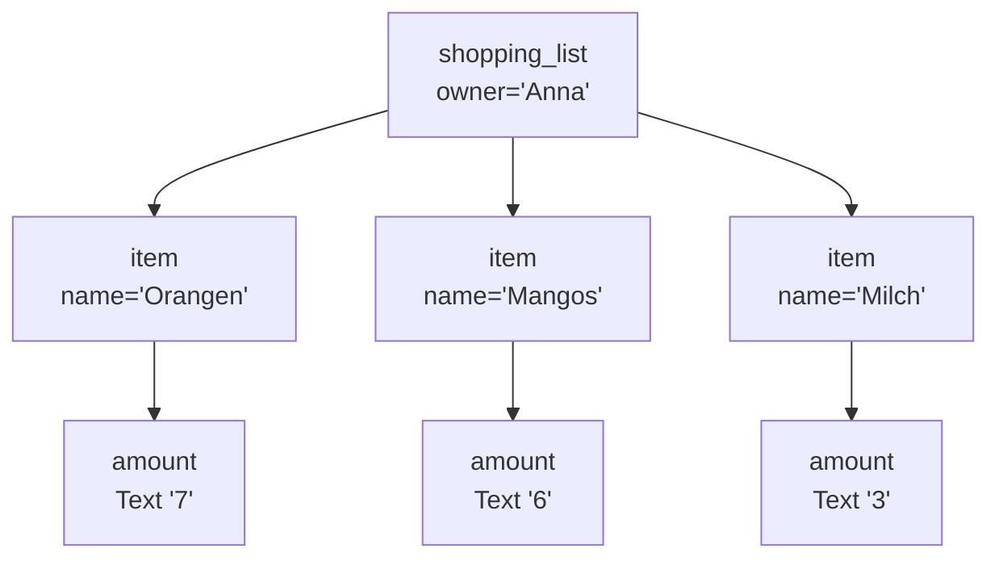
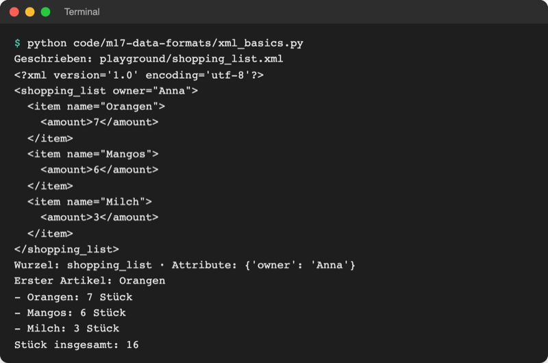
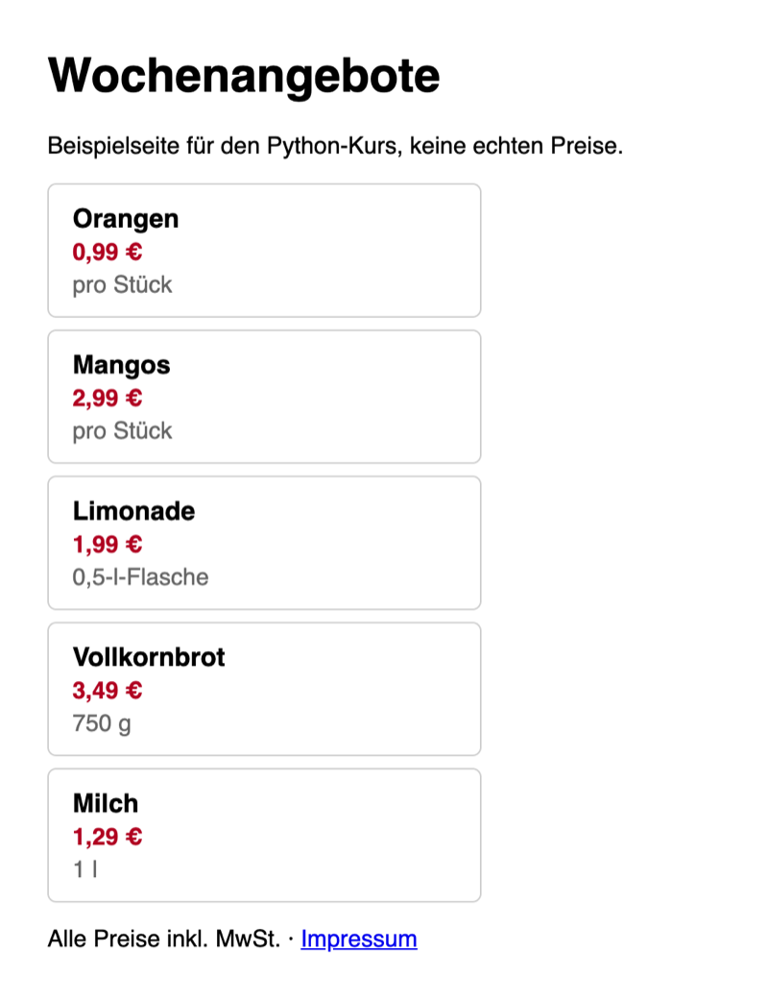
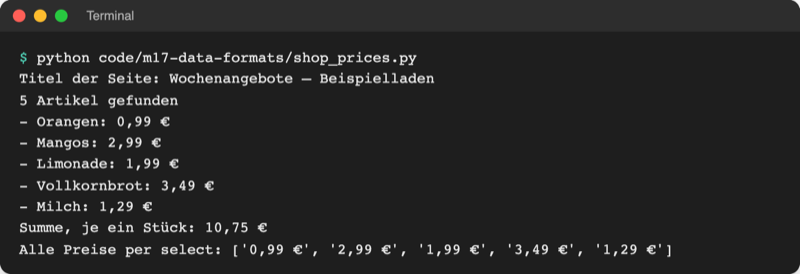
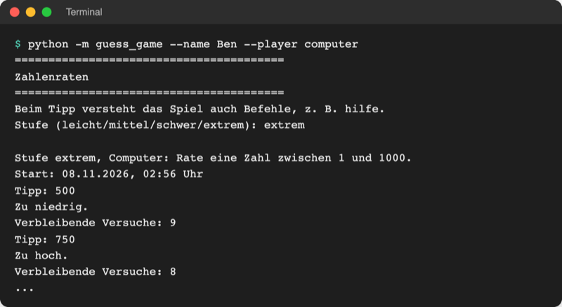
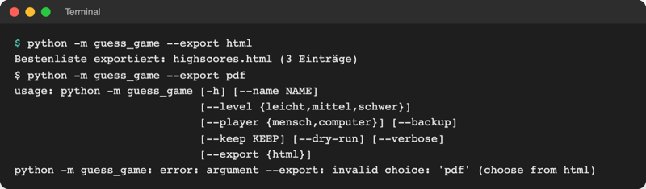
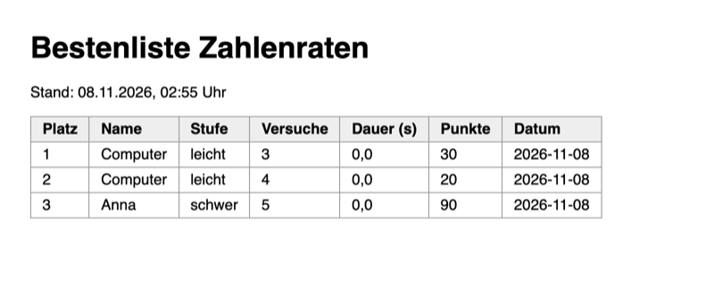

# Lab 17.1: XML und HTML

**Leitfragen:**

<details>
<summary>Wie liest ein Programm eine Preisangabe aus einer Webseite?</summary>

Eine Webseite ist Text mit Markierungen, z. B. `<p class="price">0,99 €</p>`. Das Programm sucht die Markierung, die den Preis umschließt, und nimmt den Text dazwischen; die Suche übernimmt das Paket BeautifulSoup.

</details>

<details>
<summary>Was ist der Vorteil, Stufen in einer Datei statt im Code zu haben?</summary>

Eine neue Stufe entsteht durch eine Zeile in der Datei, ohne Python anzufassen; das Programm übernimmt sie beim nächsten Start. Andere Programme können dieselbe Datei lesen.

</details>

<details>
<summary>Woran erkennt man die Struktur einer HTML-Seite?</summary>

An den verschachtelten Markierungen: `<div>` öffnet einen Kasten, `</div>` schließt ihn, alles dazwischen gehört hinein. Der Browser zeigt diesen Text mit **Strg+U** (macOS: **Cmd+Option+U**, „Seitenquelltext“).

</details>

- XML und HTML sind Textformate mit Markierungen in spitzen Klammern. XML speichert Daten, HTML beschreibt Webseiten.
- Beide bilden einen Baum: ein Element enthält andere Elemente. Python liest XML mit `xml.etree.ElementTree` (Standardbibliothek), HTML mit dem Paket BeautifulSoup.

## Begriffe

| Begriff | Bedeutung |
| --- | --- |
| XML | „Extensible Markup Language“: Textformat für Daten mit selbst gewählten Markierungen wie `<level>`; strenge Regeln |
| HTML | „HyperText Markup Language“: Textformat für Webseiten mit festen Markierungen wie `<h1>` (Überschrift) oder `<p>` (Absatz) |
| Tag | eine Markierung: Start-Tag `<low>`, End-Tag `</low>`; wie Klammern um einen Satzteil |
| Element | Start-Tag, Inhalt und End-Tag zusammen: `<low>1</low>` |
| Text eines Elements | was zwischen Start- und End-Tag steht, hier `1`; in Python immer ein String |
| Attribut | Zusatzangabe im Start-Tag: `<level name="leicht">`; Name und Wert, wie ein Etikett am Karton |
| Baum, Wurzel, Kind | Elemente stecken ineinander wie Ordner in Ordnern; das äußerste ist die Wurzel (root), direkt enthaltene Elemente sind seine Kinder |
| parsen | Text lesen und in eine Struktur verwandeln, hier in einen Baum aus Element-Objekten |
| `ElementTree` (`ET`) | Modul der Standardbibliothek zum Lesen und Schreiben von XML |
| BeautifulSoup | Paket (`beautifulsoup4`, Import `bs4`), das auch unsauberes HTML in einen Baum verwandelt |
| `class` (in HTML) | Attribut, das Elemente einer Sorte markiert, z. B. `class="price"` für alle Preise |
| CSS-Selektor | kurze Suchangabe für HTML-Elemente: `.price` = alle mit `class="price"`, `div.product` = alle `<div>` mit `class="product"` |
| Web Scraping | Daten automatisch aus Webseiten herauslesen |
| `robots.txt` | Datei einer Website, die festlegt, welche Bereiche Programme abrufen dürfen |
| `__file__` | Variable, die Python in jedem Modul setzt: der Pfad dieser `.py`-Datei |
| `html.escape` | ersetzt `<`, `>` und `&` in einem Text, damit der Browser ihn als Text zeigt und nicht als Tag liest |

## Drei Textformate im Vergleich

Dieselben Daten, eine Stufe des Spiels, einmal als XML und einmal als JSON (Lab 8.2):

```xml
<level name="leicht">
  <low>1</low>
  <high>10</high>
  <tries>5</tries>
</level>
```

```json
{"name": "leicht", "low": 1, "high": 10, "tries": 5}
```

| | XML | HTML | JSON |
| --- | --- | --- | --- |
| Zweck | Daten speichern und austauschen | Webseiten beschreiben | Daten speichern und austauschen |
| Markierungen | frei wählbar: `<level>`, `<tries>` | fest vorgegeben: `<h1>`, `<p>`, `<table>` | keine; `{}`, `[]`, `"Schlüssel": Wert` |
| Datentypen | nur Text; Zahlen wandelt das Programm um | nur Text | Zahl, String, `true`/`false`, `null` |
| Regeln | streng: jedes Tag wird geschlossen, sonst Fehler | locker: Browser verzeihen fehlende End-Tags | streng |
| Python | `xml.etree.ElementTree` | BeautifulSoup (lesen), Text schreiben | `json` |
| Typisch für | Konfiguration, Office-Dateien (Lab 17.2), ältere Schnittstellen | jede Webseite, Berichte zum Weitergeben | Web-APIs (Lab 16.1), Bestenliste |

## XML: ein Baum aus Elementen

Die Datei `playground/shopping_list.xml` aus der Demo unten:

```xml
<?xml version='1.0' encoding='utf-8'?>         <!-- Kopfzeile: XML-Version und Kodierung -->
<shopping_list owner="Anna">                    <!-- Wurzel mit Attribut owner -->
  <item name="Orangen">                         <!-- Kind der Wurzel -->
    <amount>7</amount>                          <!-- Kind von item, Text "7" -->
  </item>
  <item name="Mangos">
    <amount>6</amount>
  </item>
  <item name="Milch">
    <amount>3</amount>
  </item>
</shopping_list>
```

`<!-- ... -->` ist ein Kommentar in XML und HTML. Als Baum gezeichnet:



Dieses Bild trägt durch das ganze Lab: Lesen heißt, im Baum von der Wurzel zu den Kindern zu gehen.

## XML lesen und schreiben mit ElementTree

Datei: [code/m17-data-formats/xml_basics.py](../../project/code/m17-data-formats/xml_basics.py). Teil 1 baut den Baum oben und schreibt ihn in die Datei, Teil 2 liest ihn wieder:

```python
import xml.etree.ElementTree as ET  # as ET: kurzer Name für das Modul

tree = ET.parse(XML_FILE)  # Datei lesen -> Baum
root = tree.getroot()  # das äußerste Element
print("Wurzel:", root.tag, "· Attribute:", root.attrib)

first = root.find("item")  # find: das erste passende Kind
print("Erster Artikel:", first.get("name"))  # get: Wert eines Attributs

for item in root.findall("item"):  # findall: alle passenden Kinder als Liste
    amount = int(item.find("amount").text)  # .text ist immer ein String
    print(f"- {item.get('name')}: {amount} Stück")

# iter: alle Elemente mit diesem Namen im ganzen Baum, egal wie tief
total = sum(int(element.text) for element in root.iter("amount"))
```



_Quelle: eigener Screenshot, Kurs-Repo, 08.11.2026._

| Befehl | Wirkung |
| --- | --- |
| `ET.parse(pfad).getroot()` | Datei lesen, Wurzelelement holen |
| `element.tag` | Name des Elements, z. B. `"item"` |
| `element.text` | Text zwischen den Tags, immer `str` (oder `None`) |
| `element.get("name")` / `element.attrib` | ein Attribut / alle Attribute als Dictionary |
| `element.find("amount")` | erstes Kind mit diesem Namen, sonst `None` |
| `element.findall("item")` | alle direkten Kinder mit diesem Namen (Liste) |
| `element.iter("amount")` | alle Elemente mit diesem Namen im ganzen Baum |
| `ET.Element("x", a="1")`, `ET.SubElement(eltern, "y")` | Element bauen, Kind anhängen (Schreiben) |
| `ET.indent(root)`, `ET.ElementTree(root).write(pfad, encoding="utf-8", xml_declaration=True)` | einrücken und speichern |

**XML aus fremden Quellen:** Eine präparierte XML-Datei kann den Rechner mit Millionen von Ersetzungen lahmlegen oder Dateien anfragen. Die Python-Dokumentation nennt die Risiken: Geschützt gegen die bekannten Angriffe ist der eingebaute Parser Expat ab Version 2.7.2; `python -c "import pyexpat; print(pyexpat.EXPAT_VERSION)"` zeigt die eigene Version (beim Test des Kurses mit Python 3.14.2: `expat_2.7.3`). Für Dateien aus dem Internet oder von Fremden gibt es zusätzlich das Paket [`defusedxml`](https://pypi.org/project/defusedxml/) (Version 0.7.1) mit denselben Funktionen in abgesicherter Form. Eigene Dateien wie die Spielstufen brauchen das nicht. Stand: 08.11.2026.

Original: [Python-Dokumentation, Abschnitt XML security: An attacker can abuse XML features to carry out denial of service attacks, access local files ...; Expat versions lower than 2.7.2 may be vulnerable](https://docs.python.org/3.14/library/xml.html#xml-security), Stand 08.11.2026.

## HTML: Webseiten als Baum

HTML sieht aus wie XML, die Tags sind aber festgelegt. Ausschnitt aus [data/shopping_items.html](../../project/data/shopping_items.html), einer lokalen Beispielseite:

```html
<div class="product">              <!-- ein Kasten pro Artikel -->
  <h2>Orangen</h2>                 <!-- Überschrift: Artikelname -->
  <p class="price">0,99 €</p>      <!-- Absatz mit class="price": der Preis -->
  <p class="unit">pro Stück</p>
</div>
```



_Quelle: eigener Screenshot, `data/shopping_items.html` im Browser (Chromium), 08.11.2026._

Der Browser baut aus dem Text denselben Baum wie ElementTree aus XML: Elemente, darin Text und Attribute.


_Quelle: Birger Eriksson, „DOM-model.svg“, Wikimedia Commons (https://commons.wikimedia.org/wiki/File:DOM-model.svg), CC BY-SA 3.0, abgerufen am 08.11.2026._

**HTML ist kein sauberes XML.** `<meta charset="utf-8">` hat kein End-Tag, und Browser zeigen auch Seiten mit vergessenen `</p>` an. `ET.parse("data/shopping_items.html")` bricht deshalb ab: `ParseError: mismatched tag: line 13, column 2`. BeautifulSoup verzeiht solche Lücken.

## HTML lesen mit BeautifulSoup

Datei: [code/m17-data-formats/shop_prices.py](../../project/code/m17-data-formats/shop_prices.py). Das Paket ist mit `requirements.txt` installiert (Lab 6.2).

```python
from bs4 import BeautifulSoup  # Paket beautifulsoup4, Import heißt bs4

with open(PAGE, encoding="utf-8") as file:
    soup = BeautifulSoup(file, "html.parser")  # HTML-Text -> Baum aus Tags

products = soup.find_all("div", class_="product")  # class_ mit _, class ist reserviert
for product in products:
    name = product.find("h2").get_text(strip=True)  # Text ohne Leerzeichen am Rand
    price_text = product.select_one(".price").get_text(strip=True)  # "0,99 €"
    price = float(price_text.replace("€", "").replace(",", ".").strip())
```



_Quelle: eigener Screenshot, Kurs-Repo, 08.11.2026._

| Befehl | Wirkung |
| --- | --- |
| `BeautifulSoup(text_oder_datei, "html.parser")` | HTML parsen (`html.parser` ist in Python eingebaut) |
| `soup.find("h2")` | erstes `<h2>`, sonst `None` |
| `soup.find_all("div", class_="product")` | alle `<div>` mit dieser Klasse (Liste) |
| `soup.select(".price")` / `soup.select_one(".price")` | alle / das erste Element zum CSS-Selektor |
| `tag.get_text(strip=True)` | Text des Elements, Leerzeichen am Rand entfernt |
| `tag.get("href")` | Wert eines Attributs |
| `soup.title.get_text()` | Text im `<title>` der Seite |

**Nur auswerten, was erlaubt ist.** Der Kurs liest ausschließlich lokale Dateien. Für fremde Websites gilt: Nutzungsbedingungen lesen, die Regeln in `https://<seite>/robots.txt` beachten (Standard RFC 9309, Stand: 08.11.2026), selten und langsam abfragen und eine angebotene Schnittstelle (API, Lab 16.1) vorziehen. Ändert eine Website ihr HTML, findet das Skript nichts mehr; Scraping ist deshalb immer zerbrechlich.

## Im Spiel: Stufen aus levels.xml

Bisher stehen die Stufen als Dictionary in `logic.py` (Lab 4.3). Ab jetzt liegen sie in `guess_game/levels.xml`, mit Attribut **und** Kind-Elementen:

```xml
<levels>
  <level name="leicht">
    <low>1</low>
    <high>10</high>
    <tries>5</tries>
  </level>
  <!-- mittel und schwer genauso -->
</levels>
```

`logic.py` liest die Datei beim Import und baut daraus dasselbe Dictionary wie vorher; alles, was `LEVELS` nutzt, bleibt unverändert:

```python
# levels.xml gehört zum Programm: liegt im Paketordner neben logic.py,
# egal in welchem Ordner das Spiel startet (__file__ = Pfad dieser Datei)
LEVELS_FILE = Path(__file__).parent / "levels.xml"


def load_levels(path=LEVELS_FILE):
    """Liest die Stufen aus der XML-Datei: {"leicht": (1, 10, 5), ...}."""
    root = ET.parse(path).getroot()  # Wurzelelement <levels>
    levels = {}
    for element in root.findall("level"):  # alle <level>-Kinder
        low = int(element.find("low").text)  # Text zwischen <low> und </low>
        ...
        levels[element.get("name")] = (low, high, tries)  # Attribut name="..."
    return levels
```

**Warum `Path(__file__).parent`?** Ein relativer Pfad wie `Path("levels.xml")` gilt ab dem Ordner, in dem das Terminal steht (Lab 8.1). Spieldateien wie `highscores.json` sollen genau dort entstehen. `levels.xml` gehört dagegen zum Programm wie der Code: `__file__` ist der Pfad von `logic.py`, `.parent` dessen Ordner. So findet das Spiel die Datei aus jedem Startordner, und sie wandert beim Kopieren des Pakets mit. Die Demo [code/m17-data-formats/where_am_i.py](../../project/code/m17-data-formats/where_am_i.py), einmal aus `playground/` gestartet (Pfadanfang gekürzt):

```text
$ python ../code/m17-data-formats/where_am_i.py
Terminal steht in: /…/project/playground
Diese Datei:       /…/project/playground/../code/m17-data-formats/where_am_i.py
Ordner der Datei:  /…/project/playground/../code/m17-data-formats
Path('data') / ... gefunden?       False
Path(__file__).parent... gefunden? True
```

Die Kursdaten in `data/` sind Beispieldateien für die Demos; die Spielstufen liegen deshalb nicht dort, sondern im Paket.

Zwei kleine Anpassungen machen neue Stufen möglich:

- `ui.py` setzt die Stufennamen zusammen statt sie fest zu schreiben: `"/".join(logic.LEVELS)` ergibt `"leicht/mittel/schwer"` (`join` verbindet alle Strings einer Sammlung, hier die Schlüssel, mit dem Text davor).
- `Score.points()` nutzt `LEVEL_POINTS.get(self.level)` (Lab 4.3): Für eine neue Stufe ohne Punkteregel kommt `None` statt eines `KeyError`, und die Methode gibt `0` zurück.

Eine vierte Stufe in `levels.xml` (`extrem`, 1 bis 1000, 10 Versuche) erscheint damit ohne eine Zeile Python in Abfrage, Hilfe und `--level`:



_Quelle: eigener Screenshot, Kopie des Spielstands Lab 17.1 mit ergänzter Stufe, 08.11.2026._

## Im Spiel: Bestenliste als HTML-Seite

Neues Modul `guess_game/export.py`: `export_html(scores)` sammelt die Seite Zeile für Zeile in einer Liste und schreibt sie mit `open(..., "w", encoding="utf-8")` (Lab 8.1). Der Kern ist eine Tabellenzeile `<tr>` (table row) mit Zellen `<td>` pro Score:

```python
    place = 1
    for score in scores:
        name = html.escape(score.name)  # < > & im Namen als Text, nicht als HTML
        seconds = f"{score.seconds:.1f}".replace(".", ",")
        lines.append(
            f"<tr><td>{place}</td><td>{name}</td><td>{score.level}</td>"
            f"<td>{score.tries}</td><td>{seconds}</td><td>{score.points()}</td>"
            f"<td>{score.date}</td></tr>"
        )
        place += 1
```

`html.escape` schützt die Seite: Stünde in `highscores.json` ein Name wie `<b>Anna</b>`, würde der Browser ihn sonst als Fettschrift ausführen. Die Option `--export html` arbeitet wie `--backup` (Lab 14.3) als Werkzeug-Modus: exportieren und ohne Spiel beenden.



_Quelle: eigener Screenshot, Spielstand Lab 17.1 nach zwei Spielen, 08.11.2026._

Ergebnis im Browser (Datei per Doppelklick öffnen):



_Quelle: eigener Screenshot, `highscores.html` aus dem Spielstand Lab 17.1 im Browser (Chromium), 08.11.2026. Dauer 0,0 s, weil die Eingaben per Skript kamen._

## Typische Fehler

| Symptom | Ursache | Lösung |
| --- | --- | --- |
| `ParseError: mismatched tag: line 22, column 16` | Tippfehler im Tag, z. B. `<high>1000</hihg>` | Zeile und Spalte in `levels.xml` prüfen; Start- und End-Tag müssen gleich heißen |
| `AttributeError: 'NoneType' object has no attribute 'text'` | `find` fand das Kind nicht (fehlt oder anders geschrieben) | Elementnamen in Datei und Code vergleichen, Groß-/Kleinschreibung zählt |
| `FileNotFoundError: ... levels.xml` | Datei liegt nicht neben `logic.py` oder heißt anders | `levels.xml` in den Ordner `guess_game/` legen |
| `ValueError: invalid literal for int()` | Text im Element ist keine Zahl, z. B. `<tries>fünf</tries>` | nur Ziffern in `low`, `high`, `tries` |
| `AttributeError: 'NoneType' object has no attribute 'get_text'` | BeautifulSoup fand das Element nicht | Tag und Klasse im Seitenquelltext prüfen (Strg+U) |
| `ModuleNotFoundError: No module named 'bs4'` | Paket nicht installiert oder `.venv` nicht aktiv | `.venv` aktivieren, `pip install -r requirements.txt` |
| Browser zeigt Umlaute falsch | `<meta charset="utf-8">` fehlt oder Datei ohne `encoding="utf-8"` geschrieben | beides ergänzen |

## Vertiefung

- `findall("level")` sucht nur direkte Kinder; `findall(".//amount")` oder `iter("amount")` suchen in allen Ebenen.
- XML-Dateien großer Programme nutzen Namensräume (`xmlns="..."`, z. B. in `.xlsx`, Lab 17.2); die Tags heißen dann `{url}name`.
- `soup.select("div.product > h2")` findet nur `<h2>`, die direkt in einem `div.product` stecken; die Schreibweise stammt aus CSS, der Sprache für das Aussehen von Webseiten.

## Fazit

- XML und HTML sind Bäume aus Elementen mit Text und Attributen; JSON ist die schlankere Alternative für Daten.
- `ElementTree` liest XML mit `parse`, `find`, `findall`, `.text`, `.get`; BeautifulSoup liest auch unsauberes HTML mit `find_all` und `select`.
- Programmdateien findet `Path(__file__).parent`, Spieldaten entstehen im aktuellen Ordner.

In der Übung liest das eigene Spiel seine Stufen aus `levels.xml` und exportiert die Bestenliste als `highscores.html`.
