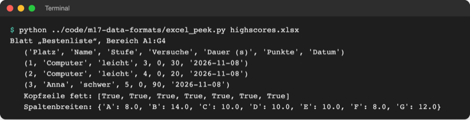
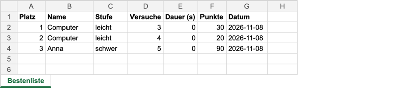

# Lab 17.2 – Lösung: Bestenliste als Excel-Datei

Fertiger Stand: [project/examples/m17-data-formats/l02-excel/](../../project/examples/m17-data-formats/l02-excel/) mit geänderten [guess_game/export.py](../../project/examples/m17-data-formats/l02-excel/guess_game/export.py) und `guess_game/__main__.py`.

## Aufgabe 1: Imports und Konstanten

```python
import html
from datetime import datetime
from pathlib import Path

from openpyxl import Workbook
from openpyxl.styles import Font

HTML_FILE = Path("highscores.html")  # entsteht im aktuellen Ordner
EXCEL_FILE = Path("highscores.xlsx")

# Spalte im Excel-Blatt -> Breite (ungefähr in Zeichen)
COLUMN_WIDTHS = {"A": 8, "B": 14, "C": 10, "D": 10, "E": 10, "F": 8, "G": 12}
```

`openpyxl` ist ein Paket von PyPI und steht deshalb in einem eigenen Import-Block unter der Standardbibliothek (Lab 6.2).

## Aufgaben 2 bis 4: export_excel

```python
def export_excel(scores, path=EXCEL_FILE):
    """Schreibt die Bestenliste als Excel-Tabelle in path und gibt path zurück."""
    workbook = Workbook()  # neue, leere Arbeitsmappe mit einem Blatt
    sheet = workbook.active  # das erste Blatt
    sheet.title = "Bestenliste"
    sheet.append(["Platz", "Name", "Stufe", "Versuche", "Dauer (s)", "Punkte", "Datum"])
    for cell in sheet[1]:  # Zeile 1 = Kopfzeile
        cell.font = Font(bold=True)
    place = 1
    for score in scores:
        # Zahlen bleiben Zahlen: Excel kann damit rechnen und sortieren
        row = [
            place,
            score.name,
            score.level,
            score.tries,
            score.seconds,
            score.points(),
            score.date,
        ]
        sheet.append(row)  # hängt eine Zeile unter der letzten an
        place += 1
    for column, width in COLUMN_WIDTHS.items():
        sheet.column_dimensions[column].width = width
    workbook.save(path)  # erst jetzt entsteht die Datei
    return path
```

- Anders als in `export_html` braucht der Name kein `html.escape`: Excel zeigt Zellinhalt immer als Text.
- `score.date` ist ein Text `JJJJ-MM-TT` (Lab 8.2) und bleibt Text; die Dauer ist eine Zahl (`0.0` speichert `openpyxl` als `0`).
- Für eine leere Bestenliste entsteht eine Datei mit nur der Kopfzeile.

## Aufgabe 5: Auswahl excel und Prüfung

`__main__.py`:

```python
    parser.add_argument(
        "--export", choices=["html", "excel"], help="Bestenliste als Datei speichern"
    )


def run_export(args):
    """Speichert die Top 10 der Bestenliste als Datei, ohne zu spielen."""
    with storage.Scoreboard("highscores.json") as board:
        scores = board.top(count=10)
    if args.export == "excel":
        path = export.export_excel(scores)
    else:
        path = export.export_html(scores)
    ui.show_export(path, len(scores))
    logger.info(f"Export: {len(scores)} Einträge nach {path}")
```

```text
$ python -m guess_game --export excel
Bestenliste exportiert: highscores.xlsx (3 Einträge)
```



_Quelle: eigener Screenshot, Spielstand Lab 17.2 nach zwei Spielen (Anna schwer 5, Computer leicht 4 und 3), 08.11.2026._



_Quelle: eigene Darstellung: Inhalt von `highscores.xlsx` (Darstellung als Tabelle), erzeugt aus den mit `openpyxl` gelesenen Zellwerten, Fettschrift und Spaltenbreiten, 08.11.2026. Kein Screenshot von Excel._

`run_export` entscheidet mit `if`/`else`; die Auswahl selbst prüft argparse über `choices`, deshalb reicht der `else`-Zweig für `html`.

## Erweiterung

```python
# Artikel ab 2 € aus der Kursdatei in eine neue Excel-Datei übernehmen
# Start im Ordner playground/: python expensive_items.py

from pathlib import Path

from openpyxl import Workbook, load_workbook
from openpyxl.styles import Font

SOURCE = Path("..") / "data" / "shopping_items.xlsx"  # nur lesen
TARGET = Path("expensive_items.xlsx")
LIMIT = 2.0

source_sheet = load_workbook(SOURCE).active
rows = list(source_sheet.iter_rows(values_only=True))  # Kopfzeile + Daten

workbook = Workbook()
sheet = workbook.active
sheet.title = "Teuer"
sheet.append(rows[0])  # Kopfzeile übernehmen
for cell in sheet[1]:
    cell.font = Font(bold=True)
for name, amount, price in rows[1:]:  # jede Zeile in drei Variablen entpacken
    if price >= LIMIT:
        sheet.append([name, amount, price])
workbook.save(TARGET)
print(f"{sheet.max_row - 1} Artikel ab {LIMIT:.0f} € gespeichert in {TARGET}")
```

```text
$ python expensive_items.py
2 Artikel ab 2 € gespeichert in expensive_items.xlsx
$ python ../code/m17-data-formats/excel_peek.py expensive_items.xlsx
Blatt „Teuer“, Bereich A1:C3
   ('Artikel', 'Menge', 'Einzelpreis (€)')
   ('Mangos', 6, 2.99)
   ('Vollkornbrot', 2, 3.49)
   Kopfzeile fett: [True, True, True]
   Spaltenbreiten: {}
```

Lesen und Schreiben laufen über zwei getrennte Mappen; `data/shopping_items.xlsx` wird nie gespeichert.
