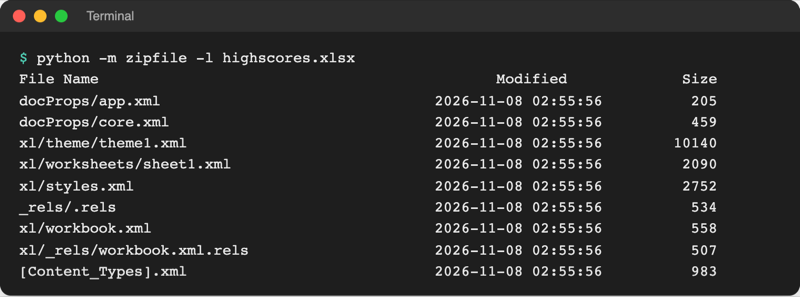
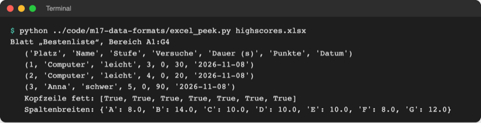

# Lab 17.2: Excel

**Leitfragen:**

<details>
<summary>Welche Excel-Aufgabe (Noten, Haushaltsbuch, Messwerte) ließe sich automatisieren?</summary>

Alles, was regelmäßig gleich abläuft: Noten jedes Semester zusammenrechnen, Ausgaben aus dem Kontoauszug ins Haushaltsbuch übertragen, Messwerte aus vielen Dateien in eine Tabelle sammeln. Ein Skript erledigt das in Sekunden und jedes Mal gleich.

</details>

<details>
<summary>Was geht verloren, wenn man eine Excel-Datei als CSV speichert?</summary>

Alles außer den Werten eines Blatts: weitere Blätter, Formeln (nur das Ergebnis bleibt), Formatierung wie Fettschrift und Spaltenbreiten, Diagramme. Zahlen und Datum werden zu Text, den das lesende Programm erst wieder umwandeln muss (Lab 8.3).

</details>

- Excel-Dateien (`.xlsx`) sind im Studium und im Beruf das häufigste Tabellenformat. Python liest und schreibt sie mit dem Paket `openpyxl`, ohne dass Excel installiert sein muss.
- Eine `.xlsx`-Datei ist ein ZIP-Paket aus XML-Dateien (Lab 17.1); `openpyxl` versteckt das hinter Arbeitsmappe, Blatt und Zelle.

## Begriffe

| Begriff | Bedeutung |
| --- | --- |
| Arbeitsmappe (Workbook) | die ganze Excel-Datei; enthält ein oder mehrere Blätter, wie ein Ordner mit Registerkarten |
| Blatt (Worksheet) | eine Tabelle in der Mappe, unten als Reiter sichtbar, z. B. „Einkauf“ |
| Zelle | ein Kästchen im Blatt; Adresse aus Spaltenbuchstabe und Zeilennummer, z. B. `B2` |
| Bereich | Rechteck aus Zellen, z. B. `A1:C6` (von A1 bis C6) |
| Formel | Text, der mit `=` beginnt, z. B. `=SUM(D2:D6)`; Excel rechnet sie beim Öffnen aus |
| `openpyxl` | Paket zum Lesen und Schreiben von `.xlsx` (steht in `requirements.txt`) |
| ZIP | Archivformat, das mehrere Dateien in eine packt und verkleinert; auch Grundlage von `.docx` und `.pptx` |
| `Font` | Schriftangaben einer Zelle in `openpyxl`, z. B. `Font(bold=True)` für fett |

## Was in einer .xlsx-Datei steckt

Eine `.xlsx` lässt sich wie jedes ZIP öffnen. Python bringt dafür ein Werkzeug mit: `python -m zipfile -l datei.xlsx` listet den Inhalt, hier für die Bestenliste aus der Übung:



_Quelle: eigener Screenshot, `highscores.xlsx` aus dem Spielstand Lab 17.2, 08.11.2026._

`xl/worksheets/sheet1.xml` enthält das Blatt als XML (Ausschnitt, eingerückt):

```xml
<cols>
  <col width="8" customWidth="1" min="1" max="1" />   <!-- Spaltenbreite von A -->
</cols>
<sheetData>
  <row r="1">                                          <!-- Zeile 1 -->
    <c r="A1" s="1" t="inlineStr">                     <!-- Zelle A1, s="1": Stil fett -->
      <is><t>Platz</t></is>                            <!-- der Text der Zelle -->
    </c>
    ...
```

Formatierung steht getrennt in `xl/styles.xml`, jede Zelle verweist mit `s="1"` darauf. Niemand muss das von Hand lesen; es erklärt aber, warum `.xlsx` mehr kann als CSV.

## Excel-Datei lesen

Datei: [code/m17-data-formats/excel_sum.py](../../project/code/m17-data-formats/excel_sum.py). Sie liest [data/shopping_items.xlsx](../../project/data/shopping_items.xlsx) (Blatt „Einkauf“: Artikel, Menge, Einzelpreis).

```python
from openpyxl import load_workbook
from openpyxl.styles import Font

SOURCE = Path("data") / "shopping_items.xlsx"  # nur lesen
TARGET = Path("playground") / "shopping_items_sum.xlsx"  # Ergebnis, neue Datei

workbook = load_workbook(SOURCE)  # ganze Arbeitsmappe laden
print("Blätter:", workbook.sheetnames)
sheet = workbook.active  # das aktive (erste) Blatt
print("Bereich mit Daten:", sheet.dimensions)

# Zeilen als Tupel lesen; values_only=True liefert Werte statt Zellen
for row in sheet.iter_rows(values_only=True):
    print(row)

# Zelle über ihren Namen: Spalte als Buchstabe, Zeile als Zahl
print("B2 =", sheet["B2"].value, "· C2 =", sheet["C2"].value)
```

Zahlen kommen als `int` bzw. `float` zurück, Text als `str`, leere Zellen als `None`; anders als bei CSV ist keine Umwandlung nötig.

## Summen ergänzen und als neue Datei speichern

```python
# Neue Spalte D: Menge × Einzelpreis, als Excel-Formel
sheet["D1"] = "Summe (€)"
sheet["D1"].font = Font(bold=True)
total = 0
last_row = sheet.max_row  # letzte Zeile mit Daten, hier 6
for number in range(2, last_row + 1):
    sheet[f"D{number}"] = f"=B{number}*C{number}"  # Excel rechnet beim Öffnen
    # Python rechnet sofort selbst mit
    total += sheet[f"B{number}"].value * sheet[f"C{number}"].value

# Summenzeile unter der letzten Zeile
sum_row = last_row + 1
sheet[f"A{sum_row}"] = "Gesamt"
sheet[f"D{sum_row}"] = f"=SUM(D2:D{last_row})"
...
workbook.save(TARGET)  # neue Datei, das Original bleibt
```

![Terminal: excel_sum.py zeigt Blätter ['Einkauf'], Bereich A1:C6, sechs Zeilen als Tupel, B2 = 7 und C2 = 0.99, Gespeichert: playground/shopping_items_sum.xlsx, Gesamt 45,67 € und In der Zelle D7 steht: =SUM(D2:D6)](https://raw.githubusercontent.com/kodschul/kodschul-python-5-open/assets/m17/excel-sum-run.png)

_Quelle: eigener Screenshot, Kurs-Repo, 08.11.2026._

- **Formeln rechnet `openpyxl` nicht aus.** In der Zelle steht der Text `=SUM(D2:D6)`; das Ergebnis berechnet erst Excel (oder LibreOffice) beim Öffnen. Wer den Wert im Skript braucht, rechnet in Python selbst mit (`total`).
- `load_workbook(pfad, data_only=True)` liefert statt der Formel den Wert, den Excel beim letzten Speichern abgelegt hat. Für eine Datei, die nur Python geschrieben hat, ist das `None` (Quelle: [openpyxl-Tutorial, „Loading from a file“](https://openpyxl.readthedocs.io/en/stable/tutorial.html), Stand: 08.11.2026).
- **Nie die Kursdatei überschreiben:** Das Ergebnis geht in eine neue Datei unter `playground/`. Ein Fehler im Skript zerstört so nie das Original.

| Befehl | Wirkung |
| --- | --- |
| `load_workbook(pfad)` | vorhandene Datei laden |
| `Workbook()` | neue, leere Mappe mit einem Blatt |
| `workbook.sheetnames` / `workbook.active` | Namen aller Blätter / das aktive Blatt |
| `workbook["Einkauf"]` | Blatt über seinen Namen |
| `sheet.title = "Bestenliste"` | Blatt umbenennen |
| `sheet["B2"].value` | Wert einer Zelle lesen |
| `sheet["D1"] = "Summe"` | Wert oder Formel in eine Zelle schreiben |
| `sheet.append([...])` | Liste als neue Zeile unter die letzte hängen |
| `sheet[1]` | alle Zellen der Zeile 1 (Tupel) |
| `sheet["A1:C6"]` | Bereich: Tupel von Zeilen, jede ein Tupel von Zellen |
| `sheet.iter_rows(values_only=True)` | alle Zeilen als Tupel von Werten |
| `sheet.max_row`, `sheet.dimensions` | letzte Zeile mit Daten, Bereich als Text `"A1:C6"` |
| `cell.font = Font(bold=True)` | Zelle fett |
| `sheet.column_dimensions["B"].width = 14` | Spaltenbreite, ungefähr in Zeichen |
| `workbook.save(pfad)` | Datei schreiben; erst jetzt entsteht sie |

## openpyxl, pandas oder CSV?

| | `openpyxl` | `pandas.read_excel` (Lab 19.2) | CSV mit `csv` (Lab 8.3) |
| --- | --- | --- | --- |
| Denkweise | Zelle für Zelle, wie in Excel | ganze Tabelle auf einmal | Zeile für Zeile, alles Text |
| Formatierung, Formeln, mehrere Blätter | ja | lesen nur Werte | nein |
| Auswerten (Summen, Gruppen, Mittelwerte) | selbst programmieren | eine Zeile pro Auswertung | selbst programmieren |
| Gut für | Berichte mit Aussehen erzeugen, einzelne Zellen ändern | Daten analysieren | einfacher Austausch zwischen Programmen |

## Grenzen

- `.xls` (Excel bis 2003) ist ein älteres Binärformat: `InvalidFileException: openpyxl does not support the old .xls file format`. Abhilfe: in Excel oder LibreOffice als `.xlsx` speichern.
- `.xlsm` (Mappe mit Makros) lädt `openpyxl`, führt Makros aber nie aus; beim Speichern bleiben sie nur mit `load_workbook(pfad, keep_vba=True)` erhalten.
- Diagramme und Formen gehen verloren, wenn eine vorhandene Datei geladen und unter gleichem Namen gespeichert wird (Warnung im openpyxl-Tutorial, Stand: 08.11.2026).
- Unter Windows sperrt Excel eine geöffnete Datei: `workbook.save` meldet dann `PermissionError`.

## Im Spiel: Bestenliste als Excel-Datei

`export.py` bekommt neben `export_html` die Funktion `export_excel`; die Option heißt `--export excel`. Die Funktion bekommt dieselbe Liste von `Score`-Objekten wie der HTML-Export:

```python
from openpyxl import Workbook
from openpyxl.styles import Font

EXCEL_FILE = Path("highscores.xlsx")

# Spalte im Excel-Blatt -> Breite (ungefähr in Zeichen)
COLUMN_WIDTHS = {"A": 8, "B": 14, "C": 10, "D": 10, "E": 10, "F": 8, "G": 12}


def export_excel(scores, path=EXCEL_FILE):
    """Schreibt die Bestenliste als Excel-Tabelle in path und gibt path zurück."""
    workbook = Workbook()  # neue, leere Arbeitsmappe mit einem Blatt
    sheet = workbook.active  # das erste Blatt
    sheet.title = "Bestenliste"
    sheet.append(["Platz", "Name", "Stufe", "Versuche", "Dauer (s)", "Punkte", "Datum"])
    for cell in sheet[1]:  # Zeile 1 = Kopfzeile
        cell.font = Font(bold=True)
    ...
```

Danach folgen eine Zeile pro Score und die Spaltenbreiten mit `for column, width in COLUMN_WIDTHS.items():` (Lab 4.3). Platz, Versuche, Dauer und Punkte bleiben Zahlen, damit Excel damit rechnen und sortieren kann.


_Quelle: eigene Darstellung: Inhalt von `highscores.xlsx` (Darstellung als Tabelle), erzeugt aus den mit `openpyxl` gelesenen Zellwerten, Fettschrift und Spaltenbreiten der Datei, 08.11.2026. Kein Screenshot von Excel; in Excel oder LibreOffice sieht die Datei entsprechend aus._

Ohne Excel lässt sich die Datei mit [code/m17-data-formats/excel_peek.py](../../project/code/m17-data-formats/excel_peek.py) prüfen, hier aus `playground/`:



_Quelle: eigener Screenshot, Spielstand Lab 17.2 nach zwei Spielen, 08.11.2026._

## Typische Fehler

| Symptom | Ursache | Lösung |
| --- | --- | --- |
| `ModuleNotFoundError: No module named 'openpyxl'` | Paket nicht installiert oder `.venv` nicht aktiv | `.venv` aktivieren, `pip install -r requirements.txt` |
| `InvalidFileException: openpyxl does not support the old .xls file format` | alte `.xls`-Datei | als `.xlsx` speichern |
| `PermissionError` beim Speichern | Datei ist in Excel geöffnet (Windows) | Excel schließen, erneut starten |
| Zelle zeigt `=SUM(D2:D6)` statt einer Zahl | `openpyxl` rechnet keine Formeln | Datei in Excel öffnen oder in Python rechnen |
| Kopfzeile nicht fett, dafür die erste Datenzeile | `sheet[2]` statt `sheet[1]`; Zeilen zählen in Excel ab 1, nicht ab 0 | `for cell in sheet[1]:` |
| Zahl steht als Text in der Zelle, Excel zeigt ein grünes Dreieck | Wert als String angehängt, z. B. `f"{score.tries}"` | Zahl unverändert anhängen |
| Original-Kursdatei verändert | `save` mit demselben Pfad wie `load_workbook` | immer in eine neue Datei speichern |

## Fazit

- `.xlsx` ist ein ZIP aus XML-Dateien; `openpyxl` arbeitet mit Arbeitsmappe, Blatt und Zelle.
- Lesen mit `load_workbook` und `iter_rows`, schreiben mit `append` und Zellzuweisung, gestalten mit `Font` und `column_dimensions`, speichern mit `save`.
- Formeln speichert `openpyxl` nur als Text; Excel rechnet sie beim Öffnen.

In der Übung schreibt das eigene Spiel mit `--export excel` die Bestenliste als `highscores.xlsx`.
