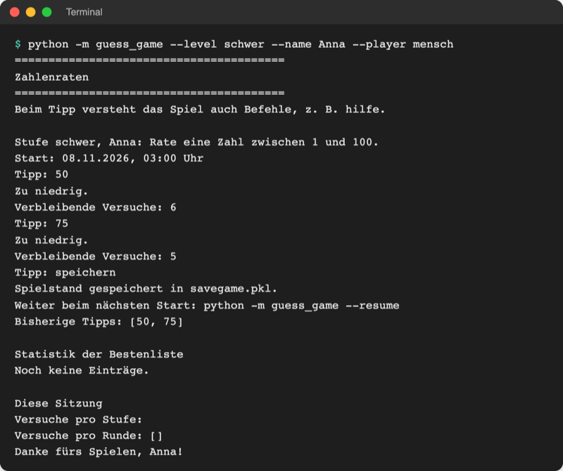
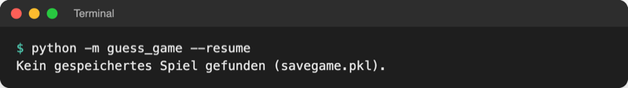

# Lab 17.3 – Lösung: Spiel speichern und fortsetzen

Fertiger Stand: [project/examples/m17-data-formats/l03-pickle/](../../project/examples/m17-data-formats/l03-pickle/) mit geänderten `guess_game/storage.py`, `logic.py`, `ui.py` und `__main__.py`.

## Aufgabe 1: save_game und load_game

```python
import pickle

SAVEGAME_FILE = Path("savegame.pkl")  # laufendes Spiel, Befehl speichern


def save_game(game, path=SAVEGAME_FILE):
    """Speichert das laufende Game-Objekt mit pickle (Binärdatei: "wb")."""
    with open(path, "wb") as file:
        pickle.dump(game, file)  # Objekt -> Bytes, samt Player und Tipps


def load_game(path=SAVEGAME_FILE):
    """Lädt das gespeicherte Spiel und löscht die Datei danach.

    Sicherheitsregel: pickle.load kann beim Laden Code ausführen.
    Deshalb nur selbst gespeicherte Dateien laden, nie fremde.
    """
    with open(path, "rb") as file:
        game = pickle.load(file)  # Bytes -> wieder ein Game-Objekt
    path.unlink()  # ein Spielstand lässt sich nur einmal fortsetzen
    return game
```

`import pickle` steht oben bei den anderen Imports der Standardbibliothek (alphabetisch nach `json`). Binärdateien bekommen kein `encoding`: Bytes sind keine Zeichen.

## Aufgabe 2: saved und __getstate__

```python
        self.stopped = False  # True nach dem Befehl "quit"
        self.saved = False  # True nach dem Befehl "speichern"
```

```python
    def __getstate__(self):
        """pickle fragt hier, was gespeichert wird: alles außer der Bestenliste."""
        state = self.__dict__.copy()  # alle Attribute als Dictionary
        state["scoreboard"] = None  # die Bestenliste hat ihre eigene Datei
        return state
```

Ein gespeichertes `Game` enthält damit (geprüft mit `pickle.load` im Spielordner):

```text
{'player': <guess_game.players.HumanPlayer object at 0x...>, 'scoreboard': None,
 'level': 'schwer', 'next_level': 'schwer', 'stopped': False, 'saved': False,
 'low': 1, 'high': 100, '_max_tries': 7, '_Game__secret': 76, 'guesses': [50, 75],
 'started': datetime.datetime(2026, 11, 8, ...)}
```

Das `HumanPlayer`-Objekt reist mit, die Bestenliste nicht. `saved` ist im Spielstand `False`, weil `save_game` vor `game.saved = True` läuft (Aufgabe 3).

## Aufgabe 3: Befehl speichern in ui.py

```python
from guess_game import logic, storage
```

```python
    print("  bestenliste   Bestenliste zeigen")
    print("  speichern     Spiel speichern und beenden (weiter mit --resume)")
    print("  quit          Spiel beenden")
```

```python
            case ["speichern"]:
                storage.save_game(game)  # zuerst speichern, dann beenden
                game.saved = True
                game.stop()
```

```python
    elif game.saved:  # Geheimzahl nicht verraten, das Spiel geht weiter
        print(f"Spielstand gespeichert in {storage.SAVEGAME_FILE}.")
        print("Weiter beim nächsten Start: python -m guess_game --resume")
    elif game.stopped:
        print(f"Spiel beendet. Die Zahl war {game.reveal_secret()}.")
```

- Die Reihenfolge zählt: Stünde `game.saved = True` vor `save_game`, steckte „gespeichert“ mit in der Datei, und `main()` würde die fortgesetzte Runde nach dem Gewinn ohne Eintrag in die Bestenliste abbrechen.
- `game.stop()` beendet die `while`-Schleife in `play_round` wie `quit`; der eigene Zweig in `show_result` muss deshalb **vor** `elif game.stopped:` stehen, sonst verrät das Spiel die Geheimzahl.

## Aufgabe 4: --resume in __main__.py

```python
    parser.add_argument(
        "--resume", action="store_true", help="gespeichertes Spiel fortsetzen"
    )
```

```python
    saved_game = None  # bleibt None, wenn kein Spiel fortgesetzt wird
    if args.resume:
        if not storage.SAVEGAME_FILE.exists():
            print(f"Kein gespeichertes Spiel gefunden ({storage.SAVEGAME_FILE}).")
            sys.exit(1)
        saved_game = storage.load_game()
        logger.info(f"Spiel fortgesetzt aus {storage.SAVEGAME_FILE}")
    ui.show_banner()
    ...
    with storage.Scoreboard("highscores.json") as board:
        if saved_game is not None:
            saved_game.scoreboard = board  # wurde nicht mitgespeichert
        # eine Runde pro Durchlauf; ein fortgesetztes Spiel läuft als erste
        for game in ui.rounds(player, board, args.level, saved_game):
            logger.info(f"Neue Runde: Stufe {game.level}")
            score = ui.play_round(game)  # @timed hat score.seconds eingetragen
            ui.show_result(game, score)
            if game.saved:  # Befehl speichern: Runde geht beim nächsten Start weiter
                logger.info(f"Spielstand gespeichert in {storage.SAVEGAME_FILE}")
                break
            if game.stopped:  # Befehl quit: Runde zählt nicht
```

- `if game.saved:` steht vor `if game.stopped:`: Eine gespeicherte Runde ist auch gestoppt, soll aber eine eigene Log-Zeile bekommen. Beide Fälle verlassen die Schleife, bevor `append_history` und `save_score` laufen; die gespeicherte Runde zählt also erst, wenn sie fortgesetzt und beendet ist.
- `logger.info(...)` beim Fortsetzen ist optional, steht aber im Example; `game.log` zeigt dann „Spiel fortgesetzt aus savegame.pkl“.

## Aufgabe 5: Testlauf



_Quelle: eigener Screenshot, Spielstand Lab 17.3, 08.11.2026._

![Terminal: --resume setzt mit Bisherige Tipps [50, 75] und 5 verbleibenden Versuchen fort, Anna gewinnt mit 76 nach 5 Versuchen, Bestenliste zeigt den Eintrag](https://raw.githubusercontent.com/kodschul/kodschul-python-5-open/assets/m17/game-resume-run.png)

_Quelle: eigener Screenshot, Spielstand Lab 17.3, 08.11.2026. Dauer 0,0 s, weil die Eingaben per Skript kamen._



_Quelle: eigener Screenshot, Spielstand Lab 17.3, 08.11.2026._

```text
$ echo $?
1
```

„Start:“ zeigt beim Fortsetzen die ursprüngliche Startzeit (sie steckt im Spielstand), die Dauer misst nur den fortgesetzten Teil. „Benötigte Versuche: 5“ zählt alle Tipps, auch die vor dem Speichern.

## Erweiterung

In `storage.save_game` nach dem `pickle.dump` (`json` ist in `storage.py` schon importiert):

```python
    # Erweiterung: derselbe Zustand als JSON, zum Vergleich
    with open("savegame.json", "w", encoding="utf-8") as file:
        json.dump(
            game.__getstate__(), file, ensure_ascii=False, indent=2, default=str
        )
```

`savegame.json` nach zwei Tipps:

```json
{
  "player": "<guess_game.players.HumanPlayer object at 0x106c8e510>",
  "scoreboard": null,
  "level": "schwer",
  "next_level": "schwer",
  "stopped": false,
  "saved": false,
  "low": 1,
  "high": 100,
  "_max_tries": 7,
  "_Game__secret": 76,
  "guesses": [
    50,
    75
  ],
  "started": "2026-11-08 03:08:16.265714"
}
```

| | `savegame.pkl` | `savegame.json` |
| --- | --- | --- |
| Größe | 309 Bytes | 326 Bytes |
| In VS Code | Hinweis „binary or unsupported text encoding“; mit **Open Anyway** nur Zeichensalat mit Namen wie `guess_game.logic` und `Game` | lesbar, jede Zeile ein Attribut |
| `player` | echtes `HumanPlayer`-Objekt | nur noch Text `<... object at 0x...>`, nicht wiederherstellbar |
| `started` | `datetime` | Text, müsste mit `datetime.fromisoformat` zurückverwandelt werden |
| Geheimzahl | versteckt, aber mit `pickle.load` lesbar | `_Game__secret: 76` steht offen da |

Für ein JSON-Fortsetzen müsste das Programm `Game` und `HumanPlayer` aus den Einzelwerten neu bauen; `pickle` nimmt diese Arbeit ab, verlangt dafür aber Vertrauen in die Datei.
