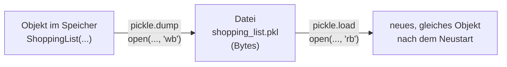
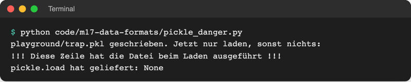
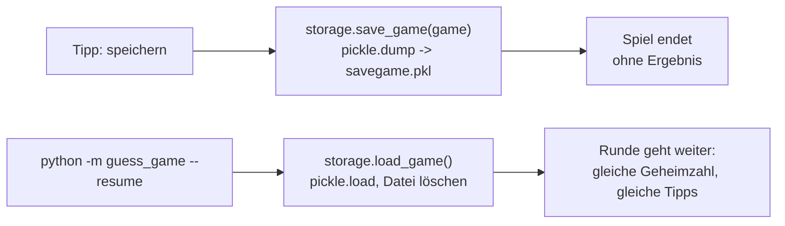

# Lab 17.3: Serialisierung mit pickle

**Leitfragen:**

<details>
<summary>Wie lässt sich ein halb gespieltes Spiel „einfrieren“?</summary>

Alles festhalten, was die Runde gerade ausmacht (Geheimzahl, bisherige Tipps, Stufe, Name, Startzeit), in eine Datei schreiben und beim nächsten Start genau so wiederherstellen. `pickle` erledigt das für ein ganzes Objekt in einem Schritt.

</details>

<details>
<summary>Warum kann JSON kein <code>Game</code>-Objekt speichern?</summary>

JSON kennt nur Dictionary, Liste, Text, Zahl, `true`/`false` und `null` (Lab 8.2). Ein `Game` mit `Player`-Objekt und `datetime` passt in keinen dieser Typen: `TypeError: Object of type Game is not JSON serializable`. Es müsste erst von Hand in ein Dictionary umgewandelt und beim Laden wieder zusammengebaut werden.

</details>

<details>
<summary>Was könnte eine manipulierte Spielstand-Datei anrichten?</summary>

Mit `pickle` geladen: beliebige Befehle auf dem Rechner ausführen, z. B. Dateien löschen oder Daten verschicken. Harmloser, aber auch möglich: die Geheimzahl auslesen oder die Versuche zurücksetzen, also mogeln.

</details>

- Lab 8.2 hat Daten serialisiert: Listen und Dictionaries als JSON-Text. `pickle` serialisiert beliebige Python-Objekte, samt Objekten darin, als Bytes.
- `pickle` ist bequem, aber nur für eigene Dateien: Beim Laden kann eine Datei Code ausführen.

## Begriffe

| Begriff | Bedeutung |
| --- | --- |
| Serialisierung | aus Lab 8.2: Daten aus dem Speicher in Text oder Bytes verwandeln, damit sie in eine Datei passen |
| `pickle` | Modul der Standardbibliothek, das Python-Objekte in Bytes verwandelt und zurück; „to pickle“ = einlegen, haltbar machen |
| Bytes, Binärdatei | Daten als Folge von Zahlen 0–255 statt als lesbarer Text; ein Texteditor zeigt nur Zeichensalat |
| `"wb"` / `"rb"` | Modus von `open`: binär schreiben / binär lesen („b“ = binary); ohne `encoding` |
| `pickle.dump(obj, file)` / `pickle.load(file)` | Objekt in eine Binärdatei schreiben / daraus wiederherstellen |
| `__dict__` | Dictionary, in dem jedes Objekt seine Attribute hält: `{"level": "schwer", "guesses": [50, 75], ...}` |
| `__getstate__` | Magic Method (Lab 11.1), die `pickle` beim Speichern fragt: „Was soll ich einpacken?“ |
| `default=` (bei `json.dump`) | Funktion, die `json` für jeden Wert aufruft, den es nicht kennt, z. B. `default=str` |
| `Path.unlink()` | löscht die Datei hinter dem Pfad |

## Ein Objekt einfrieren und auftauen



Datei: [code/m17-data-formats/pickle_vs_json.py](../../project/code/m17-data-formats/pickle_vs_json.py). Die Dataclass (Lab 11.2) enthält eine Liste und ein Datum:

```python
@dataclass
class ShoppingList:
    owner: str
    items: list
    created: datetime  # JSON kennt kein Datum


shopping = ShoppingList("Anna", ["Orangen", "Milch"], datetime(2026, 11, 8, 15, 30))

# 1. pickle: Objekt -> Bytes -> Datei ("wb" = write binary)
with open(PICKLE_FILE, "wb") as file:
    pickle.dump(shopping, file)
with open(PICKLE_FILE, "rb") as file:  # "rb" = read binary
    loaded = pickle.load(file)  # Bytes -> wieder ein ShoppingList-Objekt
```

Das geladene Objekt ist wieder eine `ShoppingList` mit echtem `datetime`, ohne jede Umwandlung. Die Datei selbst ist für Menschen unlesbar; lesbar sind nur Namen wie `__main__` und `ShoppingList`: `pickle` speichert, **aus welchem Modul** die Klasse stammt, nicht ihren Code. Laden klappt deshalb nur dort, wo dieselbe Klasse importierbar ist.

## Eigene Objekte für JSON umwandeln

JSON lehnt das Objekt direkt ab. Der Weg aus Lab 11.2: `asdict` macht aus der Dataclass ein Dictionary, `default=str` macht aus dem Datum einen Text:

```python
try:
    json.dumps(shopping)
except TypeError as error:
    print("JSON direkt:", error)  # Object of type ShoppingList is not JSON serializable

data = asdict(shopping)  # {"owner": "Anna", "items": [...], "created": datetime(...)}
with open(JSON_FILE, "w", encoding="utf-8") as file:
    json.dump(data, file, ensure_ascii=False, indent=2, default=str)
```


_Quelle: eigener Screenshot, Kurs-Repo, 08.11.2026._

Zurück kommt aus JSON nur ein Dictionary mit Text: Wer wieder ein `ShoppingList`-Objekt mit Datum will, baut es selbst, z. B. mit `datetime.fromisoformat(back["created"])` für das Datum.

## pickle oder JSON?

| | `pickle` | JSON |
| --- | --- | --- |
| Lesbarkeit | Bytes, im Editor unlesbar | Text, im Editor lesbar und änderbar |
| Was passt hinein | fast jedes Python-Objekt: eigene Klassen, `datetime`, Sets, Objekte in Objekten | nur Dictionary, Liste, Text, Zahl, `true`/`false`, `null` |
| Aufwand | ein Aufruf, keine Umwandlung | eigene Objekte erst umwandeln (`asdict`, `default=`), beim Laden zurückbauen |
| Austausch | nur Python, und nur mit denselben Klassen | jede Sprache, jedes Werkzeug, jede Web-API (Lab 16.1) |
| Versionen | Klasse geändert (Attribut umbenannt, Modul verschoben) → alte Dateien laden nicht mehr oder ohne neue Attribute | Daten bleiben lesbar; das Programm entscheidet, was es mit fehlenden Feldern macht |
| Sicherheit | **Laden kann Code ausführen**: nur eigene Dateien | Laden liefert nur Daten |
| Gut für | kurzlebige Zwischenstände des eigenen Programms (Spielstand, Cache) | Daten, die bleiben oder geteilt werden (Bestenliste, Einstellungen) |

## Sicherheitsregel: pickle nie aus fremden Quellen laden

Die Python-Dokumentation stellt die Warnung an den Anfang der Seite:

Original: [Python-Dokumentation zu pickle, Warnung: The pickle module is not secure. Only unpickle data you trust. It is possible to construct malicious pickle data which will execute arbitrary code during unpickling.](https://docs.python.org/3.14/library/pickle.html), Stand 08.11.2026.

Warum? `pickle` speichert nicht nur Daten, sondern auch die Anweisung, wie das Objekt wieder aufgebaut wird. Eine Klasse kann diese Anweisung mit der Magic Method `__reduce__` selbst festlegen, und darin darf jede Funktion stehen. Die Demo [code/m17-data-formats/pickle_danger.py](../../project/code/m17-data-formats/pickle_danger.py) zeigt es harmlos mit `print`:

```python
class Trap:
    def __reduce__(self):
        # pickle fragt: "Wie wird dieses Objekt beim Laden wieder aufgebaut?"
        # Antwort hier: "Rufe print mit diesem Text auf" (statt z. B. Dateien löschen)
        return (print, ("!!! Diese Zeile hat die Datei beim Laden ausgeführt !!!",))
```



_Quelle: eigener Screenshot, Kurs-Repo, 08.11.2026._

Wer die Datei bekommt, sieht von `Trap` nichts; ein einziges `pickle.load` genügt. Deshalb:

> **Merksatz:** `pickle.load` nur für Dateien, die das eigene Programm selbst geschrieben hat. Alles von außen (Download, E-Mail, Upload, fremder Rechner) als JSON lesen.

## Im Spiel: speichern und fortsetzen

Neuer Befehl `speichern` beim Tipp und neue Option `--resume`. Ablauf:



`storage.py` schreibt und liest den Spielstand; nach dem Laden wird die Datei gelöscht, damit niemand dieselbe Runde zweimal fortsetzt:

```python
SAVEGAME_FILE = Path("savegame.pkl")  # laufendes Spiel, Befehl speichern


def save_game(game, path=SAVEGAME_FILE):
    """Speichert das laufende Game-Objekt mit pickle (Binärdatei: "wb")."""
    with open(path, "wb") as file:
        pickle.dump(game, file)  # Objekt -> Bytes, samt Player und Tipps


def load_game(path=SAVEGAME_FILE):
    """Lädt das gespeicherte Spiel und löscht die Datei danach.

    Sicherheitsregel: pickle.load kann beim Laden Code ausführen.
    Deshalb nur selbst gespeicherte Dateien laden, nie fremde.
    """
    with open(path, "rb") as file:
        game = pickle.load(file)  # Bytes -> wieder ein Game-Objekt
    path.unlink()  # ein Spielstand lässt sich nur einmal fortsetzen
    return game
```

**Was nicht mit soll: `__getstate__`.** `pickle.dump(game, ...)` packt normalerweise alle Attribute ein, also das ganze `game.__dict__`, und mit `game.scoreboard` auch die komplette Bestenliste. Die hat aber ihre eigene Datei (`highscores.json`); im Spielstand wäre sie nur eine veraltete Kopie. `__getstate__` ist die Stelle, an der `pickle` fragt, was eingepackt wird. Die Methode in `Game` antwortet: alles, nur ohne Bestenliste.

```python
    def __getstate__(self):
        """pickle fragt hier, was gespeichert wird: alles außer der Bestenliste."""
        state = self.__dict__.copy()  # alle Attribute als Dictionary
        state["scoreboard"] = None  # die Bestenliste hat ihre eigene Datei
        return state
```

`copy()` ist wichtig: Ohne Kopie würde die Methode dem laufenden Spiel selbst die Bestenliste wegnehmen. Beim Fortsetzen setzt `__main__.py` die aktuelle Bestenliste wieder ein: `saved_game.scoreboard = board`.

Speichern nach zwei Tipps:

![Terminal: Spiel schwer, Anna tippt 50 und 75, dann speichern: Spielstand gespeichert in savegame.pkl. Weiter beim nächsten Start: python -m guess_game --resume. Bisherige Tipps [50, 75]](https://raw.githubusercontent.com/kodschul/kodschul-python-5-open/assets/m17/game-save-run.png)

_Quelle: eigener Screenshot, Spielstand Lab 17.3, 08.11.2026._

Fortsetzen: Name, Stufe, Tipps und Geheimzahl kommen aus dem Spielstand, es gibt keine Fragen:

![Terminal: python -m guess_game --resume zeigt Fortsetzung. Bisherige Tipps [50, 75], Verbleibende Versuche 5, dann Tipps 80, 77, 76 und Richtig, Anna! Benötigte Versuche: 5](https://raw.githubusercontent.com/kodschul/kodschul-python-5-open/assets/m17/game-resume-run.png)

_Quelle: eigener Screenshot, Spielstand Lab 17.3, direkt nach dem Speichern, 08.11.2026._

Grenzen dieser Lösung:

- Die Geheimzahl steht im Spielstand. Wer `pickle.load(...)._Game__secret` aufruft (Namensverschleierung aus Lab 9.3), kennt sie: Mogeln ist möglich.
- Ändert sich die Klasse `Game` (neues Attribut in `__init__`), fehlt es in alten Spielständen, und ein Zugriff darauf endet mit `AttributeError`.
- Nur Menschen können speichern; der Computer tippt keine Befehle.

## Typische Fehler

| Symptom | Ursache | Lösung |
| --- | --- | --- |
| `TypeError: write() argument must be str, not bytes` | Datei mit `"w"` statt `"wb"` geöffnet | `open(path, "wb")` |
| `UnicodeDecodeError: 'utf-8' codec can't decode byte 0x80 ...` | `.pkl` als Text geöffnet (`"r"`, `encoding=...`) | `open(path, "rb")`, ohne `encoding` |
| `EOFError: Ran out of input` | leere oder abgebrochene `.pkl`-Datei | Datei löschen, neu speichern |
| `ModuleNotFoundError: No module named 'guess_game'` beim Laden | `savegame.pkl` aus einem anderen Ordner geladen, in dem das Paket fehlt | im Spielordner laden; `pickle` braucht die Klasse |
| `--resume` meldet „Kein gespeichertes Spiel gefunden (savegame.pkl).“ | Datei wurde schon fortgesetzt (und gelöscht) oder im anderen Ordner gespeichert | erneut speichern; Terminal im Spielordner |
| Nach `--resume` gewonnen, aber die Bestenliste bleibt leer | `game.saved = True` vor `save_game` gesetzt: „gespeichert“ steckt mit in der Datei, `main()` bricht nach der Runde ab | erst speichern, dann `saved` setzen |

## Fazit

- `pickle.dump`/`pickle.load` mit `"wb"`/`"rb"` friert ein ganzes Objekt ein und taut es wieder auf; `__getstate__` legt fest, was mitkommt.
- JSON braucht für eigene Objekte Umwandlung (`asdict`, `default=`), ist dafür lesbar, austauschbar und sicher.
- `pickle.load` nur für selbst geschriebene Dateien: Laden kann Code ausführen.

In der Übung bekommt das eigene Spiel den Befehl `speichern` und die Option `--resume`.
