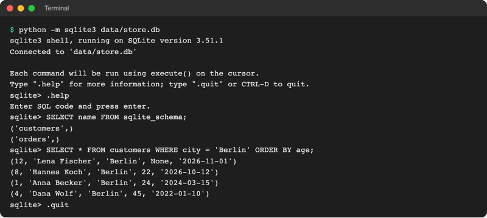
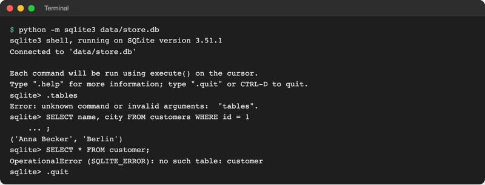

# Lab 18.1: Datenbanken und SQL

**Leitfragen:**

<details>
<summary>Wie findet man in einer JSON-Datei mit 100 000 Spielen alle Gewinne von Anna im November?</summary>

Mit JSON nur so: die ganze Datei laden und in einer Schleife jedes Spiel prüfen, für jede neue Frage neuer Code. Eine Datenbank beantwortet dieselbe Frage mit einer Zeile: `SELECT * FROM scores WHERE name = 'Anna' AND date >= '2026-11-01'`.

</details>

<details>
<summary>Was passiert, wenn zwei Programme gleichzeitig dieselbe JSON-Datei schreiben?</summary>

Beide lesen den alten Stand, beide schreiben die ganze Datei neu: Die zweite überschreibt den Eintrag der ersten, schlimmstenfalls bleibt eine halbe Datei zurück. Eine Datenbank regelt den Zugriff und schreibt jede Änderung ganz oder gar nicht.

</details>

<details>
<summary>Welche Spalten bräuchte eine Tabelle für Spielrunden?</summary>

Dieselben Angaben wie ein `Score` (Lab 11.2) und eine Zeile in `history.csv` (Lab 8.3): Name, Stufe, Versuche, Sekunden, gewonnen, Datum. Dazu eine Nummer `id`, die jede Zeile eindeutig macht. Genau so sieht die Tabelle `rounds` in Lab 18.2 aus.

</details>

- Eine Datenbank speichert Daten in Tabellen und beantwortet Fragen dazu in der Sprache SQL.
- SQLite ist eine Datenbank in einer einzigen Datei, in Python schon eingebaut: keine Installation, kein Server.
- Mit `python -m sqlite3 data/store.db` lässt sich jede SQLite-Datei direkt im Terminal abfragen.

## Begriffe

| Begriff | Bedeutung |
| --- | --- |
| Datenbank | geordnete Sammlung von Daten, die ein Programm (das Datenbanksystem) verwaltet; wie ein Archiv mit Archivar, der Fragen beantwortet |
| relationale Datenbank | Datenbank aus Tabellen; „Relation“ ist der Fachbegriff für Tabelle |
| Tabelle | feste Spalten, beliebig viele Zeilen; wie ein Excel-Blatt mit Regeln |
| Zeile (Datensatz) | ein Eintrag, z. B. eine Kundin oder eine Spielrunde |
| Spalte | eine Eigenschaft mit Namen und Typ, z. B. `city TEXT` |
| Primärschlüssel | Spalte, deren Wert jede Zeile eindeutig macht, meist `id`; wie eine Matrikelnummer |
| SQL | „Structured Query Language“: Sprache, um Tabellen anzulegen, zu füllen und abzufragen |
| Abfrage (Query) | ein SQL-Befehl, der Daten liefert: `SELECT …` |
| `NULL` | „kein Wert“ in einer Zelle; Python zeigt ihn als `None` |
| SQLite | Datenbanksystem, das eine ganze Datenbank in einer Datei speichert; in Python als Modul `sqlite3` enthalten |
| Server-Datenbank | Datenbanksystem, das als eigenes Programm läuft und Anfragen übers Netz annimmt (PostgreSQL, MySQL) |
| SQLite-Shell | Eingabezeile, in der SQL-Befehle direkt laufen: `python -m sqlite3` |

## Wann Dateien nicht mehr reichen

Bis Tag 4 speichert das Spiel in Dateien: Bestenliste als JSON, Verlauf als CSV. Das reicht für wenige Einträge und ein Programm. Mit wachsenden Daten zeigen sich vier Grenzen:

| Problem | Mit JSON/CSV | Mit einer Datenbank |
| --- | --- | --- |
| viele Einträge | ganze Datei laden, alles durchsuchen | liest nur die passenden Zeilen |
| neue Frage („Gewinne pro Stufe?“) | neuer Python-Code mit Schleife | eine SQL-Abfrage |
| zwei Programme schreiben gleichzeitig | eines überschreibt das andere | Datenbank regelt den Zugriff |
| Absturz beim Schreiben | Datei halb geschrieben, kaputt | Änderung ganz oder gar nicht (Transaktion, Lab 18.2) |

## Wohin mit Daten?

Jede Stufe des Kurses löst ein Problem der vorherigen:

| Wohin mit Daten? | Lab | Rolle im Spiel | Grenze |
| --- | --- | --- | --- |
| Variable | 2.2 | Geheimzahl, aktueller Tipp | weg nach Programmende |
| Liste / Set / Dictionary | 4.1–4.3 | bisherige Tipps, Stufen | weg nach Programmende |
| Textdatei / JSON / CSV | 8.1–8.3 | Bestenliste, Spielverlauf | Suchen und Auswerten per Python-Code |
| Objekt (Klasse) | 9.2 ff. | `Game`, `Score` mit Verhalten | nur im Speicher |
| pickle | 17.3 | laufendes Spiel einfrieren | nur Python, nur eigene Dateien |
| SQLite | 18.1–18.3 | dauerhafte, abfragbare Bestenliste | ein Rechner, wenige gleichzeitige Schreiber |

## Datenbanken auf einen Blick


_Quelle: Booyabazooka, „Relational database terms“, Wikimedia Commons (https://commons.wikimedia.org/wiki/File:Relational_database_terms.svg), gemeinfrei, abgerufen am 08.11.2026._

Das Bild zeigt die Fachbegriffe: Spalte (Attribut), Zeile (Tupel), Tabelle (Relation).

| Jahr | Ereignis |
| --- | --- |
| 1970 | Edgar F. Codd (IBM) beschreibt das relationale Modell: Daten als Tabellen |
| 1974 | Donald Chamberlin und Raymond Boyce (IBM) veröffentlichen SEQUEL, später in SQL umbenannt |
| 1986/1987 | SQL wird Norm (ANSI 1986, ISO 1987); aktuelle Fassung SQL:2023 |
| 2000 | D. Richard Hipp entwickelt SQLite; Version 1.0 erscheint am 17.08.2000 |
| 2004 | SQLite 3: das Dateiformat, das bis heute gilt |

Quellen: [Wikipedia „SQL“](https://en.wikipedia.org/wiki/SQL), [Wikipedia „SQLite“](https://en.wikipedia.org/wiki/SQLite), [sqlite.org/chronology.html](https://www.sqlite.org/chronology.html), [sqlite.org/onefile.html](https://www.sqlite.org/onefile.html); abgerufen am 08.11.2026.

SQLite ist gemeinfrei (Public Domain): Code und Doku darf jede Person für jeden Zweck nutzen ([sqlite.org/copyright.html](https://www.sqlite.org/copyright.html)).

Original: [sqlite.org: Most Widely Deployed and Used Database Engine, Liste mit Android, iPhone, Mac, Windows, Browsern, PHP und Python](https://www.sqlite.org/mostdeployed.html), Stand 08.11.2026.

Laut den Entwicklern ist SQLite wahrscheinlich häufiger im Einsatz als alle anderen Datenbanken zusammen: in jedem Android-Gerät und iPhone, in Firefox, Chrome und Safari (Verlauf, Lesezeichen), in Windows 10/11 und in Python. Geschätzt sind über eine Billion SQLite-Datenbanken in Gebrauch (Seite zuletzt geändert am 21.04.2026).

## Das relationale Modell

Eine Tabelle sieht aus wie ein Excel-Blatt, hat aber Regeln. Ausschnitt aus `data/store.db`, Tabelle `customers`:

| id (Primärschlüssel) | name | city | age | since |
| --- | --- | --- | --- | --- |
| 1 | Anna Becker | Berlin | 24 | 2024-03-15 |
| 2 | Ben Schulz | Hamburg | 31 | 2023-11-02 |
| 12 | Lena Fischer | Berlin | `NULL` | 2026-11-01 |

| Excel-Blatt | Datenbanktabelle |
| --- | --- |
| jede Zelle kann alles enthalten | jede Spalte hat einen Typ: `INTEGER` (ganze Zahl), `REAL` (Kommazahl), `TEXT` |
| Zeilen nur über die Zeilennummer unterscheidbar | Primärschlüssel `id`: jede Zeile eindeutig, vergibt SQLite selbst |
| Pflichtfelder gibt es nicht | `NOT NULL`: Spalte darf nicht leer bleiben |
| eine Person bearbeitet die Datei | viele Programme greifen gleichzeitig zu |
| Suchen per Filter-Menü | Suchen per SQL |

Eine zweite Tabelle `orders` (Bestellungen) speichert in `customer_id` die `id` der Kundin. So hängen Tabellen zusammen, ohne Daten doppelt zu speichern; verbunden werden sie in Lab 18.3.

## SQLite oder Server-Datenbank?

| | SQLite | Server-Datenbank (PostgreSQL, MySQL, SQL Server) |
| --- | --- | --- |
| Installation | keine, in Python enthalten | eigenes Programm installieren und betreiben |
| Daten liegen | in einer Datei, z. B. `game.db` | beim Server, Zugriff übers Netz |
| Benutzer und Rechte | keine (wer die Datei lesen darf, sieht alles) | Konten, Passwörter, Rechte pro Tabelle |
| gleichzeitige Schreiber | einer zur Zeit | viele |
| typisch für | Apps, Browser, Geräte, Skripte, Prototypen | Webshops, Firmen-Daten, viele Nutzer |

Quelle: [sqlite.org/whentouse.html](https://www.sqlite.org/whentouse.html), abgerufen am 08.11.2026. SQL ist bei allen fast gleich; was hier gelernt wird, gilt auch für Server-Datenbanken.

## SQL-Grundbefehle

| Befehl | Wirkung |
| --- | --- |
| `CREATE TABLE name (spalte TYP, …)` | Tabelle anlegen |
| `INSERT INTO name (spalten) VALUES (werte)` | Zeile einfügen |
| `SELECT spalten FROM name` | Zeilen lesen; `*` = alle Spalten |
| `… WHERE bedingung` | nur passende Zeilen |
| `… ORDER BY spalte` / `… DESC` | sortieren, aufsteigend / absteigend |
| `UPDATE name SET spalte = wert WHERE …` | Werte ändern |
| `DELETE FROM name WHERE …` | Zeilen löschen |

Alle Befehle an der Tabelle `customers` (`--` leitet in SQL einen Kommentar ein):

```sql
CREATE TABLE customers (
    id INTEGER PRIMARY KEY,   -- Primärschlüssel, Nummer vergibt SQLite
    name TEXT NOT NULL,       -- Pflichtfeld
    city TEXT NOT NULL,
    age INTEGER,              -- darf fehlen (NULL)
    since TEXT NOT NULL       -- Datum als Text JJJJ-MM-TT
);
INSERT INTO customers (name, city, age, since) VALUES ('Mia Lang', 'Leipzig', 26, '2026-11-08');
SELECT name, age FROM customers WHERE city = 'Berlin' ORDER BY age DESC;
SELECT * FROM customers WHERE age > 30 AND city <> 'Köln';   -- <> heißt "ungleich"
UPDATE customers SET city = 'Dresden' WHERE name = 'Mia Lang';
DELETE FROM customers WHERE name = 'Mia Lang';
```

- Text steht in einfachen Anführungszeichen `'Berlin'`, Zahlen ohne. Vergleiche: `=`, `<>`, `<`, `>`, `<=`, `>=`, verknüpft mit `AND`, `OR`.
- Großbuchstaben für SQL-Wörter sind Konvention, nicht Pflicht. Jeder Befehl endet mit `;`.
- `UPDATE` und `DELETE` ohne `WHERE` treffen **alle** Zeilen der Tabelle.

## Die SQLite-Shell: python -m sqlite3

Seit Python 3.12 bringt Python eine eigene SQLite-Shell mit ([Doku](https://docs.python.org/3.14/library/sqlite3.html#command-line-interface), Stand: 08.11.2026). Start im Ordner `project/`, `.venv` aktiv:



_Quelle: eigener Screenshot, Kurs-Repo, 08.11.2026._

| Eingabe | Wirkung |
| --- | --- |
| `python -m sqlite3 data/store.db` | Shell mit dieser Datenbank starten; fehlt die Datei, entsteht eine leere |
| `python -m sqlite3 data/store.db "SELECT …"` | eine Abfrage ausführen, Ergebnis zeigen, fertig |
| `SELECT name FROM sqlite_schema;` | alle Tabellen der Datenbank (`sqlite_schema` verwaltet SQLite selbst) |
| `SELECT sql FROM sqlite_schema WHERE name = 'customers';` | `CREATE TABLE`-Befehl der Tabelle, also ihre Spalten |
| `.help` · `.version` · `.quit` | Kurzhilfe · SQLite-Version · Shell beenden |

- Jede Ergebniszeile erscheint als Python-Tupel, `NULL` als `None`. Die Versionsnummer hängt von der Installation ab.
- Änderungen in der Shell (`INSERT`, `UPDATE`, `DELETE`) stehen sofort in der Datei. Zurücksetzen: `python code/m18-sqlite/init_store_db.py` legt `data/store.db` neu an ([Skript](../../project/code/m18-sqlite/init_store_db.py)).
- `.tables` und `.schema` aus Anleitungen im Netz gehören zum Programm `sqlite3` von sqlite.org; die Python-Shell kennt sie nicht (geprüft mit Python 3.14.2).

## Grafische Ansicht: DB Browser for SQLite (optional)


_Quelle: DB Browser for SQLite, README (https://github.com/sqlitebrowser/sqlitebrowser), MPL 2.0 / GPL 3.0, abgerufen am 08.11.2026._

DB Browser for SQLite ([sqlitebrowser.org](https://sqlitebrowser.org/), kostenlos, Version 3.13.1 vom 16.10.2024, Stand: 08.11.2026) zeigt Tabellen wie ein Tabellenblatt (Reiter „Browse Data“) und führt SQL aus („Execute SQL“). Für den Kurs ist es nicht nötig. Änderungen speichert erst **Write Changes**; vor dem nächsten Spielstart die Datei schließen.

## Typische Fehler

| Symptom | Ursache | Lösung |
| --- | --- | --- |
| Shell zeigt `...` und wartet | `;` am Ende fehlt | `;` eingeben, Enter |
| `Error: unknown command … "tables"` | `.tables` gibt es nur im sqlite.org-Programm | `SELECT name FROM sqlite_schema;` |
| `no such table: customers` | falscher Ordner: Shell hat eine neue, leere Datei angelegt | `.quit`, `cd` nach `project/`, neu starten; leere Datei löschen |
| `no such column: Berlin` | Text ohne Anführungszeichen | `WHERE city = 'Berlin'`; doppelte `"…"` meinen in SQL Spaltennamen |
| Zeile mit `NULL` fehlt im Ergebnis | `age > 30` ist für `NULL` weder wahr noch falsch | `WHERE age IS NULL` fragt leere Werte ab |
| alle Zeilen geändert oder gelöscht | `UPDATE`/`DELETE` ohne `WHERE` | `python code/m18-sqlite/init_store_db.py` |



_Quelle: eigener Screenshot, Kurs-Repo, 08.11.2026._

## Fazit

- Eine relationale Datenbank speichert Tabellen mit festen Spalten; der Primärschlüssel macht jede Zeile eindeutig.
- SQL fragt mit `SELECT … WHERE … ORDER BY` ab und ändert mit `INSERT`, `UPDATE`, `DELETE`.
- SQLite ist eine Datei statt eines Servers, in Python enthalten und die meistgenutzte Datenbank der Welt.

In der Übung entstehen drei Abfragen auf die Tabelle `customers` in `data/store.db`.
