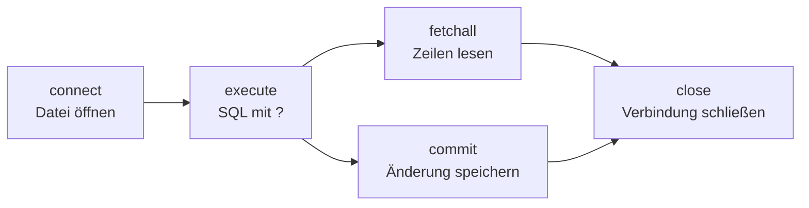
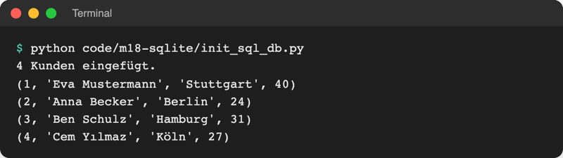
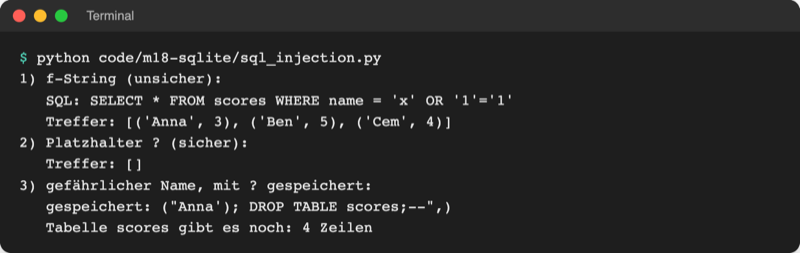
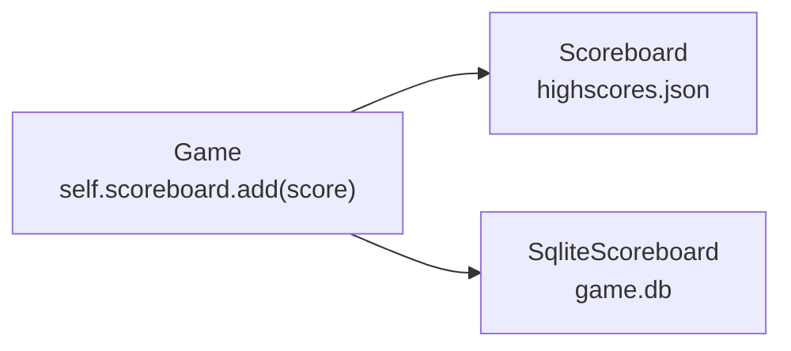
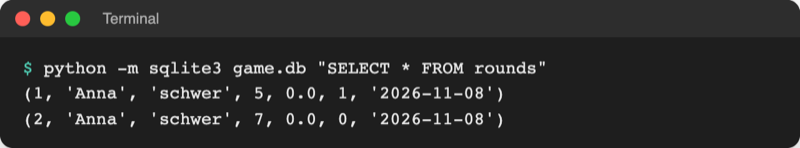

# Lab 18.2: SQLite in Python

**Leitfragen:**

<details>
<summary>Welche Klasse des Spiels muss für die Datenbank geändert werden – und welche nicht?</summary>

Nur die Bestenliste: Neben `Scoreboard` entsteht `SqliteScoreboard` mit denselben Methoden. `Game` ruft nur `self.scoreboard.add(score)` auf und merkt den Tausch nicht; das ist der Nutzen der Komposition aus Lab 10.3.

</details>

<details>
<summary>Was passiert, wenn jemand als Namen <code>Anna'); DROP TABLE scores;--</code> eingibt?</summary>

Baut das Programm den Namen per f-String in den SQL-Text ein, kann das `'` den Text beenden und der Rest als SQL laufen: Die Tabelle wäre weg (SQL-Injection). Mit dem Platzhalter `?` landet der Name nur als Text in der Tabelle.

</details>

<details>
<summary>Wann landen die Daten wirklich in der Datei?</summary>

Erst nach `commit()`. Bis dahin sieht nur die eigene Verbindung die neue Zeile; endet das Programm vorher, ist sie weg.

</details>

- Das Modul `sqlite3` gehört zu Python: Verbindung öffnen, SQL ausführen, bestätigen, schließen.
- Werte kommen nie per f-String in SQL, sondern immer über Platzhalter `?`.
- Im Spiel ersetzt `SqliteScoreboard` die JSON-Bestenliste; `Game` bleibt unverändert, jede Runde landet in `game.db`.

## Begriffe

| Begriff | Bedeutung |
| --- | --- |
| Verbindung (Connection) | offene Leitung zu einer Datenbankdatei: `sqlite3.connect("game.db")`; wie ein laufendes Telefonat |
| Cursor | Objekt, das Befehle ausführt und Ergebniszeilen liefert; `connection.execute(...)` legt ihn selbst an |
| `execute(sql, werte)` | führt einen SQL-Befehl aus; `werte` ist ein Tupel für die Platzhalter |
| `executemany(sql, liste)` | führt denselben Befehl einmal pro Tupel der Liste aus |
| `fetchone()` / `fetchall()` | holt eine Ergebniszeile / alle Ergebniszeilen |
| Transaktion | Gruppe von Änderungen, die ganz oder gar nicht gilt |
| `commit()` / `rollback()` | Änderungen der Transaktion endgültig speichern / zurücknehmen |
| Platzhalter `?` | Lücke im SQL-Text, die `sqlite3` sicher mit einem Wert füllt |
| SQL-Injection | Angriff: Eingabe wird Teil des SQL-Befehls und ändert, was er tut |
| `sqlite3.Row` | Zeilentyp mit Zugriff über Spaltennamen: `row["name"]` statt `row[1]` |
| `":memory:"` | Datenbank nur im Arbeitsspeicher, weg nach Programmende; gut für Tests |

## Der Weg von Python zur Datenbank



## Tabelle anlegen und füllen: init_sql_db.py

Datei: [code/m18-sqlite/init_sql_db.py](../../project/code/m18-sqlite/init_sql_db.py). Sie legt `playground/customers.db` an:

```python
connection = sqlite3.connect(DB_FILE)  # öffnet die Datei, legt sie notfalls an
cursor = connection.cursor()  # Cursor: führt Befehle aus und liefert Ergebnisse

# IF NOT EXISTS: beim zweiten Start keine Fehlermeldung "table already exists"
cursor.execute("""
    CREATE TABLE IF NOT EXISTS customers (
        id INTEGER PRIMARY KEY,
        name TEXT NOT NULL,
        city TEXT,
        age INTEGER
    )
""")

cursor.execute("SELECT COUNT(*) FROM customers")
count = cursor.fetchone()[0]  # eine Zeile als Tupel, z. B. (0,)
if count == 0:
    # ein Datensatz: Werte als Tupel, eingesetzt an den ?-Platzhaltern
    cursor.execute(
        "INSERT INTO customers (name, city, age) VALUES (?, ?, ?)",
        ("Eva Mustermann", "Stuttgart", 40),
    )
    # viele Datensätze: dasselbe INSERT einmal pro Tupel der Liste
    cursor.executemany(
        "INSERT INTO customers (name, city, age) VALUES (?, ?, ?)", NEW_CUSTOMERS
    )
    connection.commit()  # erst jetzt stehen die Zeilen sicher in der Datei
```



_Quelle: eigener Screenshot, Kurs-Repo, 08.11.2026._

Beim zweiten Start meldet das Skript `Tabelle schon befüllt (4 Kunden), nichts eingefügt.` `"""…"""` ist ein Text über mehrere Zeilen (Lab 2.4).

## Lesen mit Spaltennamen: sql_db.py

Datei: [code/m18-sqlite/sql_db.py](../../project/code/m18-sqlite/sql_db.py). Die Stadt kommt aus `input()` und geht über `?` in die Abfrage:

```python
connection.row_factory = sqlite3.Row  # Zeilen wie Dictionaries: row["name"]

city = input("Stadt: ").strip()
# execute direkt auf der Verbindung: Abkürzung, legt den Cursor selbst an
rows = connection.execute(
    "SELECT name, age FROM customers WHERE city = ? ORDER BY name",
    (city,),  # Tupel mit einem Wert: Komma nicht vergessen
).fetchall()
```

```text
$ python code/m18-sqlite/sql_db.py
Stadt: Köln
Cem Yılmaz (27 Jahre)
```

## Wann stehen die Daten in der Datei?

Datei: [code/m18-sqlite/commit_demo.py](../../project/code/m18-sqlite/commit_demo.py). Zwei Verbindungen zur selben Datei, die zweite spielt „ein anderes Programm“:

```text
$ python code/m18-sqlite/commit_demo.py
vorher: 4 Kunden
nach INSERT, ohne commit: 4 Kunden
nach commit: 5 Kunden
Fehler: Fehler mitten in der Transaktion
nach Fehler im with-Block: 5 Kunden
nach DELETE im with-Block: 4 Kunden
```

Die Verbindung arbeitet auch als Context Manager (Lab 13.2), aber anders als eine Datei:

```python
with writer:  # diesmal ohne Fehler: DELETE wird gespeichert (Testzeile weg)
    writer.execute("DELETE FROM customers WHERE name = ?", ("Test",))
```

| Ende des `with connection:`-Blocks | Wirkung |
| --- | --- |
| ohne Fehler | `commit()`: Änderungen gespeichert |
| mit Fehler | `rollback()`: alle Änderungen des Blocks zurückgenommen |
| immer | Verbindung bleibt **offen**: `close()` ist weiter nötig |

> **Merksatz:** Ohne `commit()` ist nichts gespeichert.

## Platzhalter statt f-Strings: SQL-Injection

Ein f-String setzt die Eingabe als Text in den SQL-Befehl. Enthält die Eingabe ein `'`, endet dort der SQL-Text, und der Rest wird Teil des Befehls. Die Python-Doku warnt ausdrücklich davor:

Original: [Python-Doku: How to use placeholders to bind values in SQL queries, Beispiel Never do this -- insecure! mit ' OR TRUE; --](https://docs.python.org/3.14/library/sqlite3.html#how-to-use-placeholders-to-bind-values-in-sql-queries), Stand 08.11.2026.

Datei: [code/m18-sqlite/sql_injection.py](../../project/code/m18-sqlite/sql_injection.py), Datenbank nur im Speicher (`":memory:"`):

```python
# Eingabe einer Angreiferin statt eines Namens
name = "x' OR '1'='1"

print("1) f-String (unsicher):")
sql = f"SELECT * FROM scores WHERE name = '{name}'"
# ...
print("2) Platzhalter ? (sicher):")
rows = connection.execute("SELECT * FROM scores WHERE name = ?", (name,)).fetchall()
```



_Quelle: eigener Screenshot, Kurs-Repo, 08.11.2026._

- Mit `?` schickt `sqlite3` SQL-Text und Wert getrennt an SQLite; der Wert wird nie als SQL gelesen.
- `execute()` führt nur **einen** Befehl aus; ein angehängtes `; DROP TABLE …` scheitert dort mit `ProgrammingError`. Die Abfrage aus Punkt 1 klappt trotzdem, und andere Wege (`executescript`, andere Datenbanken) führen auch das `DROP` aus (geprüft: Tabelle danach weg).
- `?` gilt nur für **Werte**. Tabellen- und Spaltennamen stehen fest im Code.

## Im Spiel: SqliteScoreboard

`Game` hält seit Lab 10.3 eine Bestenliste als Attribut und ruft nur `add` auf. Die neue Klasse bietet dieselben Methoden, deshalb ändern sich nur `storage.py` und zwei Zeilen in `__main__.py`:



| Schnittstelle | `Scoreboard` (JSON) | `SqliteScoreboard` (SQLite) |
| --- | --- | --- |
| `with … as board:` | lädt JSON, speichert am Ende | verbindet, legt Tabellen an, lädt |
| `add(score)` | hängt an die Liste an | `INSERT` + `commit()` sofort |
| `top(by, count)`, `scores` | gleich | gleich |
| neu: `add_round(score)` | – | jede Runde in Tabelle `rounds` |

Jede bisherige Datei wird eine Tabelle: `scores` wie `highscores.json` (nur Gewinne), `rounds` wie `history.csv` (jede Runde). Die Spalten sind die sechs Felder von `Score` plus `id`; `True` speichert SQLite als `1`.

```python
CREATE_ROUNDS = """
CREATE TABLE IF NOT EXISTS rounds (
    id INTEGER PRIMARY KEY,
    name TEXT NOT NULL,
    level TEXT NOT NULL,
    tries INTEGER NOT NULL,
    seconds REAL NOT NULL,
    won INTEGER NOT NULL,
    date TEXT NOT NULL
)
"""
INSERT_ROUND = """
INSERT INTO rounds (name, level, tries, seconds, won, date)
VALUES (?, ?, ?, ?, ?, ?)
"""
```

Kern der Klasse ([storage.py](../../project/examples/m18-sqlite/l02-sqlite3/guess_game/storage.py)):

```python
    def __enter__(self):
        """Beginn des with-Blocks: Datenbank öffnen, Tabellen anlegen, laden."""
        self.connection = sqlite3.connect(self.path)  # legt game.db notfalls an
        self.connection.row_factory = sqlite3.Row  # Zeilen mit Spaltennamen
        self.connection.execute(CREATE_SCORES)
        self.connection.execute(CREATE_ROUNDS)
        self.connection.commit()
        self.scores = self.load()
        return self

    def add(self, score):
        """Speichert einen Gewinn sofort in der Tabelle scores."""
        self.scores.append(score)
        self.connection.execute(INSERT_SCORE, score_values(score))
        self.connection.commit()  # erst jetzt steht die Zeile sicher in game.db
```

Commit nach jedem `INSERT`: Auch nach Strg+C oder einem Absturz sind alle fertigen Runden gespeichert; `__exit__` schließt nur noch die Verbindung. In `__main__.py` ändert sich `storage.Scoreboard("highscores.json")` zu `storage.SqliteScoreboard("game.db")`, dazu `board.add_round(score)` nach `append_history`.



_Quelle: eigener Screenshot, Kurs-Repo, 08.11.2026._

- `highscores.json` schreibt das Spiel ab jetzt nicht mehr; `fetch_scores.py` aus Lab 16.2 zeigt daher nur noch alte Einträge. Die Übernahme alter Einträge folgt in Lab 18.3.
- `__getstate__` aus Lab 17.3 sorgt dafür, dass `speichern` die Verbindung nicht mitpickelt (sonst `TypeError: cannot pickle 'sqlite3.Connection' object`).
- Den Namen aus der Leitfrage lässt das Spiel ohnehin nicht zu (Namensprüfung aus Lab 15.2); `?` schützt trotzdem jeden Weg in die Datenbank.

## Typische Fehler

| Symptom | Ursache | Lösung |
| --- | --- | --- |
| Zeile fehlt nach Neustart | `commit()` vergessen | nach jedem `INSERT` committen oder `with connection:` |
| `ProgrammingError: Incorrect number of bindings supplied. The current statement uses 1, and there are 4 supplied.` | Zahl der Werte passt nicht zu den `?`, oft `(city)` statt `(city,)` | Tupel mit Komma; je `?` ein Wert |
| `no such table: rounds` | `CREATE TABLE` fehlt oder anderer Ordner, neue leere `game.db` | `CREATE TABLE IF NOT EXISTS` in `__enter__`; Spiel in `playground/` starten |
| `ProgrammingError: Cannot operate on a closed database.` | Zugriff nach `close()` bzw. nach dem `with`-Block | Zugriff in den `with`-Block verschieben |
| `TypeError: tuple indices must be integers or slices, not str` | `row["name"]` ohne `row_factory = sqlite3.Row` | `row_factory` direkt nach `connect` setzen |
| `database is locked` | anderes Programm (z. B. DB Browser) hält eine offene Änderung | dort „Write Changes“ oder schließen |

## Fazit

- `connect` → `execute` mit `?` → `commit` → `close`: Mehr braucht ein Programm für SQLite nicht.
- Platzhalter verhindern SQL-Injection; f-Strings in SQL sind tabu.
- Weil `Game` nur die Schnittstelle der Bestenliste kennt, reicht eine neue Klasse für den Umstieg auf SQLite.

In der Übung entsteht `SqliteScoreboard` im eigenen Spiel, und jede Runde landet in `game.db`.
