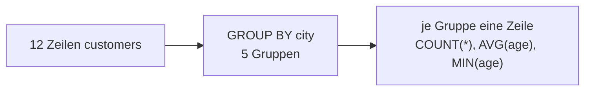
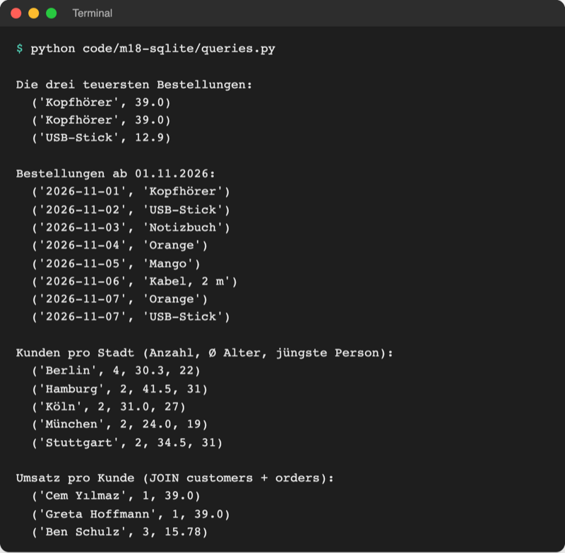
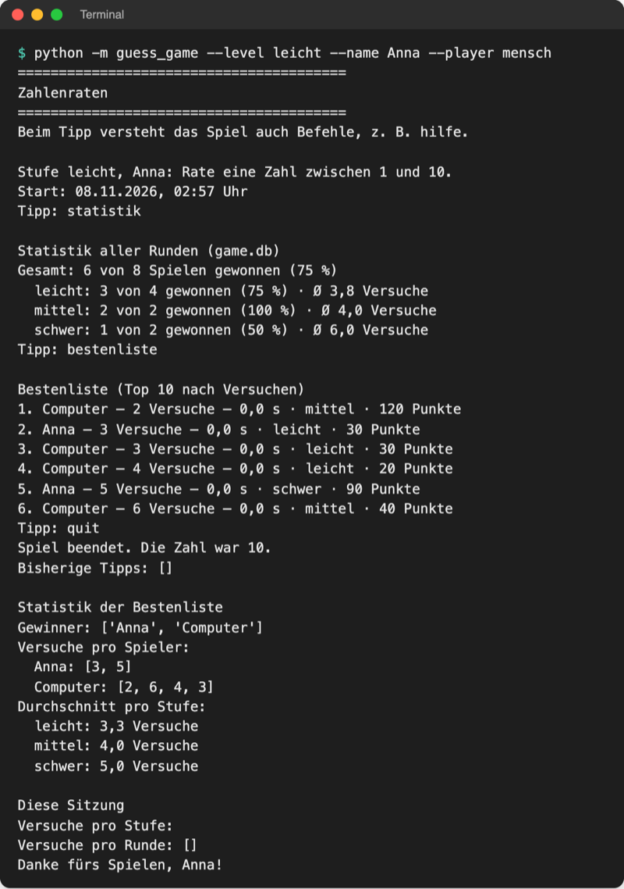
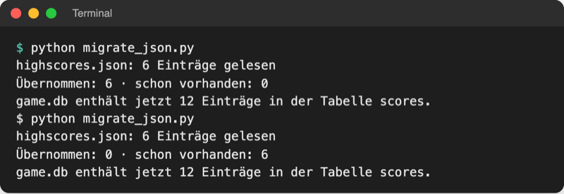

# Lab 18.3: Abfragen und Auswertungen

**Leitfragen:**

<details>
<summary>Welche Fragen würde man den gesammelten Spieldaten stellen?</summary>

Wer ist am besten? Wie oft wird pro Stufe gewonnen? Wie viele Versuche braucht es im Schnitt? Wer hat diese Woche gespielt? Jede dieser Fragen ist in SQL eine Abfrage mit `ORDER BY`, `GROUP BY` oder `WHERE`.

</details>

<details>
<summary>Wie wäre „Durchschnitt pro Stufe“ in Python ohne SQL zu rechnen?</summary>

Alle Runden laden, nach Stufe in Listen sammeln, je Liste Summe durch Anzahl teilen; so macht es `logic.statistics()` seit Lab 12.1 mit Comprehensions. In SQL erledigt das eine Zeile `GROUP BY level` mit `AVG(tries)`, ohne die Daten erst in Python zu laden.

</details>

<details>
<summary>Was passiert mit alten JSON-Daten beim Umstieg?</summary>

Nichts von selbst: Seit Lab 18.2 liest das Spiel nur noch `game.db`, die Einträge aus `highscores.json` fehlen in der Bestenliste. Ein einmaliges Migrationsskript übernimmt sie, ohne Einträge doppelt zu speichern.

</details>

- `ORDER BY … LIMIT` liefert Ranglisten, `GROUP BY` mit `COUNT`, `AVG`, `MIN` fasst Zeilen zu einer Zeile pro Gruppe zusammen.
- `JOIN` verbindet zwei Tabellen über einen Schlüssel.
- Im Spiel: `bestenliste` zeigt die Top 10 per SQL, `statistik` rechnet pro Stufe, `migrate_json.py` übernimmt `highscores.json`.

## Begriffe

| Begriff | Bedeutung |
| --- | --- |
| `LIMIT n` | nur die ersten `n` Ergebniszeilen; mit `ORDER BY` eine Rangliste |
| `GROUP BY spalte` | bündelt alle Zeilen mit gleichem Wert zu einer Gruppe, z. B. alle Runden einer Stufe |
| Aggregatfunktion | rechnet über viele Zeilen einen Wert aus: `COUNT`, `SUM`, `AVG`, `MIN`, `MAX` |
| `AS name` | gibt einer Ergebnisspalte einen Namen (Alias): `COUNT(*) AS games` |
| `ROUND(wert, n)` | rundet auf `n` Nachkommastellen |
| Fremdschlüssel | Spalte, die auf den Primärschlüssel einer anderen Tabelle zeigt: `orders.customer_id` → `customers.id` |
| `JOIN … ON` | setzt Zeilen zweier Tabellen nebeneinander, wo die Bedingung passt |
| Migration | Daten einmalig aus einem alten Format ins neue übertragen |

## Ranglisten und Zeiträume

Datei: [code/m18-sqlite/queries.py](../../project/code/m18-sqlite/queries.py) fragt `data/store.db` aus Lab 18.1 ab.

```sql
-- die drei teuersten Bestellungen: absteigend sortieren, dann abschneiden
SELECT product, price FROM orders ORDER BY price DESC, product LIMIT 3;
-- Datum als Text JJJJ-MM-TT: Textvergleich = zeitlicher Vergleich
SELECT order_date, product FROM orders WHERE order_date >= '2026-11-01' ORDER BY order_date;
```

- `ORDER BY` mit zwei Spalten: Bei gleichem Preis entscheidet die zweite.
- Ein Datum im Format `2026-11-01` sortiert als Text richtig (Jahr vor Monat vor Tag). Deshalb speichern Spiel und Beispiel-Datenbank Daten so (Lab 6.3).
- In Python kommen `3` und `'2026-11-01'` über `?` in die Abfrage: `LIMIT ?`, `WHERE order_date >= ?`.

## Gruppieren und zusammenfassen

`GROUP BY` macht aus vielen Zeilen eine Zeile pro Gruppe; die Aggregatfunktionen rechnen je Gruppe:



```sql
SELECT city, COUNT(*) AS customers, ROUND(AVG(age), 1) AS avg_age, MIN(age)
FROM customers
GROUP BY city
ORDER BY customers DESC, city;
```

| Funktion | Ergebnis je Gruppe |
| --- | --- |
| `COUNT(*)` | Anzahl der Zeilen |
| `SUM(spalte)` | Summe; bei `won` (1 oder 0) die Zahl der Gewinne |
| `AVG(spalte)` | Durchschnitt; Zeilen mit `NULL` zählen nicht mit |
| `MIN(spalte)` / `MAX(spalte)` | kleinster / größter Wert |



_Quelle: eigener Screenshot, Kurs-Repo, 08.11.2026._

Berlin zeigt 4 Kunden, aber Ø 30,3 Jahre aus nur drei Altersangaben: `AVG` überspringt Lena Fischers `NULL`.

## Zwei Tabellen verbinden: JOIN


_Quelle: LionKimbro, „Relational key“, Wikimedia Commons (https://commons.wikimedia.org/wiki/File:Relational_key.svg), gemeinfrei, abgerufen am 08.11.2026._

In `store.db` speichert jede Bestellung nur `customer_id`, nicht den Namen. `JOIN` holt den Namen dazu:

```sql
SELECT customers.name, COUNT(*) AS orders, ROUND(SUM(orders.price), 2) AS total
FROM orders
JOIN customers ON orders.customer_id = customers.id   -- passende Zeilen nebeneinander
GROUP BY customers.id
ORDER BY total DESC, customers.name
LIMIT 3;
```

`tabelle.spalte` sagt, aus welcher Tabelle eine Spalte stammt. Das Spiel braucht kein `JOIN`; eine Tabelle `players`, verbunden über den Namen, ist die Erweiterung der Übung.

## Python oder SQL?

| Frage | Python (Lab 12.1) | SQL |
| --- | --- | --- |
| Durchschnitt pro Stufe | alle Scores laden, Dict-Comprehension mit `average(...)` | `SELECT level, AVG(tries) FROM rounds GROUP BY level` |
| Top 10 nach Versuchen | `sorted(scores)[:10]` | `ORDER BY tries, seconds LIMIT 10` |
| Punkte (`LEVEL_POINTS`) | `score.points()` | geht nicht: die Punkteregel steht nur im Python-Code |

Faustregel: Was sich aus den Spalten der Tabelle rechnen lässt, erledigt SQL. Was Python-Logik braucht, bleibt in Python.

## Im Spiel: bestenliste, statistik

`storage.py` bekommt zwei feste Abfragen für die Rangliste. Spaltennamen in `ORDER BY` lassen sich nicht per `?` einsetzen, deshalb ein Dictionary statt eines f-Strings:

```python
# Bestenliste: die Datenbank sortiert und schneidet ab (LIMIT ? = count)
TOP_QUERIES = {
    "versuche": "SELECT * FROM scores ORDER BY tries, seconds LIMIT ?",
    "zeit": "SELECT * FROM scores ORDER BY seconds, tries LIMIT ?",
}
```

```python
    def top(self, by="versuche", count=10):
        """Gibt die besten Ergebnisse zurück: nach Versuchen, Zeit oder Punkten."""
        if by == "punkte":  # Punkte rechnet Python (LEVEL_POINTS), nicht SQL
            ranked = sorted(self.scores, key=lambda score: score.points(), reverse=True)
            return ranked[:count]
        rows = self.connection.execute(TOP_QUERIES[by], (count,)).fetchall()
        return to_scores(rows)
```

`to_scores(rows)` ist die Schleife aus `load()` als eigene Funktion, damit `load()` und `top()` sie teilen. Für `statistik` rechnet SQL über die Tabelle `rounds`:

```sql
SELECT level,
       COUNT(*) AS games,
       SUM(won) AS wins,
       ROUND(100.0 * SUM(won) / COUNT(*)) AS win_rate,
       ROUND(AVG(tries), 1) AS avg_tries
FROM rounds
GROUP BY level
ORDER BY level
```

`100.0` statt `100`: Zwei ganze Zahlen teilt SQLite ganzzahlig und schneidet ab (`100 * 2 / 3` ergibt `66` statt `66,7`, `2 / 3` sogar `0`). Der Befehl im Menü (Lab 13.3) ist eine Zeile; `show_level_stats(rows)` in `ui.py` druckt Gesamt und je Stufe:

```python
            case ["statistik"]:
                show_level_stats(game.scoreboard.level_stats())  # GROUP BY
```



_Quelle: eigener Screenshot, Kurs-Repo, 08.11.2026._

`Ø Versuche` zählt auch verlorene Runden mit voller Versuchszahl. Die alte „Statistik der Bestenliste“ (Python, nur Gewinne) erscheint weiter am Spielende; deshalb weichen die Durchschnitte voneinander ab.

## Migration: highscores.json übernehmen

`migrate_json.py` liegt neben dem Paket (wie `log_report.py`) und läuft einmal. Der Ablauf:

| Schritt | Werkzeug |
| --- | --- |
| alte Einträge lesen | `storage.Scoreboard("highscores.json").load()`; fehlt die Datei → Meldung, `sys.exit(1)` |
| Datenbank öffnen | `with storage.SqliteScoreboard("game.db") as board:` |
| nur neue Einträge | `score not in board.scores`: `==` einer Dataclass vergleicht alle Felder (Lab 11.2) |
| alle auf einmal speichern | neue Methode `add_many` mit `executemany` |

```python
    def add_many(self, scores):
        """Speichert viele Gewinne auf einmal (executemany), z. B. bei der Migration."""
        rows = [score_values(score) for score in scores]
        self.connection.executemany(INSERT_SCORE, rows)  # ein INSERT pro Tupel
        self.connection.commit()
        self.scores.extend(scores)
```



_Quelle: eigener Screenshot (echte Ausgabe), Kurs-Repo, 08.11.2026._

Weil vorhandene Einträge übersprungen werden, schadet ein zweiter Lauf nicht. `highscores.json` bleibt unverändert liegen.

## Typische Fehler

| Symptom | Ursache | Lösung |
| --- | --- | --- |
| Gewinnquote `0` oder abgeschnitten | ganze Zahlen teilen ganzzahlig: `SUM(won) / COUNT(*) * 100` ergibt `0` | `100.0 * SUM(won) / COUNT(*)` |
| `KeyError: 'punkte'` in `top()` | `TOP_QUERIES` hat keinen Eintrag `punkte` | Fall `punkte` vorher per Python behandeln |
| `IndexError: No item with that key` | Spaltenname in `row["…"]` passt nicht zum `AS` | gleichen Namen verwenden, z. B. `AS games` → `row["games"]` |
| Migration speichert alles doppelt | Prüfung `not in board.scores` fehlt | nur neue Scores an `add_many` geben |
| `Keine highscores.json gefunden` | Skript im falschen Ordner oder Datei fehlt | in `playground/` starten; zur Not `data/highscores_sample.json` als `highscores.json` kopieren |
| `statistik` zeigt Stufen in Fantasie-Reihenfolge | `ORDER BY` fehlt | `ORDER BY level` |

## Fazit

- `ORDER BY … LIMIT` liefert Ranglisten, `GROUP BY` mit Aggregatfunktionen beantwortet „pro Stufe“-Fragen in einer Abfrage.
- `JOIN` verbindet Tabellen über einen Schlüssel, statt Daten doppelt zu speichern.
- Eine Migration läuft einmal, liest das alte Format mit dem alten Code und überspringt Vorhandenes.

In der Übung bekommt das eigene Spiel `bestenliste` per SQL, den Befehl `statistik` und `migrate_json.py`.
