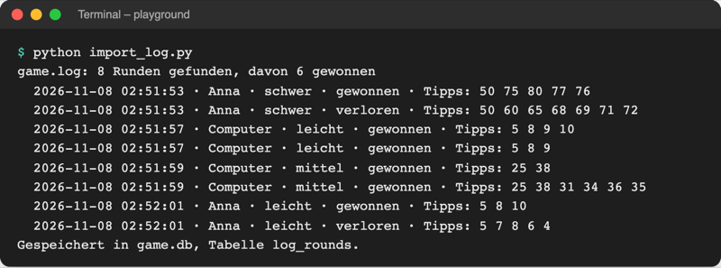
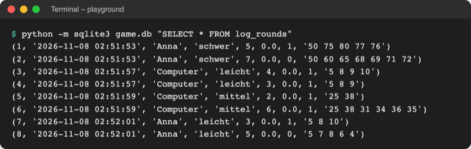

# Lab 19.1 – Lösung: Spiel-Log importieren

Fertiger Stand: [project/examples/m19-data-analysis/l01-multiline-regex/](../../project/examples/m19-data-analysis/l01-multiline-regex/) mit `guess_game/` (Code wie Lab 18.3), den Skripten aus Tag 4 und Lab 18.3 und neu [import_log.py](../../project/examples/m19-data-analysis/l01-multiline-regex/import_log.py).

## Aufgabe 1: Runden ins Log spielen

Ausschnitt aus `game.log` nach beiden Sitzungen (Zahlen und Uhrzeiten sind bei jedem Lauf anders):

```text
2026-11-08 02:51:55 INFO guess_game: Neue Runde: Stufe mittel
2026-11-08 02:51:55 DEBUG guess_game.ui: Tipp 20: zu niedrig
2026-11-08 02:51:55 DEBUG guess_game.ui: Tipp 30: zu niedrig
2026-11-08 02:51:55 DEBUG guess_game.logic: play_round dauerte 0.0 s
2026-11-08 02:51:55 INFO guess_game: Spiel mit quit beendet          <- kein Gewonnen/Verloren
```

Die `quit`-Runde hat eine „Neue Runde“-Zeile, aber keine Ergebniszeile. Genau sie zeigt, ob das Muster robust ist.

## Aufgabe 2: Gerüst starten

```text
$ python import_log.py
game.log: 0 Runden gefunden, davon 0 gewonnen
Gespeichert in game.db, Tabelle log_rounds.
```

Der Platzhalter `re.compile(r"TODO")` passt auf keine Zeile; `save_rounds` legt die leere Tabelle trotzdem an.

## Aufgabe 3: ROUND_PATTERN

```python
ROUND_PATTERN = re.compile(
    r"""
    ^(?P<started>\d{4}-\d{2}-\d{2}\ [\d:]{8})      # Datum und Uhrzeit des Starts
    \ INFO\ guess_game:\ Neue\ Runde:\ Stufe\ (?P<level>\w+)\n
    (?P<body>(?:.*\ DEBUG\ .*\n)*?)               # nur DEBUG-Zeilen: die Tipps
    .*\ INFO\ guess_game:\ (?P<result>Gewonnen|Verloren):\ (?P<name>\w+)
    \ –\ (?P<tries>\d+)\ Versuche?\ –\ (?P<seconds>[\d,]+)\ s\ ·\ \w+$
    """,
    re.MULTILINE | re.VERBOSE,  # ^ und $ je Zeile; Leerzeichen und # im Muster
)
```

| Zeile im Muster | passt auf |
| --- | --- |
| 1 | `2026-11-08 02:51:53` am Zeilenanfang → `started`; `[\d:]{8}` = acht Zeichen aus Ziffern und `:` |
| 2 | ` INFO guess_game: Neue Runde: Stufe schwer` → `level`, danach der Zeilenumbruch |
| 3 | beliebig viele ganze Zeilen, die ` DEBUG ` enthalten; `*?` hört so früh wie möglich auf |
| 4–5 | die Ergebniszeile wie in `LOG_PATTERN` aus Lab 15.2; die Stufe am Ende steht schon in `level` |

- `.*` in Zeile 3 und 4 bleibt ohne `re.DOTALL` in einer Zeile; das `\n` am Ende von Zeile 3 erzwingt ganze Zeilen.
- Trifft das Muster nach einer `quit`-Runde auf eine INFO-Zeile, die keine Ergebniszeile ist, scheitert der Versuch an dieser Stelle; `finditer` sucht bei der nächsten „Neue Runde“ weiter.
- Ohne `re.VERBOSE` müsste alles in einer Zeile ohne Kommentare stehen; mit VERBOSE wird jedes echte Leerzeichen als `\ ` geschrieben.

## Aufgabe 4: parse_rounds

```python
def parse_rounds(text):
    """Gibt alle vollständigen Runden im Text als Liste von Dictionaries zurück."""
    rounds = []
    for match in ROUND_PATTERN.finditer(text):  # ein Treffer pro Runde
        record = match.groupdict()  # {"started": "...", "level": "leicht", ...}
        guesses = GUESS_PATTERN.findall(record.pop("body"))  # ["5", "8"]
        record["guesses"] = " ".join(guesses)  # "5 8"
        record["tries"] = int(record["tries"])
        record["seconds"] = float(record["seconds"].replace(",", "."))
        record["won"] = record.pop("result") == "Gewonnen"
        rounds.append(record)
    return rounds
```

- `pop("body")` holt den Text der DEBUG-Zeilen und entfernt ihn zugleich; in der Tabelle steht stattdessen `guesses`.
- `float` versteht nur den Punkt, deshalb erst `replace(",", ".")`.
- `record.pop("result") == "Gewonnen"` ist ein Vergleich und liefert direkt `True` oder `False`; SQLite speichert das als `1` oder `0`.

## Aufgabe 5: Import prüfen



_Quelle: eigener Screenshot, Kurs-Repo, 08.11.2026 (Log mit 9 × „Neue Runde“, davon eine `quit`-Runde)._



_Quelle: eigener Screenshot, Kurs-Repo, 08.11.2026._

- Der zweite Lauf meldet dieselben Runden; die Tabelle hat danach wieder genau so viele Zeilen, weil `save_rounds` vor dem Einfügen `DELETE FROM log_rounds` ausführt.
- Gegenprobe mit der DOTALL-Variante `Neue Runde: Stufe (?P<level>\w+)\n(?P<body>.*?)(?P<result>Gewonnen|Verloren): (?P<name>\w+)` auf demselben Log: Der Treffer ab der `quit`-Runde (Stufe `mittel`) läuft über 15 Zeilen bis zum nächsten Gewinn und meldet „mittel · Computer“, die echte Computer-Runde auf Stufe `leicht` fehlt.

## Erweiterung

```python
# Kontakte mit Telefonnummer aus dem Textexport
# Start im Ordner playground/: python contacts.py

import re
from pathlib import Path

TEXT = Path("../data/addresses.txt").read_text(encoding="utf-8")

CONTACT_PATTERN = re.compile(
    r"""
    ^Name:\ (?P<name>.+)\n
    Straße:\ .+\n
    Ort:\ .+\n
    Telefon:\ (?P<phone>.+)$       # nur Blöcke, die eine Telefonzeile haben
    """,
    re.MULTILINE | re.VERBOSE,
)

for match in CONTACT_PATTERN.finditer(TEXT):
    print(f"{match.group('name')}: {match.group('phone')}")
```

```text
$ python contacts.py
Anna Beispiel: 030 1234567
Chiara Probst: 089 7654321
```

Die Telefonzeile ist hier Pflicht statt optional: Blöcke ohne sie passen nicht und fallen weg. Gruppen braucht es nur für die Teile, die ausgegeben werden.
