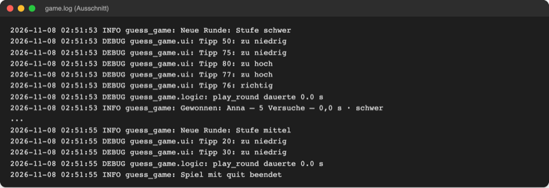
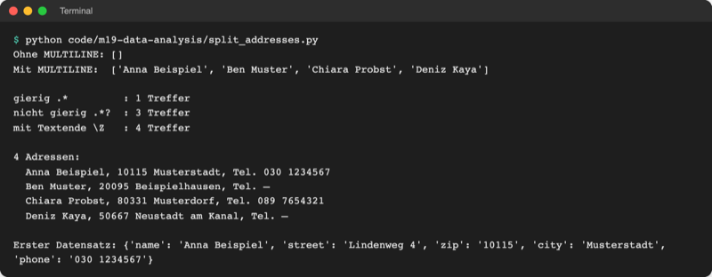
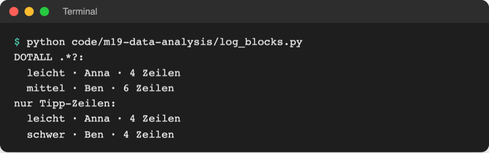
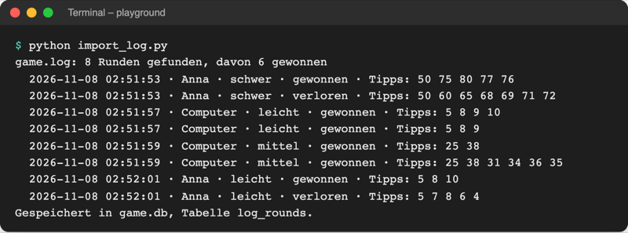

# Lab 19.1: Mehrzeiliges Parsen

**Leitfragen:**

<details>
<summary>Wo endet ein Datensatz, wenn er über fünf Zeilen geht?</summary>

Dort, wo ein festes Merkmal steht: eine Leerzeile, eine Schlusszeile wie „Gewonnen: …“ oder der Anfang des nächsten Datensatzes. Ein Muster muss dieses Ende beschreiben, sonst nimmt es zu wenig oder zu viel mit.

</details>

<details>
<summary>Warum findet <code>.*</code> manchmal viel zu viel?</summary>

`*` ist „gierig“: Es nimmt so viele Zeichen wie möglich und gibt nur so viel zurück, wie der Rest des Musters braucht. Über mehrere Zeilen hinweg kann das bis zum letzten passenden Ende im ganzen Text reichen.

</details>

<details>
<summary>Welche Texte (Kontoauszüge, Mail-Exporte, Literaturlisten) haben so eine Blockstruktur?</summary>

Alle, bei denen ein Eintrag aus mehreren Zeilen mit festen Bezeichnungen besteht: Buchungen mit Datum, Betrag und Verwendungszweck, Mails mit `From:`, `Subject:` und Text, Literaturangaben, Adresslisten, Log-Dateien eines Programms.

</details>

- Bisher (Lab 15.2) passte ein Muster auf **eine** Zeile. Viele Texte speichern einen Datensatz aber in einem **Block** aus mehreren Zeilen.
- Dieses Lab liest die ganze Datei als einen Text und schneidet ihn mit einem Muster in Blöcke: aus jedem Treffer wird ein Dictionary.

## Begriffe

| Begriff | Bedeutung |
| --- | --- |
| Datensatz (Record) | zusammengehörende Angaben zu einer Sache, z. B. eine Adresse oder eine Spielrunde |
| Block | Datensatz, der über mehrere Zeilen geht, wie eine Karteikarte in einem Stapel |
| Flag | Schalter, der die Regeln für das ganze Muster ändert, z. B. `re.MULTILINE` |
| `re.MULTILINE` | `^` und `$` gelten für jede Zeile, nicht nur für Anfang und Ende des ganzen Textes |
| `re.DOTALL` | `.` passt auch auf den Zeilenumbruch `\n`; ohne das Flag bleibt `.` in seiner Zeile |
| `re.VERBOSE` | Muster darf über mehrere Zeilen gehen und Kommentare mit `#` enthalten; Leerzeichen zählen nur als `\ ` |
| gierig (greedy) | `*` und `+` nehmen so viel Text wie möglich |
| nicht gierig (lazy) | `*?` und `+?` nehmen so wenig Text wie möglich |
| `(?:...)` | Klammer ohne Gruppe: fasst Teile zusammen (z. B. für `*` oder `?`), merkt sich aber nichts |
| `Path.read_text()` | liest eine ganze Datei in einen einzigen String |
| `dict.pop(schlüssel)` | gibt den Wert zurück und entfernt den Eintrag aus dem Dictionary |

## Blöcke im Text

Ein Block hat eine **Anfangszeile**, einige **Zeilen dazwischen** und ein **Ende**. In `game.log` (Lab 15.3) beginnt eine Runde mit „Neue Runde“, dann folgen die Tipps, am Ende steht „Gewonnen“ oder „Verloren“. Wird eine Runde mit `quit` abgebrochen, fehlt die Schlusszeile:



_Quelle: eigener Screenshot, Kurs-Repo, 08.11.2026 (Ausschnitt aus `game.log`)._

Zeile für Zeile mit `for line in file` (Lab 8.1) sieht jede Zeile nur sich selbst. Für Blöcke wird die ganze Datei auf einmal gelesen:

```python
from pathlib import Path

text = Path("data/addresses.txt").read_text(encoding="utf-8")  # ein einziger String
```

## Die drei Flags

Datei: [code/m19-data-analysis/split_addresses.py](../../project/code/m19-data-analysis/split_addresses.py). Die Datei [data/addresses.txt](../../project/data/addresses.txt) ist ein Kontakt-Export mit vier erfundenen Adressen:

```text
Name: Anna Beispiel
Straße: Lindenweg 4
Ort: 10115 Musterstadt
Telefon: 030 1234567

Name: Ben Muster
Straße: Am Bach 12a
Ort: 20095 Beispielhausen
```

| Flag | ohne Flag | mit Flag |
| --- | --- | --- |
| `re.MULTILINE` | `^Name: (.+)$` findet nichts (der Text beginnt mit „Export …“) | findet alle vier Namen |
| `re.DOTALL` | `.` hält am Zeilenende an | `.` läuft über `\n` weiter, ein Muster kann einen ganzen Block greifen |
| `re.VERBOSE` | das ganze Muster in einer Zeile | eine Zeile pro Teil, mit Kommentar |

Mehrere Flags werden mit `|` verbunden: `re.MULTILINE | re.VERBOSE`.

## Gierig oder nicht gierig

Gesucht: jeder Block von `Name:` bis zur nächsten Leerzeile (`\n\n`). Mit `re.DOTALL` kann `.*` dabei über Zeilen springen:

```python
greedy = re.findall(r"^Name: .*\n\n", TEXT, re.MULTILINE | re.DOTALL)
lazy = re.findall(r"^Name: .*?\n\n", TEXT, re.MULTILINE | re.DOTALL)
lazy_end = re.findall(r"^Name: .*?(?:\n\n|\Z)", TEXT, re.MULTILINE | re.DOTALL)
```

| Muster | Treffer | Warum |
| --- | --- | --- |
| `.*\n\n` | 1 | `.*` nimmt alles bis zur **letzten** Leerzeile: drei Blöcke in einem Treffer |
| `.*?\n\n` | 3 | `.*?` hört an der **ersten** Leerzeile auf; der letzte Block hat keine Leerzeile danach |
| `.*?(?:\n\n\|\Z)` | 4 | Ende ist „Leerzeile **oder** Textende“ (`\Z`) |

Ein Block-Muster braucht also zwei Dinge: einen nicht gierigen Teil in der Mitte und ein eindeutiges Ende.

## Feste Zeilen mit benannten Gruppen

Noch genauer als „irgendwas bis zur Leerzeile“ ist ein Muster, das jede Zeile des Blocks beschreibt. `re.VERBOSE` macht es lesbar:

```python
ADDRESS_PATTERN = re.compile(
    r"""
    ^Name:\ (?P<name>.+)\n               # .+ bleibt in einer Zeile
    Straße:\ (?P<street>.+)\n
    Ort:\ (?P<zip>\d{5})\ (?P<city>.+)$
    (?:\nTelefon:\ (?P<phone>.+))?       # (?:...)? = ganze Zeile optional
    """,
    re.MULTILINE | re.VERBOSE,  # VERBOSE: Leerzeichen als "\ ", Kommentare mit #
)

addresses = []
for match in ADDRESS_PATTERN.finditer(TEXT):  # ein Treffer pro Block
    addresses.append(match.groupdict())  # Dictionary mit allen benannten Gruppen
```

- Ohne `re.DOTALL` bleibt `.+` in seiner Zeile; `\n` im Muster steht für den Zeilenwechsel.
- `(?:\nTelefon: ...)?` macht die ganze Telefonzeile optional. Fehlt sie, ist `phone` im Dictionary `None`.
- `finditer` und `groupdict` sind aus Lab 15.2 bekannt; das Ergebnis ist eine Liste von Dictionaries wie `{'name': 'Anna Beispiel', 'street': 'Lindenweg 4', 'zip': '10115', 'city': 'Musterstadt', 'phone': '030 1234567'}`.



_Quelle: eigener Screenshot, Kurs-Repo, 08.11.2026._

## Wenn ein Block kein Ende hat

Datei: [code/m19-data-analysis/log_blocks.py](../../project/code/m19-data-analysis/log_blocks.py). Ein vereinfachtes Log mit drei Runden; die mittlere wurde abgebrochen und hat keine `ENDE`-Zeile:

```python
# Variante 1: alles zwischen START und ENDE, . passt auch auf \n
LOOSE = re.compile(
    r"^START (?P<level>\w+)\n(?P<body>.*?)ENDE (?P<result>\w+) (?P<name>\w+)$",
    re.MULTILINE | re.DOTALL,
)
# Variante 2: dazwischen nur Tipp-Zeilen, sonst kein Treffer an dieser Stelle
STRICT = re.compile(
    r"^START (?P<level>\w+)\n"
    r"(?P<body>(?:Tipp .*\n)*?)"  # nur Tipp-Zeilen, so wenige wie möglich
    r"ENDE (?P<result>\w+) (?P<name>\w+)$",
    re.MULTILINE,
)
```



_Quelle: eigener Screenshot, Kurs-Repo, 08.11.2026._

Auch das nicht gierige `.*?` ist hier falsch: Ab `START mittel` findet es keine `ENDE`-Zeile vor dem nächsten Start und läuft einfach weiter bis zu Bens Ergebnis. Heraus kommt „mittel · Ben“, zwei Runden verschmolzen, die Stufe ist falsch. Variante 2 erlaubt zwischen Anfang und Ende **nur** Tipp-Zeilen; trifft sie auf ein zweites `START`, scheitert der Versuch, und `finditer` sucht an der nächsten Stelle weiter.

> **Merksatz:** Zwischen Anfang und Ende eines Blocks nur das erlauben, was dort wirklich stehen darf.

## Im Spiel: import_log.py

Neben dem Paket entsteht das Skript `import_log.py`. Es liest `game.log`, zerlegt es in Runden und speichert jede vollständige Runde als Zeile in der neuen Tabelle `log_rounds` von `game.db` (SQLite, Lab 18.2). Das Paket `guess_game/` bleibt unverändert.

| Teil der Runde | Log-Zeile | Gruppe im Muster |
| --- | --- | --- |
| Anfang | `2026-11-08 02:51:53 INFO guess_game: Neue Runde: Stufe schwer` | `started`, `level` |
| Mitte | nur Zeilen mit ` DEBUG ` (Tipps, Dauer) | `body` |
| Ende | `… INFO guess_game: Gewonnen: Anna – 5 Versuche – 0,0 s · schwer` | `result`, `name`, `tries`, `seconds` |

Die Mitte folgt dem Prinzip von Variante 2: `(?:.*\ DEBUG\ .*\n)*?` lässt nur DEBUG-Zeilen zu. Eine Runde, die mit `quit` endet, hat statt der Schlusszeile eine INFO-Zeile und wird übersprungen. Aus dem `body` holt ein zweites, einzeiliges Muster die Tipps:

```python
# eine Tipp-Zeile im body, z. B. "Tipp 5: zu niedrig" (ungültige Tipps nicht)
GUESS_PATTERN = re.compile(r"Tipp (\d+): (?:zu hoch|zu niedrig|richtig)")
```

`GUESS_PATTERN.findall(body)` liefert `['50', '75', '80', '77', '76']`, `" ".join(...)` macht daraus `"50 75 80 77 76"` (Lab 17.1). Der Starter [starters/m19-l01-import_log.py](../../project/starters/m19-l01-import_log.py) bringt `GUESS_PATTERN`, die Tabelle, `save_rounds` und `main` fertig mit; offen sind `ROUND_PATTERN` und `parse_rounds`.



_Quelle: eigener Screenshot, Kurs-Repo, 08.11.2026 (9 × „Neue Runde“ im Log, davon eine `quit`-Runde)._

## Typische Fehler

| Symptom | Ursache | Lösung |
| --- | --- | --- |
| `0 Runden gefunden`, obwohl das Log Runden enthält | `re.MULTILINE` fehlt, `^` passt nur am Textanfang | Flags `re.MULTILINE \| re.VERBOSE` |
| `0 Runden gefunden` mit `re.VERBOSE` | Leerzeichen im Muster nicht als `\ ` geschrieben; VERBOSE ignoriert sie | jedes echte Leerzeichen als `\ ` |
| Eine Runde mit falscher Stufe, eine fehlt | `.*?` mit `re.DOTALL` frisst eine abgebrochene Runde | Mitte auf DEBUG-Zeilen beschränken |
| Nur ein riesiger Treffer | gieriges `.*` statt `.*?` | `*?` |
| Letzter Block fehlt | Ende nur als `\n\n` beschrieben | `(?:\n\n\|\Z)` |
| Ergebniszeile passt nicht | `–` oder `·` abgetippt | Zeichen aus dem Log oder Handout kopieren |
| `KeyError: 'body'` | `body` schon mit `pop` entfernt | `pop` nur einmal aufrufen |

## Vertiefung

- `\Z` steht für „Ende des ganzen Textes“, auch mit `re.MULTILINE` (dort meint `$` jedes Zeilenende). Quelle: [Python-Dokumentation `re`](https://docs.python.org/3.14/library/re.html), Stand: 08.11.2026.
- Eine mit `--resume` fortgesetzte Runde (Lab 17.3) beginnt im Log mit einer neuen „Neue Runde“-Zeile und enthält nur die Tipps nach dem Fortsetzen: `tries` stimmt, `guesses` ist kürzer.
- Für sehr große Dateien lohnt Block-für-Block-Lesen statt `read_text`; bei Logs dieser Größe (Kilobytes) ist der ganze Text kein Problem.

## Fazit

- Blöcke über mehrere Zeilen: Datei als einen Text lesen, Muster mit `re.MULTILINE`, Treffer mit `finditer` und `groupdict`.
- `.*` ist gierig, `.*?` nicht; beide laufen mit `re.DOTALL` über Zeilen und damit leicht in den nächsten Block.
- Robust wird ein Block-Muster, wenn es die erlaubten Zeilen in der Mitte und ein eindeutiges Ende beschreibt.

In der Übung entsteht `import_log.py`, das jede vollständige Runde aus `game.log` als Tabellenzeile speichert.
