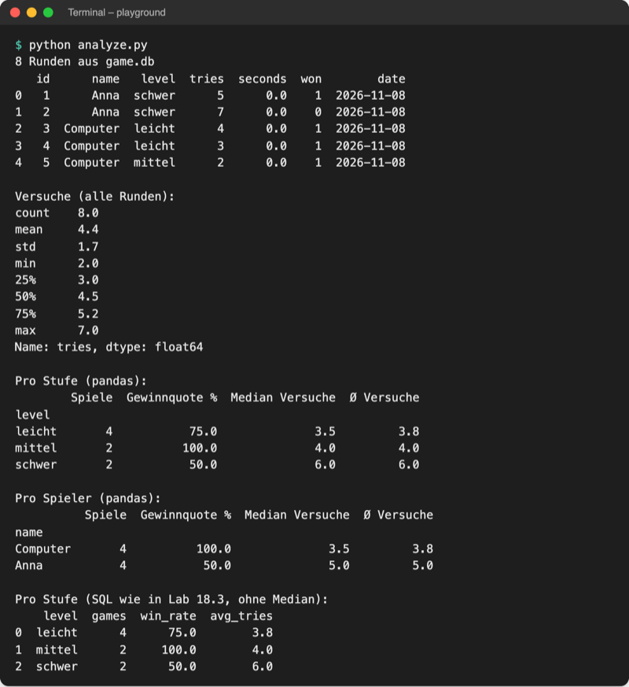

# Lab 19.2 – Lösung: Spielrunden mit pandas auswerten

Fertiger Stand: [project/examples/m19-data-analysis/l02-pandas/](../../project/examples/m19-data-analysis/l02-pandas/) mit `guess_game/` (Code wie Lab 18.3), `import_log.py` (Lab 19.1) und neu [analyze.py](../../project/examples/m19-data-analysis/l02-pandas/analyze.py). Alle Ausgaben unten stammen aus einer `game.db` mit acht Runden (je vier von Anna und vom Computer, verteilt auf drei Stufen).

## Vollständiges Skript

Aufgabe 1: `load_rounds` und Anfang von `main()`; Aufgabe 2: `describe`; Aufgabe 3: `summary`; Aufgabe 4: zweiter `summary`-Aufruf mit `sort_values`; Aufgabe 5: `SQL_STATS`.

```python
# Auswertung mit pandas: liest die Tabelle rounds aus game.db und berechnet
# Gewinnquote und Median der Versuche pro Stufe und pro Spieler
# Start im Ordner mit game.db: python analyze.py

import sqlite3
import sys
from pathlib import Path

import pandas as pd

DB_FILE = Path("game.db")

# dieselbe Frage wie der Befehl statistik (Lab 18.3), hier als SQL für den Vergleich
SQL_STATS = """
SELECT level,
       COUNT(*) AS games,
       ROUND(100.0 * SUM(won) / COUNT(*)) AS win_rate,
       ROUND(AVG(tries), 1) AS avg_tries
FROM rounds
GROUP BY level
ORDER BY level
"""


def load_rounds(path=DB_FILE):
    """Lädt alle Runden als DataFrame (eine Zeile pro Runde)."""
    connection = sqlite3.connect(path)
    rounds = pd.read_sql("SELECT * FROM rounds", connection)  # SQL -> Tabelle
    connection.close()
    return rounds


def summary(rounds, column):
    """Gewinnquote und Versuche pro Gruppe, z. B. column="level" oder "name"."""
    groups = rounds.groupby(column)  # Zeilen nach Stufe bzw. Spieler bündeln
    return pd.DataFrame(
        {
            "Spiele": groups["won"].count(),
            "Gewinnquote %": (groups["won"].mean() * 100).round(),  # won: 1 oder 0
            "Median Versuche": groups["tries"].median(),
            "Ø Versuche": groups["tries"].mean().round(1),
        }
    )


def main():
    if not DB_FILE.exists():
        print(f"{DB_FILE} nicht gefunden. Erst spielen (SQLite ab Lab 18.2).")
        sys.exit(1)
    rounds = load_rounds()
    print(f"{len(rounds)} Runden aus {DB_FILE}")  # Checkpoint nach read_sql
    print(rounds.head())  # die ersten fünf Zeilen
    print("\nVersuche (alle Runden):")
    print(rounds["tries"].describe().round(1))  # Anzahl, Mittelwert, Min, Max ...
    print("\nPro Stufe (pandas):")
    print(summary(rounds, "level"))
    print("\nPro Spieler (pandas):")
    print(summary(rounds, "name").sort_values("Gewinnquote %", ascending=False))
    connection = sqlite3.connect(DB_FILE)
    print("\nPro Stufe (SQL wie in Lab 18.3, ohne Median):")
    print(pd.read_sql(SQL_STATS, connection))
    connection.close()


if __name__ == "__main__":
    main()
```

## Aufgabe 1: Laden und Checkpoint

- `pd.read_sql(abfrage, connection)` führt die Abfrage aus und macht aus den Zeilen einen DataFrame; die Spaltennamen kommen aus der Tabelle.
- `DB_FILE.exists()` steht **vor** `connect`: `sqlite3.connect` würde eine fehlende Datei stillschweigend leer anlegen, und `read_sql` scheitert dann mit `no such table: rounds`.

```text
8 Runden aus game.db
   id      name   level  tries  seconds  won        date
0   1      Anna  schwer      5      0.0    1  2026-11-08
1   2      Anna  schwer      7      0.0    0  2026-11-08
2   3  Computer  leicht      4      0.0    1  2026-11-08
3   4  Computer  leicht      3      0.0    1  2026-11-08
4   5  Computer  mittel      2      0.0    1  2026-11-08
```

Die linke Spalte `0 … 4` ist der Index von pandas, `id` die Spalte aus der Datenbank.

## Aufgabe 2: describe

```text
Versuche (alle Runden):
count    8.0
mean     4.4
std      1.7
min      2.0
25%      3.0
50%      4.5
75%      5.2
max      7.0
Name: tries, dtype: float64
```

`50%` ist der Median aller Runden, `25%`/`75%` die Grenzen des mittleren Viertels; `std` (Standardabweichung) misst, wie weit die Werte streuen.

## Aufgaben 3 und 4: Pro Stufe und pro Spieler



_Quelle: eigener Screenshot, Kurs-Repo, 08.11.2026._

- `groups["won"].mean()` ist die Gewinnquote als Anteil (`0.75`), `* 100` und `round()` machen `75.0` daraus. Die Rechnung gilt für jede Gruppe auf einmal, wie bei einem NumPy-Array.
- Das Dictionary in `pd.DataFrame({...})` legt die Spaltennamen fest; alle vier Series haben denselben Index (die Stufen) und passen deshalb Zeile für Zeile zusammen.
- `summary` ist für Stufe und Spieler dieselbe Funktion: Nur `column` ändert sich.

## Aufgabe 5: SQL-Vergleich und Fehlerfall

| Stufe | pandas Quote / Ø | SQL `win_rate` / `avg_tries` | Median (nur pandas) |
| --- | --- | --- | --- |
| leicht | 75 % / 3,8 | 75.0 / 3.8 | 3,5 |
| mittel | 100 % / 4,0 | 100.0 / 4.0 | 4,0 |
| schwer | 50 % / 6,0 | 50.0 / 6.0 | 6,0 |

Der Spielbefehl `statistik` zeigt dieselben Werte („leicht: 3 von 4 gewonnen (75 %) · Ø 3,8 Versuche“). SQLite kennt keine `MEDIAN`-Funktion; in pandas ist es eine Methode. pandas schreibt Kommazahlen mit Punkt.

```text
$ cd ..
$ python playground/analyze.py
game.db nicht gefunden. Erst spielen (SQLite ab Lab 18.2).
$ echo $?
1
```

## Erweiterung

```python
# Größter und kleinster Umsatz pro Region (erfundene Umsätze)
# Start im Ordner playground/: python sales.py

import pandas as pd

sales = pd.read_csv("../data/umsatz_pro_ort.csv")
result = sales.groupby("Region")["Umsatz"].agg(["max", "min", "count"])
print(result.sort_values("max", ascending=False))
```

```text
$ python sales.py
           max    min  count
Region
Süd     135000  37000      6
Ost     120000  32000      5
West    102000  33000      4
Nord     95000  35000      5
```

`agg` nimmt die Namen der Kennzahlen als Liste; die Spalten des Ergebnisses heißen genauso und lassen sich deshalb direkt in `sort_values("max", ...)` verwenden.
