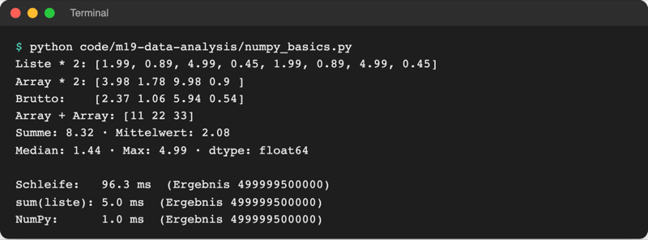
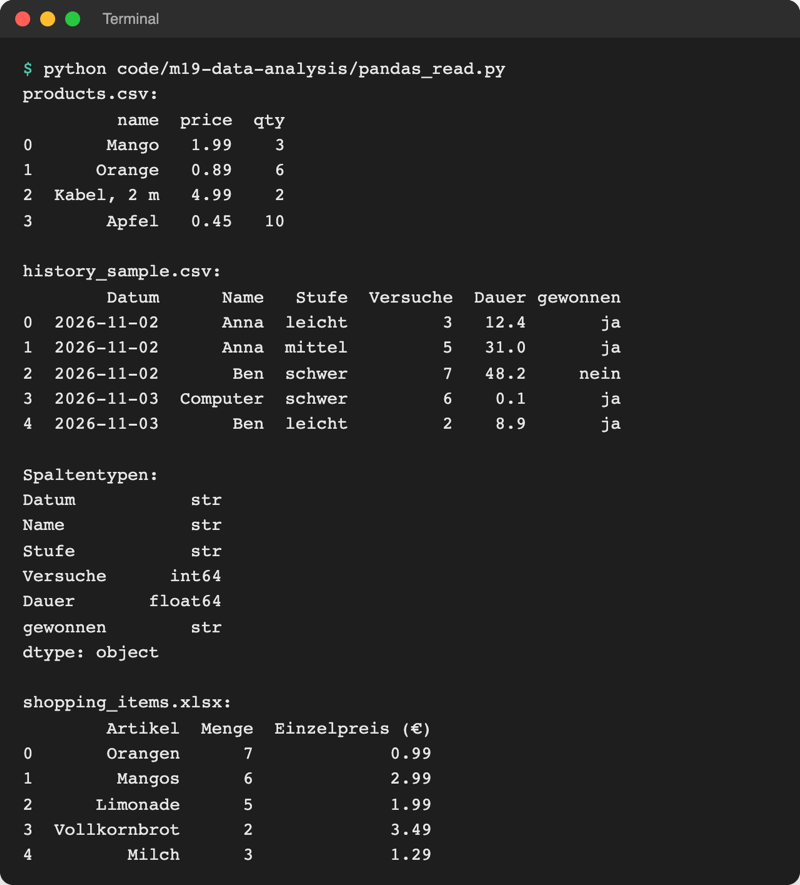
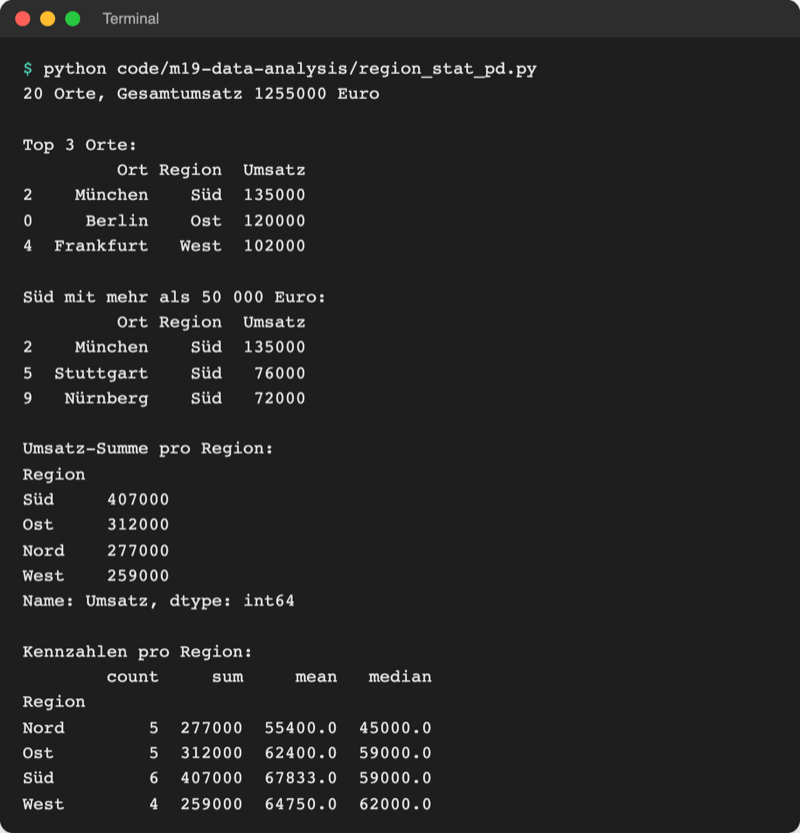
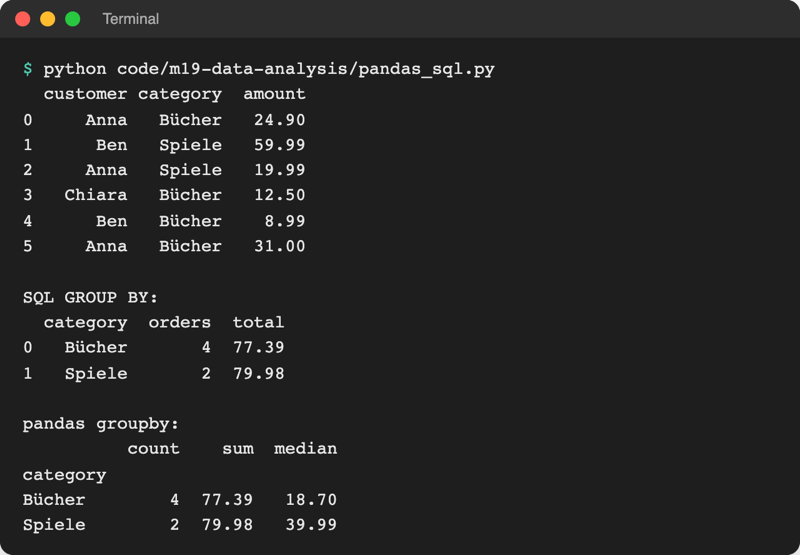

# Lab 19.2: NumPy und pandas

**Leitfragen:**

<details>
<summary>Wie lange dauert es, eine Million Zahlen in einer Python-Schleife zu addieren?</summary>

Auf einem aktuellen Laptop etwa ein Zehntel einer Sekunde. Das klingt schnell, aber `sum()` braucht nur einen Bruchteil davon und NumPy noch einmal deutlich weniger: Bei Millionen Messwerten und vielen Rechnungen wird der Unterschied spürbar.

</details>

<details>
<summary>Welche Excel-Funktionen nutzt man für Auswertungen am häufigsten?</summary>

`SUMME`, `MITTELWERT`, `ANZAHL`, `MAX`/`MIN`, Filter, Sortieren und Pivot-Tabellen („Umsatz pro Region“). Genau diese Handgriffe gibt es in pandas als Methoden, mit dem Vorteil, dass das Skript sie bei neuen Daten wiederholt.

</details>

<details>
<summary>SQL oder Python-Code: Wo rechnet man eine Auswertung besser?</summary>

Daten auswählen und vorsortieren dort, wo sie liegen (in der Datenbank, mit SQL aus Lab 18.3); rechnen, was SQL schlecht kann (Median, Diagramme, mehrere Dateien kombinieren), in Python. Oft beides: SQL holt, pandas rechnet.

</details>

- Python gehört zu den meistgenutzten Sprachen für Datenanalyse. Den Kern bilden zwei Bibliotheken von PyPI: **NumPy** rechnet mit langen Zahlenreihen, **pandas** mit Tabellen.
- Dieses Lab ordnet das Ökosystem ein, zeigt Array und DataFrame und wertet am Ende die Runden aus `game.db` mit pandas aus.

## Begriffe

| Begriff | Bedeutung |
| --- | --- |
| Datenanalyse | aus Rohdaten Antworten gewinnen: zählen, mitteln, vergleichen, zeigen |
| Data Science | Datenanalyse plus Statistik und maschinelles Lernen; Python ist dort weit verbreitet |
| NumPy | Bibliothek für Arrays; Grundlage fast aller Data-Science-Pakete |
| Array (`ndarray`) | Zahlenreihe, in der alle Werte denselben Typ haben, wie eine Spalte Zahlen in Excel |
| Vektorrechnung | eine Rechnung gilt für alle Werte auf einmal: `array * 2` statt einer Schleife |
| pandas | Bibliothek für Tabellen; Name von „panel data“ (Datentabellen in der Wirtschaftsstatistik) |
| DataFrame | Tabelle mit benannten Spalten und einem Index, „Excel-Blatt in Python“ |
| Series | eine einzelne Spalte eines DataFrame |
| Index | Zeilenbeschriftung links im DataFrame, Standard `0, 1, 2 …` |
| `groupby` | Zeilen nach einem Wert bündeln, dann je Gruppe rechnen (wie eine Pivot-Tabelle) |
| Median | mittlerer Wert der sortierten Reihe; ein einzelner Ausreißer verschiebt ihn kaum |
| Notebook | Datei, in der Code, Ergebnis und Text abwechselnd stehen (Jupyter, VS Code) |

## Data Science auf einen Blick

- **Problem:** Tabellen mit Tausenden Zeilen lassen sich in Excel noch klicken, aber nicht jede Woche neu und nachvollziehbar auswerten. Mit reinen Python-Listen wird es lang und langsam.
- **Bild:** ein Werkzeugkasten in Schichten. Unten rechnet NumPy, darauf bauen pandas (Tabellen), Matplotlib (Diagramme, Lab 19.3) und SciPy (Statistik), ganz oben scikit-learn (maschinelles Lernen). Jupyter ist der Arbeitstisch.
- **Definition:** Datenanalyse mit Python heißt: Daten laden, bereinigen, zusammenfassen und zeigen, als wiederholbares Skript.


_Eigene Grafik mit den Projektlogos. Logos: NumPy (Isabela Presedo-Floyd, gemeinfrei), pandas (Marc Garcia, BSD), Matplotlib (gemeinfrei), scikit-learn (BSD), Jupyter (BSD), alle über Wikimedia Commons; SciPy (BSD, github.com/scipy/scipy). Abgerufen am 08.11.2026, Details in `assets/images/SOURCES.md`._

| Jahr | Ereignis | Quelle |
| --- | --- | --- |
| 2001 | Fernando Pérez startet IPython (daraus wird später Jupyter); SciPy 0.1 erscheint | ipython.readthedocs.io, „History“; Virtanen et al., „SciPy 1.0“, Nature Methods 2020 (arXiv:1907.10121) |
| 2003 | John D. Hunter (1968–2012) schreibt Matplotlib, weil ihm ein Python-Werkzeug für Diagramme wie in MATLAB fehlt | matplotlib.org, „History“ |
| 2005/2006 | Travis Oliphant vereint die Vorgänger Numeric und Numarray zu NumPy; Version 1.0 erscheint 2006 | numpy.org/about; Harris et al., Nature 2020 |
| 2008 | Wes McKinney beginnt pandas bei der Investmentfirma AQR, Ende 2009 wird es Open Source | pandas.pydata.org/about |
| 2007/2010 | scikit-learn startet als Google-Summer-of-Code-Projekt, erste Version 2010 | scikit-learn.org/stable/about |
| 2014 | Project Jupyter geht aus IPython hervor | jupyter.org/about |


_Wes McKinney, Begründer von pandas, 2015. Quelle: Web Summit, Wikimedia Commons (https://commons.wikimedia.org/wiki/File:Wes_McKinney.jpg), CC BY 2.0, abgerufen am 08.11.2026._

Einsatz: Umsätze und Messwerte auswerten, Umfragen zählen, Berichte automatisieren, Daten für maschinelles Lernen vorbereiten. Versionen im Kurs: NumPy 2.5.4, pandas 3.1.1 (`requirements.txt`, Stand: 08.11.2026).

## NumPy: Array statt Liste

Datei: [code/m19-data-analysis/numpy_basics.py](../../project/code/m19-data-analysis/numpy_basics.py). Lab 4.1 hat Listen gegen Arrays abgegrenzt; hier ist der Unterschied zu sehen:

```python
import numpy as np  # Kurzname np ist überall üblich

prices = [1.99, 0.89, 4.99, 0.45]  # Liste
array = np.array(prices)  # Array aus der Liste: alle Werte vom selben Typ

print("Liste * 2:", prices * 2)  # Liste wird verdoppelt (aneinandergehängt)
print("Array * 2:", array * 2)  # jeder Wert wird verdoppelt
print("Brutto:   ", (array * 1.19).round(2))  # 19 % auf jeden Preis
```



_Quelle: eigener Screenshot, Kurs-Repo, 08.11.2026 (MacBook, Apple M-Chip; Zeiten schwanken je Rechner)._

| | Liste | NumPy-Array |
| --- | --- | --- |
| Werte | beliebig gemischt | alle vom selben Typ (`dtype`, z. B. `float64`) |
| `* 2` | Liste zweimal hintereinander | jeder Wert mal 2 |
| Rechnen über alle Werte | Schleife oder Comprehension | direkt: `array * 1.19`, `array.mean()` |
| Tempo bei einer Million Zahlen | Schleife ca. 100 ms | ca. 1 ms |
| gut für | gemischte Daten, Anhängen | Messreihen, Statistik, Grundlage für pandas |

Arrays sind schnell, weil die Zahlen dicht hintereinander im Speicher liegen und die Rechnung in kompiliertem C-Code läuft, nicht Zeile für Zeile im Python-Interpreter.

## pandas: der DataFrame

Datei: [code/m19-data-analysis/pandas_basics.py](../../project/code/m19-data-analysis/pandas_basics.py)

```python
import pandas as pd  # Kurzname pd ist überall üblich

df = pd.DataFrame(shopping_items)  # Liste von Dictionaries -> Tabelle
df["qty"]  # eine Spalte (Series)
df["total"] = df["qty"] * df["unit_price"]  # neue Spalte, Rechnung für jede Zeile
df[df["unit_price"] > 1]  # filtern: nur Zeilen mit True
df.sort_values("total", ascending=False)  # sortieren, größter Wert zuerst
df["total"].describe()  # Anzahl, Mittelwert, Min, Max, Quartile
```

```text
       name  qty  unit_price
0    Orange    7        0.99
1     Mango    6        2.99
2  Limonade    5        1.99
3     Apfel   10        0.45
```

`df` ist der übliche Name für „DataFrame“. Der Filter `df["unit_price"] > 1` liefert pro Zeile `True` oder `False`; `df[...]` behält nur die Zeilen mit `True`. Zwei Bedingungen verbindet `&` (und) bzw. `|` (oder), jede in Klammern.

| Excel | pandas |
| --- | --- |
| Blatt öffnen | `pd.read_csv(...)`, `pd.read_excel(...)` |
| Spalte markieren | `df["Umsatz"]` |
| Formel nach unten ziehen | `df["Brutto"] = df["Netto"] * 1.19` |
| Filter | `df[df["Region"] == "Süd"]` |
| Sortieren | `df.sort_values("Umsatz", ascending=False)` |
| `SUMME`, `MITTELWERT`, `ANZAHL`, `MEDIAN` | `.sum()`, `.mean()`, `.count()`, `.median()` |
| Pivot-Tabelle | `df.groupby("Region")["Umsatz"].sum()` |

## Daten laden

Datei: [code/m19-data-analysis/pandas_read.py](../../project/code/m19-data-analysis/pandas_read.py)

| Quelle | Befehl |
| --- | --- |
| CSV mit Komma | `pd.read_csv("data/products.csv")` |
| CSV des Spiels (Lab 8.3) | `pd.read_csv("history.csv", sep=";", decimal=",", encoding="utf-8-sig")` |
| Excel (Lab 17.2) | `pd.read_excel("data/shopping_items.xlsx")` |
| SQLite (Lab 18.2) | `pd.read_sql("SELECT * FROM rounds", connection)` |

`history.csv` braucht drei Angaben: Semikolon als Trennzeichen, Komma als Dezimalzeichen (sonst bleibt `"12,4"` Text) und `utf-8-sig`, damit die Markierung am Dateianfang nicht im ersten Spaltennamen landet. Beispieldatei: [data/history_sample.csv](../../project/data/history_sample.csv).



_Quelle: eigener Screenshot, Kurs-Repo, 08.11.2026._

## Gruppieren und zusammenfassen

Datei: [code/m19-data-analysis/region_stat_pd.py](../../project/code/m19-data-analysis/region_stat_pd.py), Daten: [data/umsatz_pro_ort.csv](../../project/data/umsatz_pro_ort.csv) (20 Orte, erfundene Umsätze).

```python
sales = pd.read_csv("data/umsatz_pro_ort.csv")  # Spalten: Ort, Region, Umsatz
groups = sales.groupby("Region")  # Zeilen nach Region bündeln
print(groups["Umsatz"].sum().sort_values(ascending=False))
print(groups["Umsatz"].agg(["count", "sum", "mean", "median"]).round())
```



_Quelle: eigener Screenshot, Kurs-Repo, 08.11.2026._

`groupby` allein rechnet noch nichts; erst die Methode danach (`sum`, `mean`, `count`, `median`) fasst jede Gruppe zu einer Zahl zusammen. `agg([...])` macht mehrere davon auf einmal, das Ergebnis ist wieder ein DataFrame mit der Region als Index.

## SQL oder pandas?

Datei: [code/m19-data-analysis/pandas_sql.py](../../project/code/m19-data-analysis/pandas_sql.py) stellt dieselbe Frage („Umsatz pro Kategorie“) einmal per `GROUP BY` und einmal per `groupby`. `sqlite3.connect(":memory:")` legt dafür eine Datenbank nur im Arbeitsspeicher an.



_Quelle: eigener Screenshot, Kurs-Repo, 08.11.2026._

| Aufgabe | SQL (Lab 18.3) | pandas |
| --- | --- | --- |
| Daten liegen in einer Datenbank, viele Zeilen | **stark:** nur das Nötige holen (`WHERE`, `LIMIT`) | lädt alles in den Arbeitsspeicher |
| Anzahl, Summe, Durchschnitt pro Gruppe | `GROUP BY` mit `COUNT`, `SUM`, `AVG` | `groupby` mit `count`, `sum`, `mean` |
| Median, Quartile, `describe` | in SQLite nicht eingebaut | eine Methode: `median()`, `describe()` |
| Daten aus CSV, Excel und Datenbank kombinieren | nur was in der Datenbank steht | alles wird ein DataFrame |
| Diagramm | nein | `DataFrame.plot`, Matplotlib (Lab 19.3) |
| Ergebnis im laufenden Programm (Spielbefehl `statistik`) | **stark:** klein, ohne Zusatzpaket | schwergewichtig für eine Zeile Text |

Faustregel: SQL wählt aus und verdichtet, pandas rechnet weiter und bereitet auf. `pd.read_sql` ist die Brücke.

## Notebooks

Analysen entstehen oft in Notebooks: Code, Tabelle und Text stehen untereinander auf einer Seite (Jupyter; in VS Code über die Erweiterung „Jupyter“). Dieser Kurs bleibt bei einem Skript, das sich wie jedes andere Programm starten und wiederholen lässt.

## Im Spiel: analyze.py

Neben dem Paket entsteht das Skript `analyze.py`. Es lädt die Tabelle `rounds` aus `game.db` (jede Runde seit Lab 18.2) und berechnet pro Stufe und pro Spieler Spiele, Gewinnquote und Median der Versuche:

```python
def load_rounds(path=DB_FILE):
    """Lädt alle Runden als DataFrame (eine Zeile pro Runde)."""
    connection = sqlite3.connect(path)
    rounds = pd.read_sql("SELECT * FROM rounds", connection)  # SQL -> Tabelle
    connection.close()
    return rounds
```

- `won` ist `1` oder `0`. Der Mittelwert von `won` ist deshalb direkt die Gewinnquote: `[1, 1, 0, 1]` → `0.75` → `75 %`.
- Die Zusammenfassung baut aus mehreren Series einen neuen DataFrame: `pd.DataFrame({"Spiele": ..., "Gewinnquote %": ...})`, ein Dictionary aus Spaltenname und Series.
- Zum Vergleich führt das Skript die `statistik`-Abfrage aus Lab 18.3 per `pd.read_sql` aus: gleiche Zahlen, aber ohne Median.

## Typische Fehler

| Symptom | Ursache | Lösung |
| --- | --- | --- |
| `ModuleNotFoundError: No module named 'pandas'` | `.venv` nicht aktiv oder Pakete nicht installiert | `.venv` aktivieren, `pip install -r requirements.txt` |
| `KeyError: 'Umsatz'` | Spaltenname falsch geschrieben oder BOM im ersten Namen | `print(df.columns)`; bei `history.csv` `encoding="utf-8-sig"` |
| Ganze CSV landet in **einer** Spalte | Trennzeichen `;` nicht angegeben | `sep=";"` |
| Dauer ist Text (`str`), `mean()` scheitert | Dezimalkomma | `decimal=","` |
| `ValueError: The truth value of a Series is ambiguous` | `and`/`or` zwischen zwei Bedingungen | `&`/`\|` und jede Bedingung in Klammern |
| `DatabaseError: Execution failed on sql 'SELECT * FROM rounds': no such table: rounds` | `game.db` aus einem Stand vor Lab 18.2 oder falscher Ordner | im Ordner mit der aktuellen `game.db` starten, erst eine Runde spielen |
| Ergebnis nicht wie erwartet sortiert | `sort_values` ändert den DataFrame nicht selbst | Ergebnis zuweisen oder direkt ausgeben |

## Vertiefung

- Offizielle Einstiege: [NumPy: the absolute basics for beginners](https://numpy.org/doc/stable/user/absolute_beginners.html), [10 minutes to pandas](https://pandas.pydata.org/docs/user_guide/10min.html). Stand: 08.11.2026.
- pandas 3 speichert Text standardmäßig als eigenen Typ `str` (in der Ausgabe von `dtypes` zu sehen); ältere Anleitungen zeigen dort `object`.
- Polars ist eine neuere, schnelle Alternative zu pandas mit ähnlichen Ideen (DataFrame, `group_by`).

## Fazit

- NumPy rechnet mit ganzen Zahlenreihen auf einmal und ist dabei um ein Vielfaches schneller als eine Schleife.
- Ein pandas-DataFrame ist eine Tabelle mit Spaltennamen: laden, Spalte wählen, filtern, sortieren, `groupby` und `median` ersetzen die üblichen Excel-Handgriffe.
- SQL wählt Daten aus, pandas rechnet weiter; `pd.read_sql` verbindet beides.

In der Übung entsteht `analyze.py`, das die eigenen Spielrunden pro Stufe und pro Spieler auswertet.
