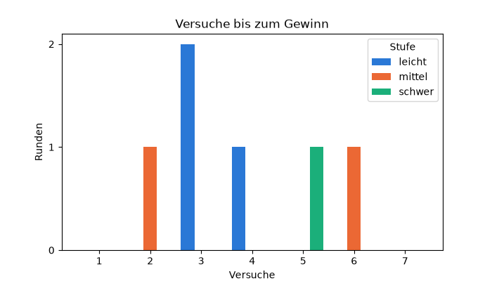
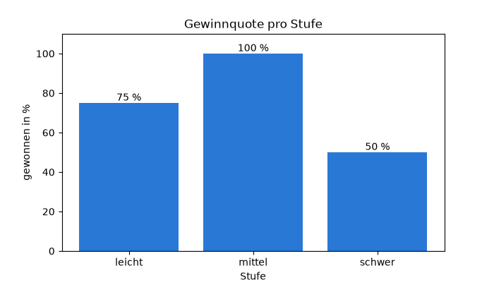
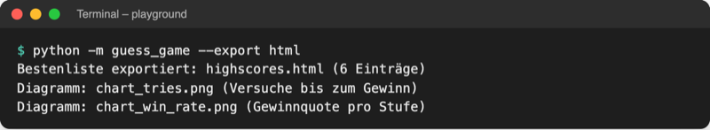
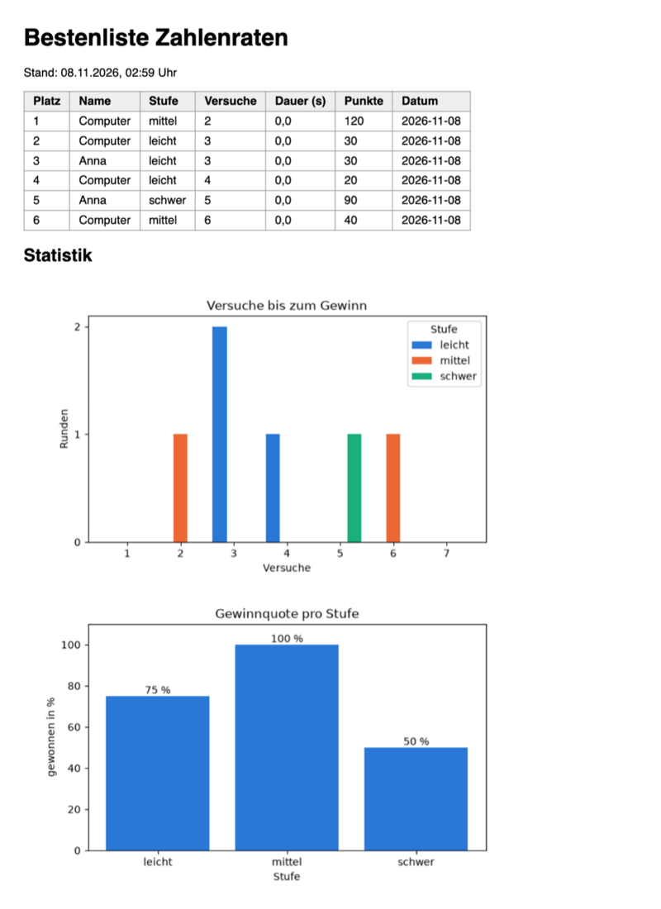
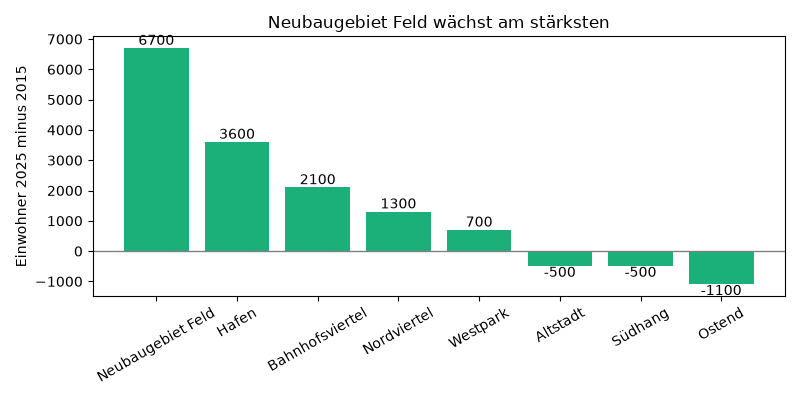

# Lab 19.3 – Lösung: Statistikseite mit Diagrammen

Fertiger Stand: [project/examples/m19-data-analysis/l03-matplotlib/](../../project/examples/m19-data-analysis/l03-matplotlib/) mit neu [guess_game/charts.py](../../project/examples/m19-data-analysis/l03-matplotlib/guess_game/charts.py) und geändertem `export.py`, `ui.py`, `__main__.py`. Daten wie in Lab 19.2 (acht Runden, sechs Gewinne).

## Aufgaben 1 bis 4: charts.py

```python
# Diagramme: wertet die Runden aus game.db aus und speichert sie als PNG
# Nur die Bilder erzeugen (ohne HTML): python -m guess_game.charts

import sqlite3
from pathlib import Path

import matplotlib.pyplot as plt
import pandas as pd
from matplotlib.ticker import MaxNLocator

from guess_game import storage

plt.switch_backend("Agg")  # nur Bilddateien, nie ein Fenster (auch ohne Bildschirm)

TRIES_CHART = Path("chart_tries.png")  # entstehen im aktuellen Ordner
WIN_RATE_CHART = Path("chart_win_rate.png")
TRIES_TITLE = "Versuche bis zum Gewinn"
WIN_RATE_TITLE = "Gewinnquote pro Stufe"

# feste Farbe pro Stufe, damit leicht in jedem Diagramm gleich aussieht
COLORS = {"leicht": "#2a78d6", "mittel": "#eb6834", "schwer": "#1baf7a"}


def load_rounds(path=storage.DB_FILE):
    """Lädt alle Runden aus der Tabelle rounds als DataFrame."""
    connection = sqlite3.connect(path)
    rounds = pd.read_sql("SELECT * FROM rounds", connection)
    connection.close()
    return rounds


def save_tries_chart(rounds, path=TRIES_CHART):
    """Histogramm: Wie viele Versuche brauchten die Gewinne, je Stufe?"""
    won = rounds[rounds["won"] == 1]  # nur gewonnene Runden
    levels = sorted(won["level"].unique())  # leicht, mittel, schwer
    data = [won[won["level"] == level]["tries"] for level in levels]
    colors = [COLORS.get(level, "gray") for level in levels]  # neue Stufe: grau
    bins = range(1, rounds["tries"].max() + 2)  # ein Balken pro Versuchszahl
    fig, ax = plt.subplots(figsize=(7, 4))  # Figure = Bild, Axes = Diagramm
    ax.hist(data, bins=bins, align="left", color=colors, label=levels)
    ax.set_title(TRIES_TITLE)
    ax.set_xlabel("Versuche")
    ax.set_ylabel("Runden")
    ax.yaxis.set_major_locator(MaxNLocator(integer=True))  # nur ganze Zahlen
    ax.legend(title="Stufe")
    fig.savefig(path, dpi=100)
    plt.close(fig)  # Speicher freigeben
    return path


def save_win_rate_chart(rounds, path=WIN_RATE_CHART):
    """Balkendiagramm: Anteil gewonnener Runden pro Stufe in Prozent."""
    rates = rounds.groupby("level")["won"].mean() * 100  # wie in analyze.py
    fig, ax = plt.subplots(figsize=(7, 4))
    bars = ax.bar(rates.index, rates.values, color=COLORS["leicht"])
    ax.bar_label(bars, fmt="%.0f %%")  # Wert über jedem Balken, z. B. 75 %
    ax.set_title(WIN_RATE_TITLE)
    ax.set_xlabel("Stufe")
    ax.set_ylabel("gewonnen in %")
    ax.set_ylim(0, 110)  # Platz für die Beschriftung über 100 %
    fig.savefig(path, dpi=100)
    plt.close(fig)
    return path


def save_charts(rounds):
    """Speichert beide Diagramme; gibt [(Datei, Titel), ...] zurück.

    Ohne gewonnene Runde gibt es nichts zu zeigen: leere Liste.
    """
    if rounds["won"].sum() == 0:
        return []
    return [
        (save_tries_chart(rounds), TRIES_TITLE),
        (save_win_rate_chart(rounds), WIN_RATE_TITLE),
    ]


if __name__ == "__main__":  # python -m guess_game.charts
    for path, title in save_charts(load_rounds()):
        print(f"Diagramm gespeichert: {path} ({title})")
```

| Aufgabe | Teil | Erklärung |
| --- | --- | --- |
| 1 | Imports, `switch_backend`, Konstanten, `load_rounds` | `"Agg"` direkt nach dem Import: Das Spiel öffnet nie ein Fenster. `COLORS` gibt jeder Stufe in jedem Diagramm dieselbe Farbe. |
| 2 | `save_win_rate_chart` | Mittelwert von `won` pro Stufe = Gewinnquote (Lab 19.2); `rates.index` sind die Stufen, `rates.values` die Prozentwerte. `set_ylim(0, 110)` lässt über 100 % Platz für die Beschriftung. |
| 3 | `save_tries_chart` | `rounds[rounds["won"] == 1]` filtert die Gewinne; die Liste `data` enthält eine Series pro Stufe, `hist` zeichnet sie nebeneinander. `MaxNLocator(integer=True)` verhindert halbe Runden auf der y-Achse. |
| 4 | `save_charts`, `__main__`-Block | `rounds["won"].sum() == 0`: keine Gewinne, kein Histogramm. `python -m guess_game.charts` startet das Modul im Paket direkt (wie `python -m guess_game`, Lab 6.1). |

```text
$ python -m guess_game.charts
Diagramm gespeichert: chart_tries.png (Versuche bis zum Gewinn)
Diagramm gespeichert: chart_win_rate.png (Gewinnquote pro Stufe)
```



_Quelle: eigene Ausgabe von `charts.py`, Kurs-Repo, 08.11.2026._



_Quelle: eigene Ausgabe von `charts.py`, Kurs-Repo, 08.11.2026._

Die Balken des Histogramms stehen leicht neben der Zahl, weil Matplotlib bei mehreren Reihen jeder Stufe einen eigenen Platz innerhalb des Bereichs gibt. Die Gewinnquote zählt auch verlorene Runden (wie `statistik`), das Histogramm nur Gewinne.

## Aufgabe 5: Diagramme im HTML-Export

`export.py`, neue Signatur und Abschnitt unter der Tabelle:

```python
def export_html(scores, charts=None, path=HTML_FILE):
    """Schreibt die Bestenliste als HTML-Tabelle in path und gibt path zurück.

    charts: [(Bilddatei, Titel), ...] aus charts.save_charts, darunter als Bilder.
    """
```

```python
    lines.append("</table>")
    if charts:  # Statistik mit Diagrammen; die PNG-Dateien liegen daneben
        lines.append("<h2>Statistik</h2>")
        for chart, title in charts:
            lines.append(f'<p></p>')
```

`__main__.py`: `charts` in den Import aufnehmen (`from guess_game import charts, export, logic, players, storage, ui`), dann:

```python
def run_export(args):
    """Speichert die Top 10 der Bestenliste als Datei, ohne zu spielen."""
    with storage.SqliteScoreboard("game.db") as board:
        scores = board.top(count=10)
    images = []  # Diagramme nur für die HTML-Seite
    if args.export == "excel":
        path = export.export_excel(scores)
    else:
        images = charts.save_charts(charts.load_rounds())  # PNG-Dateien
        path = export.export_html(scores, images)
    ui.show_export(path, len(scores), images)
    logger.info(f"Export: {len(scores)} Einträge nach {path}")
```

`ui.py`:

```python
def show_export(path, count, images):
    """Meldet, wohin die Bestenliste und die Diagramme exportiert wurden."""
    word = "Eintrag" if count == 1 else "Einträge"
    print(f"Bestenliste exportiert: {path} ({count} {word})")
    for image, title in images:
        print(f"Diagramm: {image} ({title})")
```

- `charts=None` als Standardwert: Ein Aufruf ohne Diagramme (wie in Lab 17.1) funktioniert weiter. `if charts:` ist bei `None` und bei `[]` falsch.
- `images = []` steht vor dem `if`: Auch der Excel-Zweig übergibt eine Liste an `show_export`, die Schleife läuft dann nicht.
- Der Parameter heißt in `export_html` `charts`, das Modul in `__main__.py` ebenfalls; in `export.py` ist das kein Konflikt, weil `export` das Modul `charts` nicht importiert.



_Quelle: eigener Screenshot, Kurs-Repo, 08.11.2026._



_Quelle: eigener Screenshot (Chromium), `highscores.html` aus dem Kurs-Repo, 08.11.2026._

Gegenproben:

```text
$ python -m guess_game --export excel
Bestenliste exportiert: highscores.xlsx (6 Einträge)
```

In einem Ordner mit leerer `game.db`: `Bestenliste exportiert: highscores.html (0 Einträge)`, keine Diagramm-Zeile, die Seite zeigt „Noch keine Einträge.“ und keinen Statistik-Abschnitt.

## Erweiterung

```python
# Zuwachs der Einwohner 2015 -> 2025 pro Stadtteil als Balkendiagramm
# Start im Ordner playground/: python growth.py

import matplotlib.pyplot as plt
import pandas as pd

plt.switch_backend("Agg")

population = pd.read_csv("../data/population.csv")
population["Zuwachs"] = population["Einwohner_2025"] - population["Einwohner_2015"]
population = population.sort_values("Zuwachs", ascending=False)

fig, ax = plt.subplots(figsize=(8, 4))
bars = ax.bar(population["Stadtteil"], population["Zuwachs"], color="#1baf7a")
ax.bar_label(bars)
ax.axhline(0, color="gray", linewidth=1)  # Nulllinie: darunter = weniger Einwohner
ax.set_title("Neubaugebiet Feld wächst am stärksten")
ax.set_ylabel("Einwohner 2025 minus 2015")
ax.tick_params(axis="x", labelrotation=30)
fig.tight_layout()
fig.savefig("growth.png", dpi=100)
plt.close(fig)
print("Gespeichert: growth.png")
```



_Quelle: eigene Ausgabe von `growth.py`, Kurs-Repo, 08.11.2026 (erfundene Daten)._

Die neue Spalte entsteht mit einer Rechnung für alle Zeilen (Lab 19.2). Negative Balken zeigen nach unten; `axhline(0)` zeichnet die Nulllinie, damit Wachstum und Rückgang auf einen Blick zu trennen sind.
