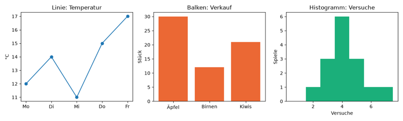
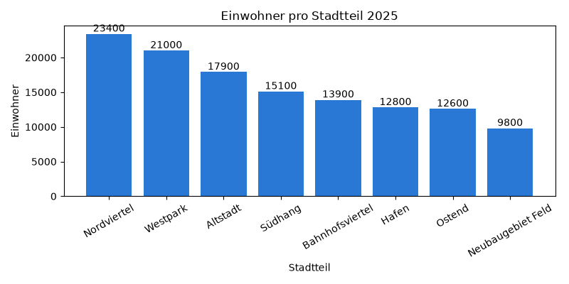
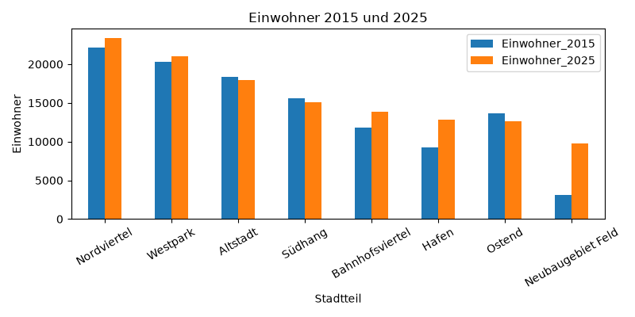
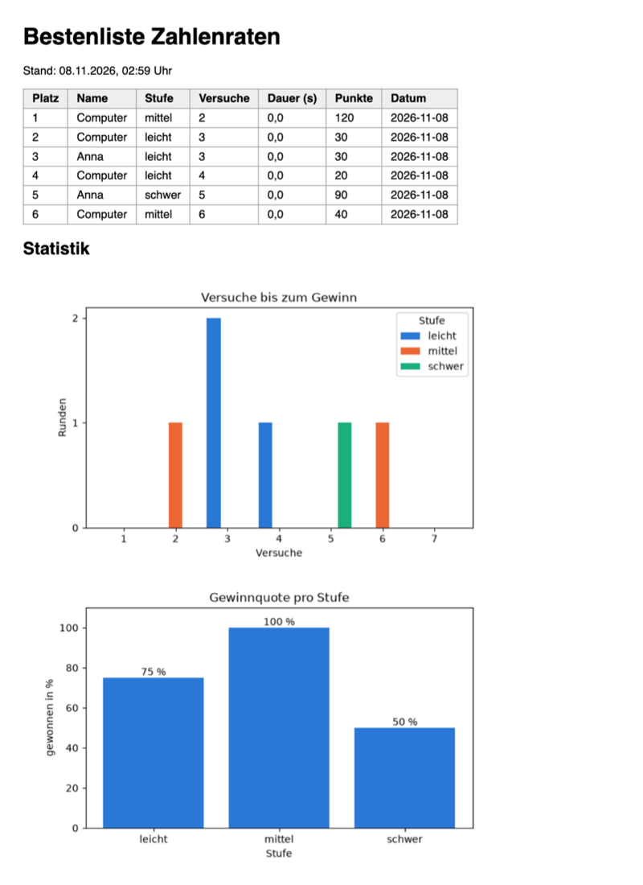

# Lab 19.3: Diagramme

**Leitfragen:**

<details>
<summary>Welche Aussage über die Spiele soll ein Diagramm auf einen Blick zeigen?</summary>

Zum Beispiel „Auf schwer gewinnt nur jede zweite Runde“ oder „Die meisten Gewinne brauchen drei bis vier Versuche“. Jede Aussage bekommt ihr eigenes Diagramm: Gewinnquote als Balken pro Stufe, Versuche als Verteilung.

</details>

<details>
<summary>Wann ist eine Tabelle besser als ein Diagramm?</summary>

Wenn genaue Werte nachgeschlagen werden (Platz 3 der Bestenliste, Datum, Name) oder es nur wenige Zahlen sind. Ein Diagramm lohnt sich, wenn ein Muster sichtbar werden soll: Unterschiede, Verläufe, Häufungen.

</details>

- **Matplotlib** ist die verbreitetste Bibliothek für Diagramme in Python (seit 2003, Lab 19.2). Matplotlib zeichnet Linien, Balken, Histogramme und vieles mehr und speichert sie als Bilddatei.
- Dieses Lab baut Diagramme Schritt für Schritt, speichert sie als PNG und bindet zwei davon in die HTML-Bestenliste des Spiels ein (Lab 17.1).

## Begriffe

| Begriff | Bedeutung |
| --- | --- |
| `matplotlib.pyplot` (`plt`) | Teil von Matplotlib, der Diagramme anlegt; Kurzname `plt` ist üblich |
| Figure | das ganze Bild, wie ein Blatt Papier |
| Axes | ein Diagramm auf dem Blatt, mit Achsen, Titel und Daten; ein Figure kann mehrere enthalten |
| `plt.subplots()` | legt Figure und Axes an: `fig, ax = plt.subplots()` |
| Liniendiagramm (`plot`) | Punkte, verbunden zu einer Linie: Verlauf über die Zeit |
| Balkendiagramm (`bar`) | ein Balken pro Kategorie: Werte vergleichen |
| Histogramm (`hist`) | zählt, wie oft Werte in Bereiche (`bins`) fallen: Verteilung zeigen |
| Legende | Kasten, der erklärt, welche Farbe welche Datenreihe ist |
| `savefig` | speichert das Figure als Bilddatei (PNG); `dpi` = Bildpunkte pro Zoll |
| Backend | Teil von Matplotlib, der zeichnet: in ein Fenster oder nur in eine Datei (`"Agg"`) |
| `DataFrame.plot` | Abkürzung von pandas: zeichnet eine Tabelle direkt mit Matplotlib |

## Figure und Axes

Ein Diagramm entsteht in vier Schritten: Blatt und Diagramm anlegen, Daten zeichnen, beschriften, speichern. Datei: [code/m19-data-analysis/chart_types.py](../../project/code/m19-data-analysis/chart_types.py) legt **ein** Figure mit **drei** Axes an, eins pro Diagrammart:

```python
import matplotlib.pyplot as plt

plt.switch_backend("Agg")  # nur Bilddateien speichern, kein Fenster öffnen

# Figure = das ganze Bild, Axes = ein Diagramm darin; hier 1 Zeile, 3 Diagramme
fig, (ax_line, ax_bar, ax_hist) = plt.subplots(1, 3, figsize=(12, 3.6))

ax_line.plot(days, temperatures, marker="o")  # Linie: Verlauf über die Zeit
ax_bar.bar(fruits, sold, color="#eb6834")  # Balken: Kategorien vergleichen
ax_hist.hist(tries, bins=range(1, 9), align="left", color="#1baf7a")  # Verteilung

fig.tight_layout()  # Abstände automatisch, nichts überlappt
fig.savefig("chart_types.png", dpi=100)
plt.close(fig)
```



_Quelle: eigene Ausgabe von `chart_types.py`, Kurs-Repo, 08.11.2026._

| Diagramm | Methode | zeigt | Beispiel |
| --- | --- | --- | --- |
| Linie | `ax.plot(x, y)` | Verlauf, Entwicklung | Temperatur pro Tag, Spiele pro Woche |
| Balken | `ax.bar(kategorien, werte)` | Vergleich von Kategorien | Umsatz pro Region, Gewinnquote pro Stufe |
| Histogramm | `ax.hist(werte, bins=...)` | Verteilung: wie oft kommt was vor | Versuche pro Spiel, Körpergrößen |

- `bins=range(1, 9)` legt die Bereiche fest: 1, 2, … 8, also ein Balken pro ganzer Zahl. `align="left"` setzt den Balken genau über die Zahl.
- Ein Histogramm bekommt die **Rohwerte** und zählt selbst; ein Balkendiagramm bekommt schon fertige Werte.

## Balkendiagramm Schritt für Schritt

Datei: [code/m19-data-analysis/population_bar.py](../../project/code/m19-data-analysis/population_bar.py), Daten: [data/population.csv](../../project/data/population.csv) (Einwohner der acht Stadtteile einer erfundenen Stadt, 2015 und 2025).

```python
population = pd.read_csv("data/population.csv")
population = population.sort_values("Einwohner_2025", ascending=False)

fig, ax = plt.subplots(figsize=(8, 4))  # Breite und Höhe in Zoll
bars = ax.bar(population["Stadtteil"], population["Einwohner_2025"], color="#2a78d6")
ax.bar_label(bars)  # Zahl über jedem Balken
ax.set_title("Einwohner pro Stadtteil 2025")
ax.set_xlabel("Stadtteil")
ax.set_ylabel("Einwohner")
ax.tick_params(axis="x", labelrotation=30)  # lange Namen schräg stellen
fig.tight_layout()
fig.savefig("population_bar.png", dpi=100)  # 8 x 4 Zoll x 100 dpi = 800 x 400 Pixel
plt.close(fig)
```



_Quelle: eigene Ausgabe von `population_bar.py`, Kurs-Repo, 08.11.2026 (erfundene Daten)._

Ein Diagramm, eine Aussage: Hier lautet sie „Nordviertel und Westpark sind die größten Stadtteile“. Sortierte Balken, ein Titel, der die Aussage nennt, und beschriftete Achsen machen sie ohne Erklärung lesbar.

## Abkürzung: DataFrame.plot

pandas kann einen DataFrame direkt zeichnen; im Hintergrund arbeitet Matplotlib. Das Ergebnis ist ein Axes, das sich wie oben weiter beschriften und speichern lässt:

```python
ax = population.plot(
    x="Stadtteil",
    y=["Einwohner_2015", "Einwohner_2025"],
    kind="bar",
    rot=30,  # Beschriftung der x-Achse um 30 Grad drehen
    figsize=(8, 4),
    title="Einwohner 2015 und 2025",
)
ax.set_ylabel("Einwohner")
ax.figure.savefig("population_compare.png", dpi=100)  # ax.figure = das Figure dazu
```



_Quelle: eigene Ausgabe von `population_bar.py`, Kurs-Repo, 08.11.2026 (erfundene Daten)._

Für schnelle Blicke in die Daten ist `DataFrame.plot` ideal; für ein Diagramm mit festen Farben und eigenen Beschriftungen ist der Weg über `fig, ax` übersichtlicher.

## Speichern statt anzeigen

| Befehl | Wirkung |
| --- | --- |
| `plt.switch_backend("Agg")` | zeichnet nur in Dateien; läuft auch ohne Bildschirm (Server, Zeitplaner) |
| `fig.savefig("bild.png", dpi=100)` | speichert das Figure; die Endung bestimmt das Format (`.png`, `.svg`, `.pdf`) |
| `plt.close(fig)` | gibt den Speicher frei; wichtig, wenn ein Programm viele Bilder erzeugt |
| `plt.show()` | öffnet ein Fenster (nicht mit `"Agg"`); in Skripten dieses Kurses nicht genutzt |

Beim allerersten Import nach der Installation meldet Matplotlib einmalig `Matplotlib is building the font cache; this may take a moment.` Das ist kein Fehler.

## Im Spiel: Statistikseite mit zwei Diagrammen

Das Paket bekommt ein neues Modul `guess_game/charts.py`. Es lädt `rounds` aus `game.db` wie `analyze.py` (Lab 19.2) und speichert zwei Bilder neben die HTML-Datei:

| Datei | Diagramm | Aussage |
| --- | --- | --- |
| `chart_tries.png` | Histogramm „Versuche bis zum Gewinn“, eine Farbe pro Stufe | wie viele Versuche ein Gewinn meist braucht |
| `chart_win_rate.png` | Balken „Gewinnquote pro Stufe“ | wie schwer jede Stufe wirklich ist |

`python -m guess_game.charts` speichert nur die zwei PNG-Dateien, ohne HTML. Neu gegenüber den Demos: Das Histogramm zeigt nur gewonnene Runden und zeichnet drei Datenreihen auf einmal.

```python
won = rounds[rounds["won"] == 1]  # nur gewonnene Runden
levels = sorted(won["level"].unique())  # leicht, mittel, schwer
data = [won[won["level"] == level]["tries"] for level in levels]
```

- `unique()` liefert jeden Wert einer Spalte nur einmal; `sorted` macht daraus eine Liste in fester Reihenfolge.
- `ax.hist(data, ..., label=levels)` mit einer **Liste** von Reihen zeichnet die Balken der Stufen nebeneinander; `ax.legend(title="Stufe")` erklärt die Farben.
- `ax.bar_label(bars, fmt="%.0f %%")` schreibt `75 %` über den Balken: `%.0f` = Zahl ohne Nachkommastelle, `%%` = das Prozentzeichen selbst.

`export_html` und die Option `--export html` stammen aus Lab 17.1; jeder Starter enthält sie. `export_html` bekommt die Liste `[(Datei, Titel), ...]` und hängt unter die Tabelle einen Abschnitt mit ``-Elementen an:

```python
    if charts:  # Statistik mit Diagrammen; die PNG-Dateien liegen daneben
        lines.append("<h2>Statistik</h2>")
        for chart, title in charts:
            lines.append(f'<p></p>')
```

`` ist ein relativer Pfad: Der Browser sucht das Bild im selben Ordner wie `highscores.html`. Wer die Seite weitergibt, gibt die zwei PNG-Dateien mit.



_Quelle: eigener Screenshot (Chromium), `highscores.html` aus dem Kurs-Repo, 08.11.2026._

## Typische Fehler

| Symptom | Ursache | Lösung |
| --- | --- | --- |
| Skript hängt, ein Fenster öffnet sich, keine Datei | `plt.show()` statt `savefig` | `plt.switch_backend("Agg")`, `fig.savefig(...)` |
| `FileNotFoundError: … 'bilder/chart.png'` | Zielordner existiert nicht; `savefig` legt keine Ordner an | Ordner vorher anlegen (`Path.mkdir`, Lab 14.3) oder ohne Ordner speichern |
| Achsenbeschriftung abgeschnitten oder überlappt | Platz nicht angepasst | `fig.tight_layout()` vor `savefig`, lange Namen drehen |
| y-Achse zeigt `0.5`, `1.5` Runden | Matplotlib wählt Kommazahlen | `ax.yaxis.set_major_locator(MaxNLocator(integer=True))` |
| HTML zeigt ein kaputtes Bild-Symbol | PNG liegt nicht neben `highscores.html` | Bilder in denselben Ordner, relativen Pfad prüfen |
| `ModuleNotFoundError: No module named 'matplotlib'` | `.venv` nicht aktiv oder Pakete nicht installiert | `.venv` aktivieren, `pip install -r requirements.txt` |
| Diagramm zeigt Stufen in zufälliger Reihenfolge | `unique()` gibt die Reihenfolge des Auftretens | `sorted(...)` |

## Vertiefung

- Aufbau eines Figures mit allen Teilen (Titel, Ticks, Gitter, Legende): [Matplotlib, „Anatomy of a figure“](https://matplotlib.org/stable/gallery/showcase/anatomy.html); Galerie mit Beispielen zu jeder Diagrammart: [matplotlib.org/stable/gallery](https://matplotlib.org/stable/gallery/index.html). Stand: 08.11.2026, Matplotlib 3.11.2.
- seaborn baut auf Matplotlib auf und liefert statistische Diagramme mit schönen Standardfarben in einer Zeile.
- Das Bild lässt sich auch direkt in die HTML-Datei einbetten (Base64), dann reicht eine einzige Datei zum Weitergeben.

## Fazit

- Ein Diagramm entsteht in vier Schritten: `fig, ax = plt.subplots()`, Daten zeichnen (`plot`, `bar`, `hist`), beschriften, `savefig`.
- Linie für Verläufe, Balken für Vergleiche, Histogramm für Verteilungen; ein Diagramm trägt eine Aussage.
- Mit dem Backend `"Agg"` entstehen PNG-Dateien ohne Fenster, die sich in HTML-Seiten einbinden lassen.

In der Übung bekommt das Spiel `charts.py`, und `--export html` erzeugt die Statistikseite mit zwei Diagrammen.
