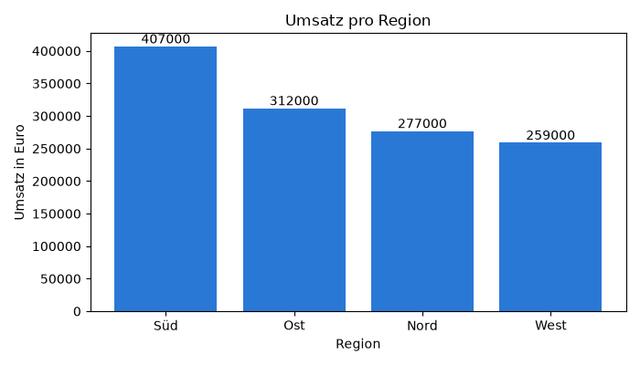
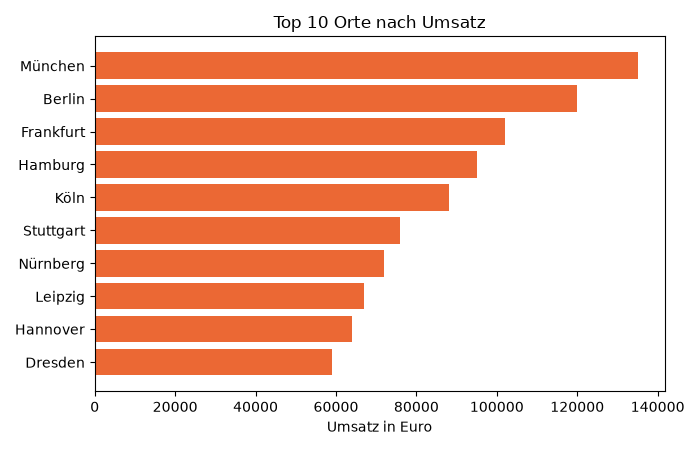

# Modul 19 – Transferlösung: Umsatzbericht

Vollständige Lösung für `playground/sales_report.py`. Die Aufgaben sind im Code mit Kommentaren markiert; danach folgen die Testläufe. Der Aufbau folgt `analyze.py` (Lab 19.2) und `charts.py` (Lab 19.3): laden → zusammenfassen → ausgeben und speichern.

## Vollständiges Skript

```python
# Umsatzbericht: wertet data/umsatz_pro_ort.csv mit pandas aus und speichert
# eine Tabelle (Excel) und ein Diagramm (PNG)
# Start im Ordner project/: python playground/sales_report.py

import sys
from pathlib import Path

import matplotlib.pyplot as plt
import pandas as pd

plt.switch_backend("Agg")  # nur Bilddatei, kein Fenster

CSV_FILE = Path("data/umsatz_pro_ort.csv")
EXCEL_FILE = Path("umsatz_regionen.xlsx")
CHART_FILE = Path("umsatz_regionen.png")


# Aufgabe 1: laden und prüfen
def load_sales(path=CSV_FILE):
    """Lädt die Umsätze als DataFrame; ohne Datei endet das Skript mit Exit 1."""
    if not path.exists():
        print(f"{path} nicht gefunden. Start im Ordner project/?")
        sys.exit(1)
    return pd.read_csv(path)


# Aufgabe 2 und 3: Kennzahlen pro Region
def region_summary(sales):
    """Orte, Summe, Durchschnitt, Median und Anteil pro Region, größte Summe zuerst."""
    groups = sales.groupby("Region")
    summary = pd.DataFrame(
        {
            "Orte": groups["Umsatz"].count(),
            "Summe": groups["Umsatz"].sum(),
            "Durchschnitt": groups["Umsatz"].mean().round(),
            "Median": groups["Umsatz"].median(),
        }
    )
    # Aufgabe 3: Anteil am Gesamtumsatz, eine Rechnung für alle Zeilen
    summary["Anteil %"] = (summary["Summe"] / sales["Umsatz"].sum() * 100).round(1)
    return summary.sort_values("Summe", ascending=False)


# Aufgabe 4: Diagramm
def save_chart(summary, path=CHART_FILE):
    """Balkendiagramm: Umsatz-Summe pro Region, Wert über jedem Balken."""
    fig, ax = plt.subplots(figsize=(7, 4))
    bars = ax.bar(summary.index, summary["Summe"], color="#2a78d6")
    ax.bar_label(bars)
    ax.set_title("Umsatz pro Region")
    ax.set_xlabel("Region")
    ax.set_ylabel("Umsatz in Euro")
    fig.tight_layout()
    fig.savefig(path, dpi=100)
    plt.close(fig)
    return path


def main():
    sales = load_sales()
    print(f"{len(sales)} Orte aus {CSV_FILE}, Spalten: {list(sales.columns)}")
    print(sales.head(3))
    summary = region_summary(sales)
    print("\nUmsatz pro Region:")
    print(summary)
    print(f"\nStärkste Region: {summary.index[0]}")
    # Aufgabe 5: Tabelle als Excel-Datei
    summary.to_excel(EXCEL_FILE)  # Index (Region) wird die erste Spalte
    print(f"Gespeichert: {EXCEL_FILE}, {save_chart(summary)}")


if __name__ == "__main__":
    main()
```

## Aufgabe 1: Laden

- `path.exists()` vor `pd.read_csv`: Ohne die Prüfung endet das Skript mit einem `FileNotFoundError`-Traceback statt mit einer verständlichen Meldung.
- Der Pfad `data/umsatz_pro_ort.csv` ist relativ zum aktuellen Ordner (Lab 8.1); deshalb startet das Skript im Ordner `project/`.

## Aufgaben 2 und 3: Zusammenfassung pro Region

- `groupby("Region")` einmal, dann vier Kennzahlen als Spalten eines neuen DataFrame (wie `summary` in `analyze.py`).
- `summary["Summe"] / sales["Umsatz"].sum() * 100` teilt jede Regionssumme durch den Gesamtumsatz: eine Rechnung für alle Zeilen, ohne Schleife.
- Nach `sort_values` steht die größte Region oben; `summary.index[0]` ist ihr Name.

## Testlauf

```text
$ python playground/sales_report.py
20 Orte aus data/umsatz_pro_ort.csv, Spalten: ['Ort', 'Region', 'Umsatz']
       Ort Region  Umsatz
0   Berlin    Ost  120000
1  Hamburg   Nord   95000
2  München    Süd  135000

Umsatz pro Region:
        Orte   Summe  Durchschnitt   Median  Anteil %
Region
Süd        6  407000       67833.0  59000.0      32.4
Ost        5  312000       62400.0  59000.0      24.9
Nord       5  277000       55400.0  45000.0      22.1
West       4  259000       64750.0  62000.0      20.6

Stärkste Region: Süd
Gespeichert: umsatz_regionen.xlsx, umsatz_regionen.png
```

## Aufgabe 4: Diagramm



_Quelle: eigene Ausgabe von `sales_report.py`, Kurs-Repo, 08.11.2026 (erfundene Daten)._

Die Reihenfolge der Balken kommt aus dem sortierten DataFrame: `summary.index` sind die Regionen in der Reihenfolge der Tabelle.

## Aufgabe 5: Excel-Datei und Fehlerfall

Inhalt von `umsatz_regionen.xlsx` (gelesen mit `openpyxl`):

| Region | Orte | Summe | Durchschnitt | Median | Anteil % |
| --- | --- | --- | --- | --- | --- |
| Süd | 6 | 407000 | 67833 | 59000 | 32.4 |
| Ost | 5 | 312000 | 62400 | 59000 | 24.9 |
| Nord | 5 | 277000 | 55400 | 45000 | 22.1 |
| West | 4 | 259000 | 64750 | 62000 | 20.6 |

`to_excel` schreibt den Index (die Region) als erste Spalte und lässt Zahlen als Zahlen stehen; Excel kann damit weiterrechnen.

```text
$ cd playground
$ python sales_report.py
data/umsatz_pro_ort.csv nicht gefunden. Start im Ordner project/?
$ echo $?
1
```

## Erweiterung

Neue Funktion in `sales_report.py`, in `main()` nach `save_chart` mit `save_top10(sales)` aufgerufen:

```python
def save_top10(sales, path=Path("umsatz_top10.png")):
    """Waagrechte Balken: die zehn Orte mit dem höchsten Umsatz, der größte oben."""
    top = sales.sort_values("Umsatz").tail(10)  # aufsteigend: größter Balken oben
    fig, ax = plt.subplots(figsize=(7, 4.5))
    ax.barh(top["Ort"], top["Umsatz"], color="#eb6834")  # barh = waagrechte Balken
    ax.set_title("Top 10 Orte nach Umsatz")
    ax.set_xlabel("Umsatz in Euro")
    fig.tight_layout()
    fig.savefig(path, dpi=100)
    plt.close(fig)
    return path
```



_Quelle: eigene Ausgabe, Kurs-Repo, 08.11.2026 (erfundene Daten)._

`barh` zeichnet den ersten Wert unten. Deshalb wird aufsteigend sortiert und mit `tail(10)` das obere Ende genommen: So steht der größte Umsatz oben.
