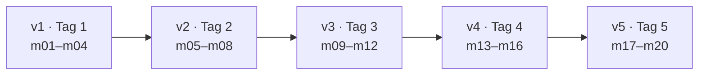

# Cheatsheet Kursabschluss: Python in fünf Tagen

## Ein Spiel, fünf Ausbaustufen

| Stand | Module | Was dazukam |
| --- | --- | --- |
| v1 | m02 Grundlagen, m03 Kontrollfluss, m04 Datensammlungen | Zufallszahl, „zu hoch / zu niedrig“, begrenzte Versuche, Liste der Tipps, drei Stufen als Dictionary |
| v2 | m05 Funktionen, m06 Module, m07 Fehler, m08 Dateien | Funktionen und Paket `guess_game/`, farbig mit `rich`, kein Absturz bei „abc“, Spieldauer, Bestenliste in JSON, Verlauf in CSV |
| v3 | m09–m11 Objektorientierung, m12 Funktional | Klassen `Game`, `Score` (Dataclass, sortierbar), `HumanPlayer`/`ComputerPlayer`, Statistik per Comprehension, Runden als Generator |
| v4 | m13 Pythonic, m14 Scripting, m15 System, m16 Automatisierung | `python -m guess_game --level …`, Befehle per `match`, `@timed`, `with`-Bestenliste, `game.log`, `--backup`, `log_report.py` |
| v5 | m17 Datenformate, m18 SQLite, m19 Datenanalyse, m20 Abschluss | Stufen aus `levels.xml`, `--export html/excel`, `speichern`/`--resume` (pickle), `game.db`, `statistik`, `analyze.py`, Diagramme, README |

## Wohin mit Daten?

| Speicherort | Lab | Rolle im Spiel | Grenze, die zur nächsten Stufe führt |
| --- | --- | --- | --- |
| Variable | 2.2 | Geheimzahl, aktueller Tipp | weg nach Programmende, nur ein Wert |
| Liste / Set / Dictionary | 4.1–4.3 | bisherige Tipps, Stufen | weg nach Programmende |
| Textdatei / JSON / CSV | 8.1–8.3 | Bestenliste, Spielverlauf | Daten ohne Verhalten, Abfragen nur per Schleife |
| Objekt (Klasse) | 9.2 ff. | `Game`, `Score`, `Player` mit Verhalten | lebt nur im Speicher |
| pickle | 17.3 | laufendes Spiel speichern, `--resume` | nur Python, unsicher bei fremden Dateien |
| SQLite | 18.1–18.3 | `game.db`: Bestenliste und alle Runden, abfragbar | – (Endstand des Kurses) |

## Wann was?

| Werkzeug | Einsatz | Modul |
| --- | --- | --- |
| Funktion | wiederkehrende Logik ohne eigenen Zustand | m05 |
| Modul / Paket | Code auf Dateien und Ordner verteilen | m06 |
| Klasse | Daten und Verhalten gehören zusammen | m09–m11 |
| Decorator | Verhalten um viele Funktionen legen (Zeit, Logging) | m13 |
| Skript mit `argparse` | Start aus der Kommandozeile und aus Automatisierungen | m14 |

## Setup

| Befehl | Wirkung |
| --- | --- |
| `python -m venv .venv` | virtuelle Umgebung anlegen (macOS/Linux vorher: `python3`) |
| `.venv\Scripts\Activate.ps1` | aktivieren, Windows PowerShell |
| `source .venv/bin/activate` | aktivieren, macOS/Linux |
| `pip install -r requirements.txt` | alle Pakete aus der Liste installieren |
| `pip list` / `pip show rich` | installierte Pakete / Details zu einem Paket |
| `deactivate` | venv verlassen |

## Python ausführen

| Befehl | Wirkung |
| --- | --- |
| `python` | interaktiver Modus (REPL), Ende mit `exit` |
| `python datei.py` | Skript ausführen |
| `python -m guess_game` | Paket mit `__main__.py` starten (im Ordner darüber) |
| `python -m guess_game.charts` | einzelnes Modul eines Pakets starten |
| `python skript.py --help` | Optionen eines argparse-Skripts anzeigen |
| `$LASTEXITCODE` / `echo $?` | Exit-Code des letzten Befehls (PowerShell / macOS, Linux) |
| Strg+C | laufendes Programm abbrechen |

## Spiel v5

| Befehl | Wirkung |
| --- | --- |
| `python -m guess_game --name Anna --level schwer --player mensch` | ohne Rückfragen starten |
| `hilfe`, `stufe schwer`, `bestenliste`, `statistik`, `speichern`, `quit` | Befehle statt Tipp |
| `python -m guess_game --resume` | gespeichertes Spiel fortsetzen |
| `python -m guess_game --export html` | `highscores.html` mit zwei Diagrammen |
| `python -m guess_game --export excel` | `highscores.xlsx` |
| `python -m guess_game --backup --dry-run` | zeigen, was gesichert würde |
| `python -m guess_game --verbose` | Log auch im Terminal |

## Skripte neben dem Paket

| Befehl | Wirkung |
| --- | --- |
| `python log_report.py . --since 2026-11-01` | Bericht aus `game*.log` in `report.txt` |
| `python migrate_json.py` | alte `highscores.json` nach `game.db` |
| `python import_log.py` | Runden aus `game.log` in Tabelle `log_rounds` |
| `python analyze.py` | Auswertung mit pandas |
| `python two_players.py --level leicht` | Wahlaufgabe Zwei-Personen-Modus (Lab 20.1) |

## Daten und Netz

| Befehl | Wirkung |
| --- | --- |
| `python -m sqlite3 game.db` | SQLite-Shell, Ende mit `.quit` |
| `python -m sqlite3 game.db "SELECT * FROM rounds"` | eine Abfrage ausführen |
| `python -m http.server 8000 --bind 127.0.0.1` | aktuellen Ordner lokal im Browser freigeben |
| `python fetch_scores.py` | Bestenliste per HTTP abrufen |

## Projekt fertigstellen

| Datei | Inhalt |
| --- | --- |
| `README.md` | Titel, Kurzbeschreibung, Voraussetzungen, Installation, Start, Werkzeuge |
| `requirements.txt` | gepinnte Pakete, z. B. `pandas==3.1.1` |
| `.gitignore` | `.venv/`, `__pycache__/`, alle erzeugten Spieldateien |
| `pyproject.toml` | Standard für installierbare Projekte; `pip install .` |
| `test_*.py` | Tests für `pytest` (Ausblick, Lab 20.2) |
