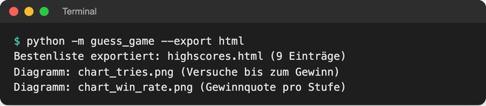
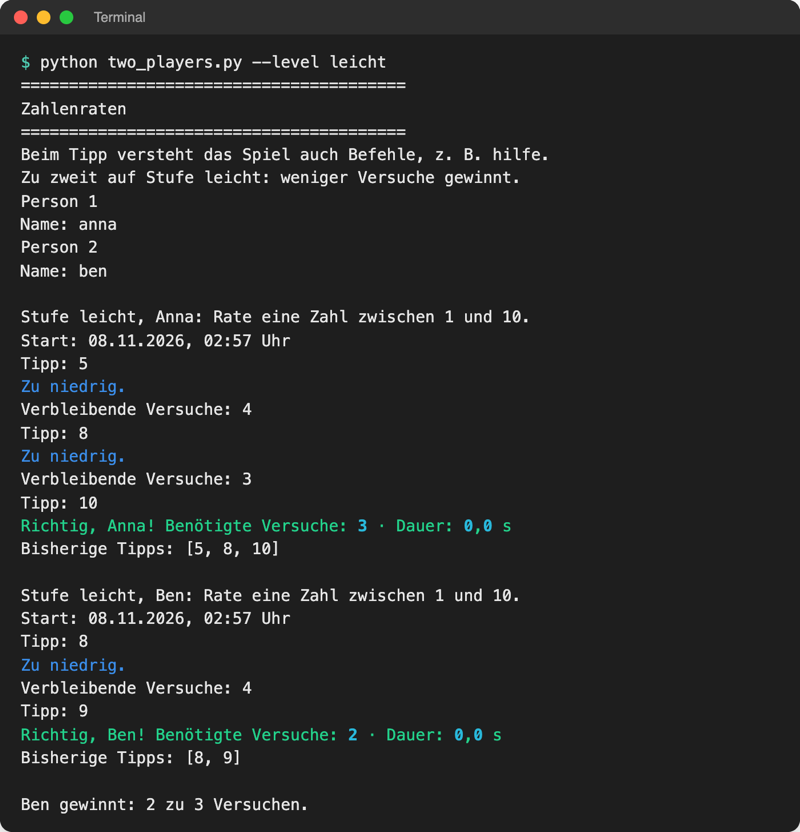
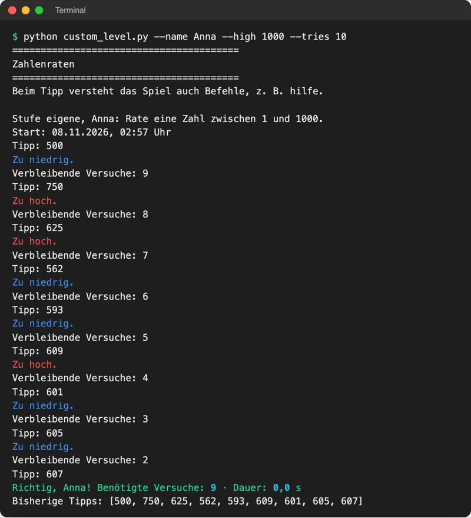

# Lab 20.1 – Lösung: Spiel v5 fertigstellen

Fertiger Stand (Spiel v5): [project/examples/m20-final-project/l01-game-v5/](../../project/examples/m20-final-project/l01-game-v5/) mit `guess_game/` (Code wie Lab 19.3), den Skripten neben dem Paket und neu [README.md](../../project/examples/m20-final-project/l01-game-v5/README.md), [requirements.txt](../../project/examples/m20-final-project/l01-game-v5/requirements.txt) und `.gitignore`. Die Pflicht (Aufgaben 1–3) ist dort vollständig geprüft. Referenzlösungen für zwei Wahlaufgaben: [code/m20-final-project/](../../project/code/m20-final-project/).

## Aufgabe 1: Spielen und in SQLite prüfen

Eine gewonnene Runde auf Stufe leicht; danach:

```text
$ python -m sqlite3 game.db "SELECT name, level, tries, won FROM rounds"
('Anna', 'leicht', 3, 1)
```

`python -m sqlite3` (Lab 18.1) nimmt die Abfrage als zweites Argument und beendet sich danach. Jede Runde, auch eine verlorene, steht in `rounds`; nur Gewinne zusätzlich in `scores` (Lab 18.2). Eine mit `quit` beendete Runde fehlt absichtlich.

## Aufgabe 2: HTML-Export



_Quelle: eigener Screenshot (echte Ausgabe in einer Kopie von l01-game-v5 nach elf Runden), Kurs-Repo, 08.11.2026._

Die Seite im Browser zeigt Tabelle und Diagramme wie im Bild der Theorie. Die Zahl der Einträge hängt von den eigenen Runden ab; die Tabelle zeigt höchstens die Top 10. Beim allerersten Export erscheint einmalig `Matplotlib is building the font cache; this may take a moment.`

## Aufgabe 3: requirements.txt und README

`requirements.txt`: die Pakete, die das Paket und die Skripte importieren. Für den Pflichtteil reichen vier; `requests` nur, wenn `fetch_scores.py` mitkommt.

```text
rich==15.0.0
openpyxl==3.1.5
pandas==3.1.1
matplotlib==3.11.2
```

Eine knappe README, die alle Abschnitte erfüllt (ausführliche Fassung: README von v5):

````markdown
# Zahlenraten

Zahlenratespiel im Terminal mit Bestenliste in SQLite und HTML-Export mit Diagrammen.

## Voraussetzungen

Python 3.14, Pakete aus `requirements.txt`.

## Installation

Im Ordner, der `guess_game/` enthält:

```bash
python -m venv .venv
.venv\Scripts\Activate.ps1          # Windows (PowerShell)
source .venv/bin/activate           # macOS/Linux
pip install -r requirements.txt
```

## Spielen

```bash
python -m guess_game
python -m guess_game --name Anna --level schwer --player mensch
python -m guess_game --help
```

## Werkzeuge

| Befehl | Ergebnis |
| --- | --- |
| `python -m guess_game --export html` | `highscores.html` mit Diagrammen |
| `python -m guess_game --export excel` | `highscores.xlsx` |
| `python -m guess_game --backup` | Kopie der Spieldateien in `backups/` |
````

Prüfung: Jeder Befehl wurde einmal kopiert und ausgeführt. Typische Lücken beim Test: Aktivierungszeile nur für ein Betriebssystem, Hinweis „im Ordner, der `guess_game/` enthält“ fehlt, `requirements.txt` ohne `matplotlib` (`ModuleNotFoundError` erst beim Export).

## Aufgabe 4: Wahlaufgaben

### Zwei-Personen-Modus (Referenzlösung)

Datei: [code/m20-final-project/two_players.py](../../project/code/m20-final-project/two_players.py). Das Skript ändert das Paket nicht, sondern nutzt es; deshalb liegt es neben `guess_game/`. Zum Ausprobieren nach `playground/` kopieren und dort starten.

```python
def play_turn(name, board, level):
    """Spielt eine Runde für name und speichert sie; None bei quit/speichern."""
    game = logic.Game(players.HumanPlayer(name), board, level)
    score = ui.play_round(game)  # eigene Geheimzahl pro Person
    ui.show_result(game, score)
    if game.stopped:  # quit oder speichern: Runde zählt nicht
        return None
    board.add_round(score)  # jede Runde in die Tabelle rounds
    game.save_score(score)  # ein Gewinn zusätzlich in scores
    return score


def winner_text(first, second):
    """Vergleicht zwei Scores: Gewinn vor Verlust, dann weniger Versuche."""
    if not first.won and not second.won:
        return "Niemand hat die Zahl gefunden: unentschieden."
    if first.won and not second.won:
        return f"{first.name} gewinnt: nur {first.name} hat die Zahl gefunden."
    if second.won and not first.won:
        return f"{second.name} gewinnt: nur {second.name} hat die Zahl gefunden."
    # beide gewonnen: Score.__lt__ vergleicht Versuche, dann Zeit (Lab 11.1)
    if first < second:
        return f"{first.name} gewinnt: {first.tries} zu {second.tries} Versuchen."
    if second < first:
        return f"{second.name} gewinnt: {second.tries} zu {first.tries} Versuchen."
    return f"Unentschieden: beide brauchten {first.tries} Versuche."
```

`main()` fragt zwei Namen mit `ui.ask_name()`, öffnet `game.db` mit `with storage.SqliteScoreboard("game.db") as board:` und ruft `play_turn` für beide auf. Wiederverwendet werden `Game`, `HumanPlayer`, `play_round` (inklusive `@timed` und Befehlsmenü), `show_result`, `SqliteScoreboard` und der Vergleich `<` aus `Score.__lt__`.



_Quelle: eigener Screenshot, Kurs-Repo, 08.11.2026._

### Eigene Stufe per CLI (Referenzlösung)

Datei: [code/m20-final-project/custom_level.py](../../project/code/m20-final-project/custom_level.py). Die Stufen sind ein Dictionary (`logic.LEVELS`, Lab 4.3 und 17.1). Das Skript ergänzt dort für diesen einen Lauf einen Eintrag; `Game` liest Bereich und Versuche wie bei jeder anderen Stufe.

```python
    parser.add_argument("--low", type=int, default=1, help="kleinste Zahl (1)")
    parser.add_argument("--high", type=int, default=1000, help="größte Zahl (1000)")
    parser.add_argument("--tries", type=int, default=10, help="Versuche (10)")
    args = parser.parse_args()
    if args.low >= args.high:
        parser.error("--low muss kleiner als --high sein.")  # Exit-Code 2
```

```python
    logic.LEVELS["eigene"] = (args.low, args.high, args.tries)  # nur für diesen Lauf
    ...
        game = logic.Game(players.HumanPlayer(name), board, "eigene")
```

```text
$ python custom_level.py --low 50 --high 10
usage: custom_level.py [-h] [--name NAME] [--low LOW] [--high HIGH]
                       [--tries TRIES]
custom_level.py: error: --low muss kleiner als --high sein.
```



_Quelle: eigener Screenshot, Kurs-Repo, 08.11.2026._

Grenzen: Für `eigene` gibt es keine Punkteregel (`points()` liefert 0), in den Diagrammen erscheint die Stufe grau, und `speichern` sollte in dieser Variante nicht benutzt werden, weil das normale Spiel die Stufe `eigene` beim Fortsetzen nicht kennt.

### Zeitlimit je Tipp (Anleitung)

Diese Wahlaufgabe ändert `ui.py`, weil die Zeit zwischen Frage und Antwort nur in `play_round` messbar ist. Getestet auf einer Kopie von v5:

1. Oben in `ui.py`: `import time` und `TIME_LIMIT = 15  # Sekunden je Tipp`.
2. In `play_round` die Zeit um die Eingabe messen und einen zusätzlichen `case` **vor** den normalen Zahlen-`case` setzen (der erste passende `case` gewinnt, Lab 13.3):

```python
        start = time.perf_counter()  # Stoppuhr für diesen Tipp
        text = player.next_guess()  # Zahl oder Befehl, als Text
        waited = time.perf_counter() - start
        match text.split():  # "stufe schwer" -> ["stufe", "schwer"]
            case [number] if number.isdigit() and waited > TIME_LIMIT:
                make_slow_guess(game, int(number), waited)
            case [number] if number.isdigit():  # genau ein Wort aus Ziffern
                make_guess(game, int(number))
```

3. Neue Funktion neben `make_guess`: wertet den Tipp aus (Versuch zählt), zeigt aber keinen Hinweis:

```python
def make_slow_guess(game, number, waited):
    """Zu langsamer Tipp: zählt als Versuch, aber ohne Hinweis."""
    try:
        hint = game.guess(number)  # verbraucht den Versuch wie immer
    except logic.InvalidGuessError as error:
        print(error)
        return
    logger.debug(f"Tipp {number}: {hint} (zu langsam, {waited:.1f} s)")
    game.player.on_hint(number, hint)
    if hint == "schon getippt":
        print("Diese Zahl wurde schon getippt.")
    elif hint != "richtig":  # ein richtiger Tipp gewinnt trotzdem
        print(f"Zu langsam ({format_seconds(waited)} s): kein Hinweis.")
        if not game.is_over():
            print(f"Verbleibende Versuche: {game.attempts_left}")
```

Testen ohne 15 Sekunden zu warten: `TIME_LIMIT` kurz auf `-1` setzen, dann ist jeder Tipp „zu langsam“; danach zurück auf `15`. Die Log-Zeile behält das Format `Tipp 50: zu niedrig …`, deshalb findet `import_log.py` (Lab 19.1) sie weiterhin.

### Wochenbericht

Ohne Code-Änderung, wenn `log_report.py` neben dem Paket liegt. Ausgabe nach elf Runden (alle am selben Tag):

```text
$ python log_report.py .
Bericht Zahlenraten (alle Einträge)
Log-Dateien: 1
11 Spiele, 9 gewonnen, häufigste Stufe: leicht (5 Spiele)
Meiste Gewinne:
  Computer: 6
  Ben: 2
  Anna: 1
Gespeichert in report.txt
```

Mit `--since` und einem Datum vor sieben Tagen (`JJJJ-MM-TT`) wird daraus ein Wochenbericht. Der Punkt `.` steht für den aktuellen Ordner, in dem `game.log` liegt.

### Skript aus der Wandliste

Keine Musterlösung, weil jede Idee anders ist. Gerüst: [log_report.py](../../project/examples/m16-automation/l03-report/log_report.py) aus Lab 16.3 kopieren und die fünf Schritte austauschen. Beispiel „Downloads-Ordner aufräumen“: Positionsargument `folder` (`type=Path`), `--dry-run` wie beim Backup (Lab 14.3), `folder.glob("*")`, Ziel `folder / suffix[1:]` mit `Path.move()` (Python 3.14, Lab 14.3), Bericht „12 Dateien verschoben“, Exit-Code 1, wenn der Ordner fehlt.

## Aufgabe 5: Wandliste zuordnen

Die Beispieltabelle aus der Lösung von Lab 1.1, ergänzt um die Werkzeuge:

| Aufgabe | Werkzeuge aus Modul | jetzt lösbar? |
| --- | --- | --- |
| Fotos und Scans umbenennen | 14.3 (`pathlib`, `glob`, umbenennen), 6.3 (Datum), 14.2 (`argparse`) | ja, **erstes eigenes Skript** |
| Punkte zu einer Gesamtnote zusammenrechnen | 8.3 (CSV), 5.1 (Funktionen), 19.2 (pandas) | ja |
| Wohnungsangebote vergleichen | 16.1 (`requests`), 17.1 (BeautifulSoup), 18.2 (SQLite) | teilweise: nur erlaubte Seiten auswerten |
| Downloads-Ordner aufräumen | 14.3, 16.3 (Zeitplaner, Exit-Code) | ja |
| Abschlussarbeit sichern | 14.3 (Backup wie `--backup`), 16.3 | ja |
| Umfrageergebnisse auswerten | 17.2 (Excel), 19.2 (pandas), 19.3 (Diagramm) | ja |
| Texte nach Stichworten durchsuchen | 14.3 (`glob`), 15.2 (Regex) | ja |

Markierte Idee „Fotos und Scans umbenennen“:

- Eingabe: Ordnerpfad als Argument, optional `--dry-run`.
- Verarbeitung: jede Datei mit `glob` finden, Datum der Änderung lesen, neuen Namen `2026-11-08_scan_01.pdf` bilden.
- Ausgabe: umbenannte Dateien, Zeile „30 Dateien umbenannt“, Exit-Code 0.

## Erweiterung

Häufige Funde beim README-Test in einem leeren Ordner: `python` heißt vor dem Aktivieren auf macOS/Linux `python3`, die venv fehlt (Installation ohne `python -m venv`), oder `levels.xml` wurde nicht mitkopiert (dann bricht der Import mit `FileNotFoundError` ab). Alle drei gehören als Hinweis in die README bzw. lassen sich durch Kopieren des ganzen Ordners `guess_game/` vermeiden.
