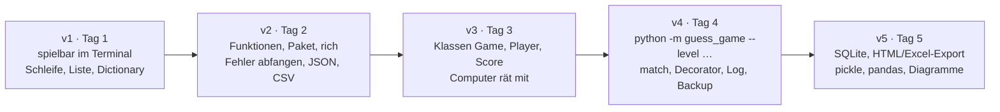
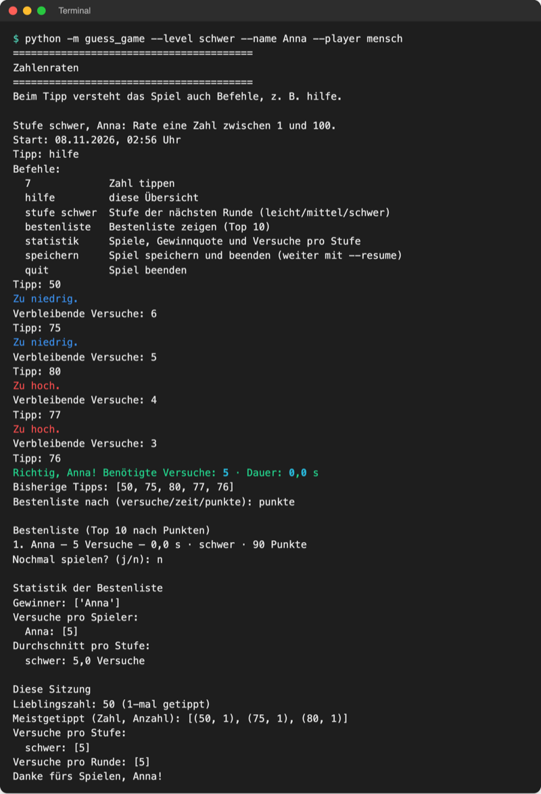
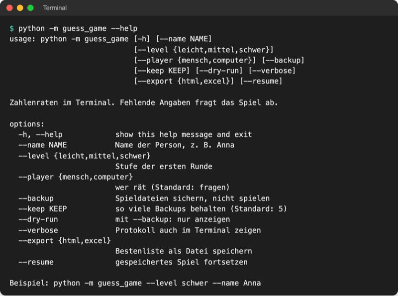
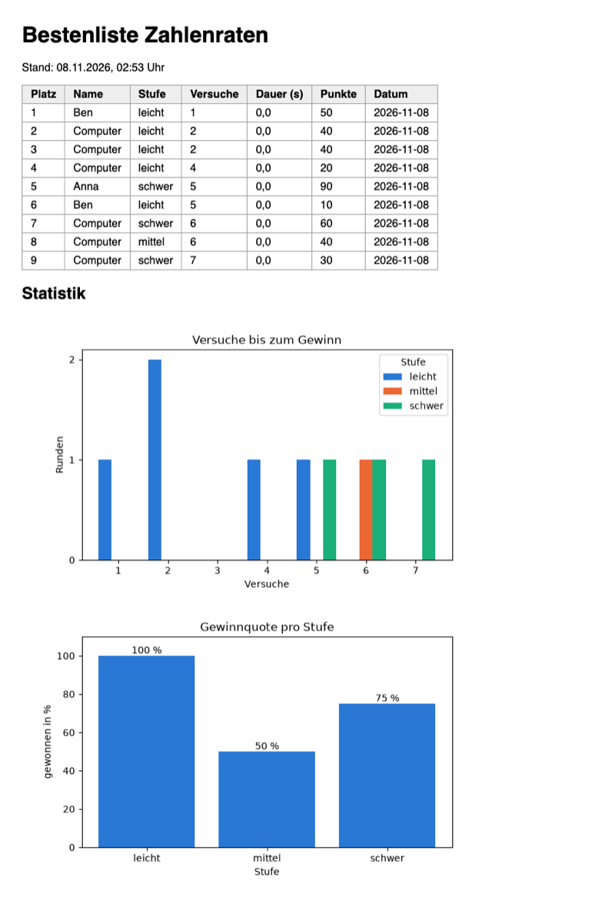

# Lab 20.1: Spiel v5 fertigstellen

**Leitfragen:**

<details>
<summary>Was braucht eine andere Person, um das Spiel ohne Hilfe zu starten?</summary>

Eine kurze Anleitung mit den genauen Befehlen (Installation, Start, Optionen), eine Liste der nötigen Pakete und ein Programm, das mit einem einzigen Befehl startet. Im Projekt sind das `README.md`, `requirements.txt` und `python -m guess_game`.

</details>

<details>
<summary>Welche Aufgabe aus der Wandliste von Tag 1 ist jetzt lösbar?</summary>

Meist mehrere: Dateien umbenennen und sichern (Modul 14), Tabellen und Logs auswerten (Module 8, 15, 19), Daten aus dem Netz holen (Modul 16), Excel-Berichte erzeugen (Modul 17). Die Übung ordnet jede Idee dem Modul mit den passenden Werkzeugen zu.

</details>

<details>
<summary>Welche Teile des Spiels würde man für ein echtes Werkzeug wiederverwenden?</summary>

Die Bausteine ohne Spiellogik: Kommandozeile mit `argparse`, Logging, Backup, SQLite-Speicher, HTML- und Excel-Export, Diagramme. Das Paket ist so aufgeteilt, dass ein neues Skript sie importieren kann, ohne das Spiel zu ändern.

</details>

- Fertig heißt: Das Programm läuft mit einem Befehl, speichert seine Daten, und eine fremde Person kann es mit der README allein installieren und starten.
- Spiel v5 ist der Code aus Lab 19.3 plus drei Dateien neben dem Paket: `README.md`, `requirements.txt`, `.gitignore`.

## Begriffe

| Begriff | Bedeutung |
| --- | --- |
| `README.md` | Begrüßungstext eines Projekts in Markdown: was es tut, wie man es installiert und startet; GitHub zeigt die Datei automatisch unter der Dateiliste an |
| Markdown | Textformat mit einfachen Zeichen für Gestaltung: `#` Überschrift, `-` Aufzählung, Backticks für Code; alle Handouts dieses Kurses sind Markdown |
| `requirements.txt` | Einkaufsliste für `pip` (Lab 6.2): ein Paket pro Zeile, mit fester Version (gepinnt) |
| `.gitignore` | Liste von Dateien und Ordnern, die Git und GitHub nicht hochladen sollen, z. B. `.venv/` und `game.db`; ohne Git eine harmlose Textdatei |
| `pyproject.toml` | heutiger Standard für die Beschreibung eines Python-Projekts in einer Datei: Name, Version, Abhängigkeiten, Startbefehl |
| Checkliste „fertig“ | feste Liste prüfbarer Punkte, nach der ein Projekt als abgeschlossen gilt (englisch: Definition of Done) |
| Wahlaufgabe | Erweiterung, die sich jede Person selbst aussucht |
| Akzeptanzkriterium | beobachtbares Ergebnis, an dem sich prüfen lässt, ob eine Aufgabe erfüllt ist, z. B. „`game.db` enthält zwei neue Zeilen“ |

## Ein Spiel, fünf Ausbaustufen

Jede Ausbaustufe hat ein Problem der vorherigen gelöst. Die ausführliche Tabelle mit allen Modulen steht im [Kurs-Cheatsheet](../final-project-cheatsheet.md).





_Quelle: eigener Screenshot, Kurs-Repo, 08.11.2026._

## Aufbau eines fertigen Python-Programms

Spiel v5 in [project/examples/m20-final-project/l01-game-v5/](../../project/examples/m20-final-project/l01-game-v5/):

```text
l01-game-v5/
├── guess_game/          Paket (Lab 6.1): der eigentliche Code
│   ├── __main__.py      Start mit python -m guess_game, Optionen, Ablauf
│   ├── logic.py         Spielregeln: Game, Score, Stufen
│   ├── players.py       HumanPlayer, ComputerPlayer
│   ├── ui.py            Ein- und Ausgabe, Befehlsmenü
│   ├── storage.py       SQLite, history.csv, Spielstand, Backup
│   ├── export.py        HTML- und Excel-Export
│   ├── charts.py        Diagramme
│   └── levels.xml       Paketdatei: Stufen gehören zum Programm
├── analyze.py           Skripte neben dem Paket: nutzen guess_game,
├── import_log.py        laufen aber eigenständig
├── log_report.py
├── migrate_json.py
├── fetch_scores.py
├── README.md            Anleitung für Menschen
├── requirements.txt     Paketliste für pip
└── .gitignore           was nicht hochgeladen wird
```

| Teil | Regel |
| --- | --- |
| Paket | ein Ordner mit `__init__.py`; Module nach Aufgabe getrennt (Lab 6.1, 10.3) |
| Paketdateien | Dateien, die zum Programm gehören (`levels.xml`), liegen im Paket und werden über `Path(__file__).parent` gefunden (Lab 17.1) |
| Spieldateien | Daten der Person (`game.db`, `game.log`, `history.csv`, `highscores.html`, …) entstehen im Startordner, nie im Paket; dieser Ordner ist der Datenordner |
| Skripte | Werkzeuge für Einzelaufgaben liegen neben dem Paket und importieren daraus (`from guess_game.logic import …`) |
| Doku und Setup | `README.md`, `requirements.txt`, `.gitignore` im obersten Ordner |

## Die README

Die README beantwortet in dieser Reihenfolge: Was ist das? Was wird gebraucht? Wie installieren? Wie starten? Welche Werkzeuge gibt es? Ausschnitt aus der [README von v5](../../project/examples/m20-final-project/l01-game-v5/README.md):

````markdown
# Zahlenraten v5

Zahlenratespiel im Terminal: Das Programm denkt sich eine Zahl, ein Mensch oder der Computer rät,
das Spiel antwortet „zu hoch“ oder „zu niedrig“. Bestenliste und alle Runden stehen in einer
SQLite-Datenbank (`game.db`) ...

## Installation

Im Ordner, der `guess_game/` enthält:

```bash
python -m venv .venv
source .venv/bin/activate        # Windows: .venv\Scripts\activate
pip install -r requirements.txt
```

## Spielen

```bash
python -m guess_game                                          # fragt Name, Spieler und Stufe
python -m guess_game --name Anna --level schwer --player mensch
python -m guess_game --resume                                 # gespeichertes Spiel fortsetzen
python -m guess_game --help                                   # alle Optionen
```
````

| Abschnitt | Inhalt |
| --- | --- |
| `# Titel` + 1–2 Sätze | was das Programm tut |
| `## Voraussetzungen` | Python-Version, Pakete |
| `## Installation` | Befehle zum Kopieren, für Windows und macOS/Linux |
| `## Spielen` / `## Benutzung` | Startbefehl, wichtigste Optionen, `--help` |
| `## Werkzeuge` | Zusatzbefehle als Tabelle (`--export`, `--backup`, Skripte) |
| `## Dateien` / `## Aufbau` | welche Dateien entstehen, was in welchem Modul steht |

Jeder Befehl steht in einem Code-Block (drei Backticks, dahinter `bash`) und ist so geschrieben, dass er kopiert und unverändert ausgeführt werden kann.

## requirements.txt und .gitignore

`requirements.txt` von v5 nennt nur die Pakete, die das Spiel selbst importiert, mit derselben Version wie die Kursdatei `project/requirements.txt`:

```text
# Pakete für Zahlenraten v5, einmal installieren:  pip install -r requirements.txt
rich==15.0.0            # farbige Hinweise im Terminal
openpyxl==3.1.5         # --export excel
pandas==3.1.1           # analyze.py und Diagramme (bringt numpy mit)
matplotlib==3.11.2      # Diagramme im HTML-Export
requests==2.34.2        # fetch_scores.py
```

`.gitignore` (Auszug) schließt alles aus, was beim Spielen entsteht oder sich neu erzeugen lässt; eine Zeile pro Datei oder Ordner, `#` leitet einen Kommentar ein:

```text
.venv/
__pycache__/
game.db
game.log
savegame.pkl
highscores.html
chart_tries.png
backups/
```

## Einordnung: pyproject.toml

Größere Projekte beschreiben sich heute in einer Datei `pyproject.toml` (Format TOML: Abschnitte in `[eckigen Klammern]`, darunter `name = wert`). Sie ersetzt `requirements.txt` und legt zusätzlich einen eigenen Startbefehl fest. Für Spiel v5 sähe sie so aus (Kurs nutzt sie nicht; getestet mit `pip install .` und Python 3.14):

```toml
[build-system]                      # Werkzeug, das aus dem Ordner ein installierbares Paket baut
requires = ["hatchling"]
build-backend = "hatchling.build"

[project]
name = "guess-game"
version = "5.0.0"
description = "Zahlenraten im Terminal mit SQLite-Bestenliste"
readme = "README.md"
requires-python = ">=3.14"
dependencies = [                    # entspricht requirements.txt
    "rich==15.0.0",
    "openpyxl==3.1.5",
    "pandas==3.1.1",
    "matplotlib==3.11.2",
]

[project.scripts]                   # neuer Befehl guess-game ruft main() auf
guess-game = "guess_game.__main__:main"
```

| | `requirements.txt` (Kurs) | `pyproject.toml` |
| --- | --- | --- |
| Inhalt | nur Paketliste | Name, Version, Python-Version, Pakete, Startbefehl |
| Installation | `pip install -r requirements.txt` | `pip install .` (Punkt = dieser Ordner) oder `uv sync` |
| Start | `python -m guess_game` | zusätzlich `guess-game` von überall |
| Veröffentlichen auf PyPI | nicht möglich | Grundlage dafür |

Stand: 08.11.2026. Quelle: [Python Packaging User Guide, Writing your pyproject.toml](https://packaging.python.org/en/latest/guides/writing-pyproject-toml/). Mehr dazu in Lab 20.2.

## Checkliste „fertig“

| Prüfung | Befehl im Projektordner | Erwartetes Ergebnis |
| --- | --- | --- |
| startet mit einem Befehl | `python -m guess_game` | Banner, Frage nach Name, Spieler und Stufe |
| Hilfe vorhanden | `python -m guess_game --help` | alle Optionen mit deutschem Hilfetext |
| speichert in SQLite | eine Runde spielen, dann `python -m sqlite3 game.db "SELECT * FROM rounds"` | eine Zeile pro gespielter Runde |
| exportiert HTML mit Diagramm | `python -m guess_game --export html` | `highscores.html` mit Tabelle und zwei Diagrammen |
| README mit Startbefehlen | `README.md` lesen | Installation und Start lassen sich kopieren und ausführen |
| Pakete vollständig | neue venv, `pip install -r requirements.txt`, Spiel starten | kein `ModuleNotFoundError` |
| keine Abstürze | Eingabe `abc`, Strg+C | Meldung statt Traceback (Lab 7.2, 15.3) |



_Quelle: eigener Screenshot, Kurs-Repo, 08.11.2026._

## Im Spiel: v5 ist fertig

Am Code ändert sich in diesem Lab nichts; der Stand aus Lab 19.3 erfüllt die Pflicht schon. Neu sind nur die drei Dateien neben dem Paket. Der Export aus Lab 17.1 und 19.3 zeigt das Ergebnis aller Runden in `game.db`:



_Quelle: eigener Screenshot (Playwright, highscores.html aus einer Kopie von l01-game-v5 nach elf Runden), Kurs-Repo, 08.11.2026._

Wahlaufgaben bauen auf v5 auf. Am saubersten sind sie, wenn das Paket unverändert bleibt und ein neues Skript daneben die Bausteine importiert, so wie `log_report.py` (Lab 16.3):

```python
from guess_game import logic, players, storage, ui   # Bausteine wiederverwenden

game = logic.Game(players.HumanPlayer("Anna"), board, "leicht")
score = ui.play_round(game)     # misst die Zeit mit @timed, gibt einen Score zurück
board.add_round(score)          # speichert in game.db
```

## Typische Fehler

| Symptom | Ursache | Lösung |
| --- | --- | --- |
| `ModuleNotFoundError: No module named 'guess_game'` | Terminal steht nicht im Ordner, der `guess_game/` enthält | `cd playground` (bzw. Projektordner), dann erneut starten |
| `ModuleNotFoundError: No module named 'matplotlib'` | venv nicht aktiv oder Paket fehlt in `requirements.txt` | venv aktivieren, `pip install -r requirements.txt`; Paket in die Liste aufnehmen |
| Erster Export dauert lange, Meldung „Matplotlib is building the font cache“ | matplotlib legt einmalig eine Schriftliste an | warten; ab dem zweiten Lauf schnell |
| `highscores.html` zeigt keine Bilder | HTML-Datei ohne die zwei PNGs kopiert | `chart_tries.png` und `chart_win_rate.png` immer mitgeben |
| Befehl aus der README scheitert | Befehl abgetippt statt getestet, oder Windows-Variante fehlt | jeden Befehl der README einmal kopieren und ausführen |
| `game.db` liegt plötzlich im Paketordner | Spiel aus `guess_game/` heraus gestartet | immer im Ordner darüber starten |

## Fazit

- Ein fertiges Programm startet mit einem Befehl, hat gepinnte Pakete und eine README, mit der eine fremde Person allein zurechtkommt.
- Code steht im Paket, Daten entstehen im Startordner, Werkzeuge liegen als Skripte daneben.
- `pyproject.toml` ist der heutige Standard für Projekte, die installiert oder veröffentlicht werden.

In der Übung wird das eigene Spiel nach der Checkliste fertig, bekommt eine README und eine Wahlaufgabe.
