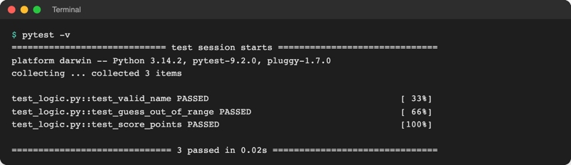

# Lab 20.2: Showcase und Ausblick

**Leitfragen:**

<details>
<summary>Welches Thema der Woche war am überraschendsten?</summary>

Darauf gibt es keine richtige Antwort. Häufig genannt: wie wenig Code ein Diagramm oder eine Datenbank braucht, dass Fehler lesbare Hinweise sind, oder dass ein Spiel in fünf Tagen zu einem echten Kommandozeilen-Werkzeug wird.

</details>

<details>
<summary>Wofür wird Python als Nächstes im Studium oder in einem eigenen Projekt eingesetzt?</summary>

Für eine Idee aus der Wandliste (Lab 1.1, Lab 20.1), für Auswertungen von Messwerten oder Umfragen, für eine kleine Web-Anwendung oder für erste Schritte in Machine Learning. Die Tabelle „Wohin nach dem Kurs?“ zeigt für jede Richtung den ersten Schritt.

</details>

- Ein Projekt zeigen ist eine eigene Fähigkeit: In zwei Minuten muss klar werden, welches Problem gelöst ist und dass es wirklich läuft.
- Nach dem Kurs öffnen sich sechs Richtungen: Web, Testen, Typprüfung, Nebenläufigkeit, Packaging sowie Data Science mit Machine Learning. Jede baut auf dem auf, was das Spiel schon kann.

## Begriffe

| Begriff | Bedeutung |
| --- | --- |
| Showcase | kurze Vorführung eines fertigen Ergebnisses vor anderen, wie ein Messestand |
| Pitch | knappe Vorstellung in wenigen Sätzen: Problem, Lösung, Ergebnis |
| Web-Framework | Paket, das die wiederkehrenden Teile einer Web-Anwendung mitbringt (Adressen, Formulare, Datenbank), wie ein Bausatz statt Einzelteilen |
| automatisierter Test | kleine Funktion, die Code mit festen Werten aufruft und das Ergebnis prüft; läuft mit einem Befehl immer wieder |
| `assert` | Anweisung, die einen Fehler auslöst, wenn die Bedingung dahinter falsch ist: `assert score.points() == 90` |
| Typprüfung | Werkzeug liest den Code (ohne ihn auszuführen) und meldet z. B., wo eine Zahl statt eines Textes übergeben wird |
| Nebenläufigkeit | mehrere Aufgaben überlappen sich zeitlich, z. B. zehn Downloads gleichzeitig statt nacheinander |
| GIL | Global Interpreter Lock: Sperre in CPython, durch die immer nur ein Thread gleichzeitig Python-Code ausführt |
| Free-Threading | Python-Variante ohne GIL; Threads laufen wirklich parallel auf mehreren Prozessorkernen |
| JIT-Compiler | übersetzt häufig ausgeführte Programmteile während des Laufs in Maschinencode, damit sie schneller werden |
| Notebook | Datei aus Code-Zellen, Text und Ergebnissen (Tabellen, Diagramme) untereinander; Endung `.ipynb` |
| Machine Learning | Programme, die Regeln aus Beispieldaten lernen statt sie vorgegeben zu bekommen |

## Ein Projekt in 2 Minuten zeigen

| Zeit | Teil | Inhalt am Beispiel Zwei-Personen-Modus |
| --- | --- | --- |
| 0:00–0:20 | Problem | „Zahlenraten konnte nur eine Person spielen; zu zweit fehlte der Vergleich.“ |
| 0:20–1:20 | Live-Demo | ein vorbereiteter Befehl: `python two_players.py --level leicht`, zwei kurze Runden, Ergebnis zeigen |
| 1:20–1:45 | So funktioniert es | ein Stück Code, z. B. `winner_text` mit `first < second` aus `Score.__lt__` |
| 1:45–2:00 | Gelernt und nächster Schritt | ein Satz Erkenntnis, ein Satz Ausblick |

- Demo vorbereiten: Terminal im richtigen Ordner, venv aktiv, Befehl schon getippt, Schrift groß (VS Code: **View → Appearance → Zoom In**).
- Kurze Stufe wählen (`leicht`), damit die Demo in einer Minute fertig ist.
- Ersatz bereithalten: ein Screenshot des Laufs, falls etwas hakt.
- Nur ein Code-Ausschnitt, nicht die ganze Datei.

## Der 5-Zeilen-Pitch

Die ersten Zeilen einer README sind der schriftliche Pitch. Fünf Zeilen reichen:

```markdown
# Zahlenraten zu zweit
**Problem:** Das Spiel kannte nur eine Person, ein Vergleich zu zweit fehlte.
**Lösung:** `two_players.py` lässt zwei Personen nacheinander raten und kürt, wer weniger Versuche braucht.
**Start:** `python two_players.py --level leicht` im Ordner mit `guess_game/`.
**Gelernt:** Ein neues Skript kann das Paket wiederverwenden, ohne es zu ändern.
```

## Wohin nach dem Kurs?

Stand: 08.11.2026; alle Links geprüft am 08.11.2026.

| Richtung | Wofür | Erster Schritt | Offizielle Seite |
| --- | --- | --- | --- |
| Web: Flask | kleine Web-Anwendungen und APIs mit wenig Code | Bestenliste als Webseite statt `http.server` (Lab 16.2) | [flask.palletsprojects.com](https://flask.palletsprojects.com/) |
| Web: Django | große Web-Anwendungen mit Datenbank, Login und Admin-Oberfläche | offizielles Tutorial „Writing your first Django app“ | [djangoproject.com](https://www.djangoproject.com/) |
| Web: FastAPI | Web-APIs (JSON wie in Lab 16.1) mit automatischer Dokumentation | `game.db` als API ausliefern | [fastapi.tiangolo.com](https://fastapi.tiangolo.com/) |
| Testen: pytest | automatische Tests mit `assert` | Tests für `logic.py` schreiben (Beispiel unten) | [docs.pytest.org](https://docs.pytest.org/) |
| Typprüfung: mypy, pyright | Fehler finden, bevor das Programm läuft | Typangaben wie bei `Score` (Lab 11.2) auch in Funktionen | [mypy.readthedocs.io](https://mypy.readthedocs.io/), [pyright](https://microsoft.github.io/pyright/) |
| Nebenläufigkeit: asyncio, threading | viele Wartezeiten (Netz, Dateien) überlappen lassen | mehrere Adressen mit `requests` parallel abrufen | [asyncio](https://docs.python.org/3/library/asyncio.html), [threading](https://docs.python.org/3/library/threading.html) |
| Packaging: `pyproject.toml`, uv, PyPI | eigenes Paket installierbar machen und veröffentlichen | `pyproject.toml` aus Lab 20.1, Tutorial „Packaging Python Projects“ | [packaging.python.org](https://packaging.python.org/en/latest/tutorials/packaging-projects/), [docs.astral.sh/uv](https://docs.astral.sh/uv/) |
| Machine Learning: scikit-learn | klassische Verfahren: vorhersagen, gruppieren, einordnen | Gewinnwahrscheinlichkeit aus `rounds` vorhersagen | [scikit-learn.org](https://scikit-learn.org/stable/) |
| Deep Learning: PyTorch | neuronale Netze (Bilder, Sprache), Grundlage vieler KI-Modelle | offizielle Tutorials „Learn the Basics“ | [pytorch.org](https://pytorch.org/) |
| Jupyter | Analysen Schritt für Schritt mit Text und Diagrammen | `analyze.py` (Lab 19.2) als Notebook in VS Code | [jupyter.org](https://jupyter.org/) |
| Python selbst | Sprache und Standardbibliothek vertiefen | offizielles Tutorial, „What's New“ jeder Version, PEPs | [docs.python.org/3/tutorial](https://docs.python.org/3/tutorial/index.html), [peps.python.org](https://peps.python.org/) |

## Testen mit pytest

Ein Test ist eine Funktion, deren Name mit `test_` beginnt; `pytest` findet alle Dateien `test_*.py` und führt sie aus. Beispiel für das Spiel, als `test_logic.py` neben `guess_game/` (pytest ist nicht in der Kurs-`requirements.txt`: vorher `pip install pytest`):

```python
import pytest

from guess_game import logic


def test_valid_name():
    assert logic.is_valid_name("Anna")
    assert not logic.is_valid_name("A")  # zu kurz


def test_guess_out_of_range():
    with pytest.raises(logic.InvalidGuessError):  # Test besteht, wenn der Fehler kommt
        logic.check_guess(0, 1, 10)


def test_score_points():
    score = logic.Score("Anna", "schwer", 5, 12.4, True, "2026-11-08")
    assert score.points() == 90  # (8 - 5) * 30
```



_Quelle: eigener Screenshot (echte Ausgabe mit pytest 9.2.0, Pfade gekürzt), Kurs-Repo, 08.11.2026._

VS Code zeigt Tests in der Ansicht **Testing** (Kolben-Symbol) und startet sie per Klick:


_Quelle: VS Code Docs, Python testing in Visual Studio Code (https://code.visualstudio.com/docs/python/testing), Microsoft, CC BY 4.0, abgerufen am 08.11.2026._

## Schneller und paralleler: Free-Threading und JIT

Bisher führt CPython wegen des GIL immer nur einen Thread gleichzeitig aus. Zwei Entwicklungen ändern das, beide noch optional:

| Version | Free-Threading (ohne GIL) | JIT-Compiler |
| --- | --- | --- |
| 3.13 (10/2024) | experimentell, eigener Build (PEP 703) | experimentell, nur beim Selbst-Übersetzen (PEP 744) |
| 3.14 (07.10.2025) | offiziell unterstützt, aber optional (PEP 779) | in den offiziellen Installern für macOS und Windows enthalten, aus; Test mit Umgebungsvariable `PYTHON_JIT=1` |
| 3.15 (09.10.2026) | macOS-Installer installieren die Free-Threading-Variante standardmäßig mit | weiter experimentell, laut Doku etwa 7–12 % schneller im Mittel |

Für Einsteigerprogramme ändert sich nichts: Das Spiel läuft auf allen Varianten gleich. Interessant wird es bei rechenintensivem Code mit Threads.

Original: [Python-Doku What's New 3.14: Abschnitt „Free-threaded Python is officially supported“](https://docs.python.org/3.14/whatsnew/3.14.html#free-threaded-python-is-officially-supported), Stand 08.11.2026.

Original: [Python-Doku What's New 3.14: Abschnitt „Binary releases for the experimental just-in-time compiler“ mit PYTHON_JIT=1](https://docs.python.org/3.14/whatsnew/3.14.html#binary-releases-for-the-experimental-just-in-time-compiler), Stand 08.11.2026.

Quellen: [What's New in Python 3.13](https://docs.python.org/3/whatsnew/3.13.html), [3.14](https://docs.python.org/3/whatsnew/3.14.html), [3.15](https://docs.python.org/3/whatsnew/3.15.html), [Python-Downloads](https://www.python.org/downloads/) (aktuell 3.15.2 vom 25.10.2026), [HOWTO Free-Threading](https://docs.python.org/3/howto/free-threading-python.html). Stand: 08.11.2026.

## Notebooks für Analysen

Ein Notebook führt Code Zelle für Zelle aus und zeigt das Ergebnis direkt darunter; ideal, um eine Auswertung wie `analyze.py` Schritt für Schritt aufzubauen. VS Code öffnet `.ipynb`-Dateien direkt (Erweiterung „Jupyter“ und Paket `ipykernel` nötig, beide nicht im Kurs installiert):


_Quelle: VS Code Docs, Jupyter Notebooks in VS Code (https://code.visualstudio.com/docs/datascience/jupyter-notebooks), Microsoft, CC BY 4.0, abgerufen am 08.11.2026._

## Fazit

- Zwei Minuten reichen für ein Projekt: Problem, Live-Demo, ein Stück Code, Erkenntnis.
- Die ersten fünf Zeilen der README sind der schriftliche Pitch.
- Jede Ausblick-Richtung hat einen ersten Schritt, der am eigenen Spiel ansetzt.

In der Übung entstehen der eigene 5-Zeilen-Pitch, eine 2-Minuten-Vorstellung und der nächste Lernschritt.
